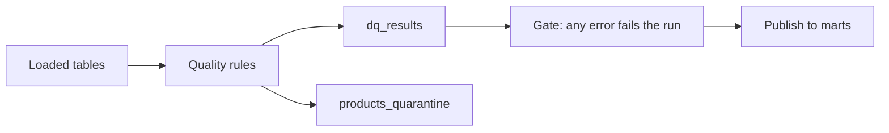

## Business problem

Inventory reports have been wrong twice this quarter: products without a category vanished from dashboards, and stock on hand disagreed with movements. The operations team wants every load to run quality rules, record the results, quarantine bad rows and fail loudly on errors.

## Learning objectives

- Express data-quality rules as SQL that counts failing rows
- Store results with severity (`error` vs `warn`)
- Split rows into valid and quarantine tables with a reason
- Reconcile a snapshot table against an event log
- Build a reusable rule engine and schema validator in Python

## Architecture

Rules run after each load. Errors stop the pipeline; warnings are reported.



## Technologies

- **PostgreSQL 16**: `VALUES` lists, `FILTER`, `FULL JOIN`
- **pandas** for a rule engine
- Plain **Python** for schema validation

## Dataset

The **inventory** dataset: 76 products, 20 suppliers, 240 purchase orders, 268 stock-level rows and 1670 stock movements. 6 products are missing a category or supplier.

## Tasks

Write the SQL rules first, then the Python engine. Each task runs in its own rolled-back transaction, so create every table the check needs in this task.

```task
{
 "id": "dq-results",
 "title": "Record rule results in dq_results",
 "type": "sql",
 "instructions": "Create `dq_results(rule_name TEXT PRIMARY KEY, table_name, severity ('error' or 'warn'), failed_rows INTEGER, status)` and insert one row per rule:\n\n| rule_name | severity | fails when |\n|---|---|---|\n| `products_category_not_null` | error | `category_id IS NULL` |\n| `products_supplier_not_null` | error | `supplier_id IS NULL` |\n| `suppliers_email_not_null` | warn | `contact_email IS NULL` |\n| `po_received_has_date` | error | status is `received` but `received_date` is NULL, or the reverse |\n| `stock_below_reorder` | warn | `quantity_on_hand < products.reorder_level` |\n\n`status` is `pass` when nothing fails, otherwise `fail` for errors and `warn` for warnings.",
 "starter": "CREATE TABLE dq_results (\n  rule_name TEXT PRIMARY KEY,\n  table_name TEXT NOT NULL,\n  severity TEXT NOT NULL CHECK (severity IN ('error', 'warn')),\n  failed_rows INTEGER NOT NULL,\n  status TEXT NOT NULL\n);\n-- TODO: INSERT one row per rule with its failed_rows and status\n",
 "solution": "CREATE TABLE dq_results (\n  rule_name TEXT PRIMARY KEY,\n  table_name TEXT NOT NULL,\n  severity TEXT NOT NULL CHECK (severity IN ('error', 'warn')),\n  failed_rows INTEGER NOT NULL,\n  status TEXT NOT NULL\n);\nINSERT INTO dq_results (rule_name, table_name, severity, failed_rows, status)\nSELECT rule_name, table_name, severity, failed_rows,\n       CASE WHEN failed_rows = 0 THEN 'pass' WHEN severity = 'error' THEN 'fail' ELSE 'warn' END\nFROM (VALUES\n  ('products_category_not_null', 'products', 'error', (SELECT COUNT(*) FROM products WHERE category_id IS NULL)),\n  ('products_supplier_not_null', 'products', 'error', (SELECT COUNT(*) FROM products WHERE supplier_id IS NULL)),\n  ('suppliers_email_not_null', 'suppliers', 'warn', (SELECT COUNT(*) FROM suppliers WHERE contact_email IS NULL)),\n  ('po_received_has_date', 'purchase_orders', 'error', (SELECT COUNT(*) FROM purchase_orders WHERE (status = 'received') <> (received_date IS NOT NULL))),\n  ('stock_below_reorder', 'stock_levels', 'warn', (SELECT COUNT(*) FROM stock_levels s JOIN products p USING (product_id) WHERE s.quantity_on_hand < p.reorder_level))\n) AS r(rule_name, table_name, severity, failed_rows);",
 "check": "SELECT (COALESCE(((SELECT COUNT(*) FROM dq_results) = 5), FALSE) AND COALESCE(((SELECT failed_rows FROM dq_results WHERE rule_name = 'products_category_not_null') = (SELECT COUNT(*) FROM products WHERE category_id IS NULL)), FALSE) AND COALESCE(((SELECT failed_rows FROM dq_results WHERE rule_name = 'suppliers_email_not_null') = (SELECT COUNT(*) FROM suppliers WHERE contact_email IS NULL)), FALSE) AND COALESCE(((SELECT failed_rows FROM dq_results WHERE rule_name = 'stock_below_reorder') = (SELECT COUNT(*) FROM stock_levels s JOIN products p USING (product_id) WHERE s.quantity_on_hand < p.reorder_level)), FALSE) AND COALESCE(((SELECT failed_rows FROM dq_results WHERE rule_name = 'po_received_has_date') = (SELECT COUNT(*) FROM purchase_orders WHERE (status = 'received') <> (received_date IS NOT NULL))), FALSE) AND COALESCE((NOT EXISTS (SELECT 1 FROM dq_results WHERE status <> CASE WHEN failed_rows = 0 THEN 'pass' WHEN severity = 'error' THEN 'fail' ELSE 'warn' END)), FALSE)) AS ok, CASE WHEN NOT COALESCE(((SELECT COUNT(*) FROM dq_results) = 5), FALSE) THEN 'dq_results needs 5 rules' WHEN NOT COALESCE(((SELECT failed_rows FROM dq_results WHERE rule_name = 'products_category_not_null') = (SELECT COUNT(*) FROM products WHERE category_id IS NULL)), FALSE) THEN 'products_category_not_null count is wrong' WHEN NOT COALESCE(((SELECT failed_rows FROM dq_results WHERE rule_name = 'suppliers_email_not_null') = (SELECT COUNT(*) FROM suppliers WHERE contact_email IS NULL)), FALSE) THEN 'suppliers_email_not_null count is wrong' WHEN NOT COALESCE(((SELECT failed_rows FROM dq_results WHERE rule_name = 'stock_below_reorder') = (SELECT COUNT(*) FROM stock_levels s JOIN products p USING (product_id) WHERE s.quantity_on_hand < p.reorder_level)), FALSE) THEN 'stock_below_reorder count is wrong' WHEN NOT COALESCE(((SELECT failed_rows FROM dq_results WHERE rule_name = 'po_received_has_date') = (SELECT COUNT(*) FROM purchase_orders WHERE (status = 'received') <> (received_date IS NOT NULL))), FALSE) THEN 'po_received_has_date count is wrong' WHEN NOT COALESCE((NOT EXISTS (SELECT 1 FROM dq_results WHERE status <> CASE WHEN failed_rows = 0 THEN 'pass' WHEN severity = 'error' THEN 'fail' ELSE 'warn' END)), FALSE) THEN 'status must be pass, fail or warn as described' ELSE 'dq_results is correct' END AS message"
}
```

```task
{
 "id": "quarantine",
 "title": "Quarantine invalid products",
 "type": "sql",
 "instructions": "Create two tables from `products`:\n\n- `products_valid`: same columns as `products`, only rows with both `category_id` and `supplier_id`\n- `products_quarantine`: same columns plus `reason TEXT`: `'missing category'`, `'missing supplier'` or `'missing category and supplier'`\n\nEvery product must land in exactly one table.",
 "starter": "CREATE TABLE products_valid AS SELECT * FROM products;\nCREATE TABLE products_quarantine AS SELECT *, ''::text AS reason FROM products WHERE FALSE;  -- TODO",
 "solution": "CREATE TABLE products_valid AS\nSELECT * FROM products WHERE category_id IS NOT NULL AND supplier_id IS NOT NULL;\nCREATE TABLE products_quarantine AS\nSELECT p.*,\n       CASE WHEN category_id IS NULL AND supplier_id IS NULL THEN 'missing category and supplier'\n            WHEN category_id IS NULL THEN 'missing category'\n            ELSE 'missing supplier' END AS reason\nFROM products p\nWHERE category_id IS NULL OR supplier_id IS NULL;",
 "check": "SELECT (COALESCE(((SELECT COUNT(*) FROM products_valid) + (SELECT COUNT(*) FROM products_quarantine) = (SELECT COUNT(*) FROM products)), FALSE) AND COALESCE((NOT EXISTS (SELECT 1 FROM products_valid WHERE category_id IS NULL OR supplier_id IS NULL)), FALSE) AND COALESCE((NOT EXISTS (SELECT product_id FROM products_valid INTERSECT SELECT product_id FROM products_quarantine)), FALSE) AND COALESCE(((SELECT COUNT(*) FROM products_quarantine WHERE reason = 'missing category') = (SELECT COUNT(*) FROM products WHERE category_id IS NULL AND supplier_id IS NOT NULL)), FALSE) AND COALESCE(((SELECT COUNT(*) FROM products_quarantine WHERE reason = 'missing supplier') = (SELECT COUNT(*) FROM products WHERE supplier_id IS NULL AND category_id IS NOT NULL)), FALSE)) AS ok, CASE WHEN NOT COALESCE(((SELECT COUNT(*) FROM products_valid) + (SELECT COUNT(*) FROM products_quarantine) = (SELECT COUNT(*) FROM products)), FALSE) THEN 'every product must land in exactly one table' WHEN NOT COALESCE((NOT EXISTS (SELECT 1 FROM products_valid WHERE category_id IS NULL OR supplier_id IS NULL)), FALSE) THEN 'products_valid contains invalid rows' WHEN NOT COALESCE((NOT EXISTS (SELECT product_id FROM products_valid INTERSECT SELECT product_id FROM products_quarantine)), FALSE) THEN 'a product appears in both tables' WHEN NOT COALESCE(((SELECT COUNT(*) FROM products_quarantine WHERE reason = 'missing category') = (SELECT COUNT(*) FROM products WHERE category_id IS NULL AND supplier_id IS NOT NULL)), FALSE) THEN 'reason ''missing category'' is wrong' WHEN NOT COALESCE(((SELECT COUNT(*) FROM products_quarantine WHERE reason = 'missing supplier') = (SELECT COUNT(*) FROM products WHERE supplier_id IS NULL AND category_id IS NOT NULL)), FALSE) THEN 'reason ''missing supplier'' is wrong' ELSE 'Quarantine works' END AS message"
}
```

```task
{
 "id": "stock-recon",
 "title": "Reconcile stock levels with movements",
 "type": "sql",
 "instructions": "Create `stock_recon(warehouse_id, product_id, on_hand, movement_sum, diff)` with one row per `stock_levels` row. `movement_sum` is the sum of `stock_movements.quantity` for that warehouse and product (0 when there are none) and `diff = on_hand - movement_sum`.",
 "starter": "CREATE TABLE stock_recon AS\nSELECT s.warehouse_id, s.product_id, s.quantity_on_hand AS on_hand, SUM(m.quantity) AS movement_sum\nFROM stock_levels s JOIN stock_movements m USING (warehouse_id, product_id)\nGROUP BY 1, 2, 3;  -- TODO",
 "solution": "CREATE TABLE stock_recon AS\nSELECT s.warehouse_id, s.product_id, s.quantity_on_hand AS on_hand,\n       COALESCE(m.total, 0) AS movement_sum,\n       s.quantity_on_hand - COALESCE(m.total, 0) AS diff\nFROM stock_levels s\nLEFT JOIN (SELECT warehouse_id, product_id, SUM(quantity) AS total FROM stock_movements GROUP BY 1, 2) m\n  USING (warehouse_id, product_id);",
 "check": "SELECT (COALESCE(((SELECT COUNT(*) FROM information_schema.columns WHERE table_schema = current_schema() AND table_name = 'stock_recon' AND column_name IN ('warehouse_id','product_id','on_hand','movement_sum','diff')) = 5), FALSE) AND COALESCE(((SELECT COUNT(*) FROM stock_recon) = (SELECT COUNT(*) FROM stock_levels)), FALSE) AND COALESCE((NOT EXISTS (SELECT 1 FROM stock_recon WHERE movement_sum IS NULL OR diff <> on_hand - movement_sum)), FALSE) AND COALESCE(((SELECT SUM(movement_sum) FROM stock_recon) = (SELECT COALESCE(SUM(m.quantity), 0) FROM stock_movements m JOIN stock_levels s USING (warehouse_id, product_id))), FALSE)) AS ok, CASE WHEN NOT COALESCE(((SELECT COUNT(*) FROM information_schema.columns WHERE table_schema = current_schema() AND table_name = 'stock_recon' AND column_name IN ('warehouse_id','product_id','on_hand','movement_sum','diff')) = 5), FALSE) THEN 'stock_recon is missing a column' WHEN NOT COALESCE(((SELECT COUNT(*) FROM stock_recon) = (SELECT COUNT(*) FROM stock_levels)), FALSE) THEN 'one row per stock_levels row' WHEN NOT COALESCE((NOT EXISTS (SELECT 1 FROM stock_recon WHERE movement_sum IS NULL OR diff <> on_hand - movement_sum)), FALSE) THEN 'movement_sum must default to 0 and diff = on_hand - movement_sum' WHEN NOT COALESCE(((SELECT SUM(movement_sum) FROM stock_recon) = (SELECT COALESCE(SUM(m.quantity), 0) FROM stock_movements m JOIN stock_levels s USING (warehouse_id, product_id))), FALSE) THEN 'movement_sum totals are wrong' ELSE 'Reconciliation table is correct' END AS message"
}
```

```task
{
 "id": "rule-engine",
 "title": "A pandas rule engine",
 "type": "python",
 "instructions": "Write `run_rules(df, rules)` where `rules` maps a rule name to `(severity, fn)` and `fn(df)` returns a boolean Series that is **True for valid rows**. Return a DataFrame with columns `rule`, `severity`, `failed`, `status` (`pass`/`fail`/`warn`), one row per rule in the given order. Also write `gate(report)` that returns `False` if any error rule failed.",
 "starter": "import io\nimport pandas as pd\n\ndf = pd.read_csv(io.StringIO(\"\"\"sku,qty,unit_cost,category\nA1,10,2.5,tools\nA2,-3,1.0,tools\nA3,5,,garden\nA4,0,4.0,\n\"\"\"))\nRULES = {\n    'qty_non_negative': ('error', lambda d: d['qty'] >= 0),\n    'cost_present': ('error', lambda d: d['unit_cost'].notna()),\n    'category_present': ('warn', lambda d: d['category'].notna()),\n}\n\ndef run_rules(df, rules):\n    return pd.DataFrame()\n\ndef gate(report):\n    return True\n",
 "solution": "import io\nimport pandas as pd\n\ndf = pd.read_csv(io.StringIO(\"\"\"sku,qty,unit_cost,category\nA1,10,2.5,tools\nA2,-3,1.0,tools\nA3,5,,garden\nA4,0,4.0,\n\"\"\"))\nRULES = {\n    'qty_non_negative': ('error', lambda d: d['qty'] >= 0),\n    'cost_present': ('error', lambda d: d['unit_cost'].notna()),\n    'category_present': ('warn', lambda d: d['category'].notna()),\n}\n\ndef run_rules(df, rules):\n    rows = []\n    for name, (severity, fn) in rules.items():\n        failed = int((~fn(df).astype(bool)).sum())\n        status = 'pass' if failed == 0 else ('fail' if severity == 'error' else 'warn')\n        rows.append({'rule': name, 'severity': severity, 'failed': failed, 'status': status})\n    return pd.DataFrame(rows, columns=['rule', 'severity', 'failed', 'status'])\n\ndef gate(report):\n    return not (report['status'] == 'fail').any()\n",
 "tests": "rep = run_rules(df, RULES)\nassert list(rep.columns) == ['rule', 'severity', 'failed', 'status']\nassert rep['failed'].tolist() == [1, 1, 1]\nassert rep['status'].tolist() == ['fail', 'fail', 'warn']\nassert gate(rep) is False or gate(rep) == False\nok = run_rules(df.iloc[[0]], RULES)\nassert ok['status'].tolist() == ['pass', 'pass', 'pass'] and bool(gate(ok))"
}
```

```task
{
 "id": "schema-validator",
 "title": "Validate records against a schema",
 "type": "python",
 "instructions": "Write `validate(records, schema)`. `schema` maps a field to `(type, nullable)`. Return a list of error strings, in record order then schema order:\n\n- `\"row 0: missing qty\"` when a field is absent\n- `\"row 1: qty is null\"` when it is `None` and not nullable\n- `\"row 2: qty expected int got str\"` on a type mismatch (`bool` is not an `int`)\n\nExtra fields are ignored.",
 "starter": "SCHEMA = {'sku': (str, False), 'qty': (int, False), 'note': (str, True)}\n\ndef validate(records, schema):\n    return []\n",
 "solution": "SCHEMA = {'sku': (str, False), 'qty': (int, False), 'note': (str, True)}\n\ndef validate(records, schema):\n    errors = []\n    for i, rec in enumerate(records):\n        for field, (typ, nullable) in schema.items():\n            if field not in rec:\n                errors.append(f'row {i}: missing {field}')\n                continue\n            v = rec[field]\n            if v is None:\n                if not nullable:\n                    errors.append(f'row {i}: {field} is null')\n            elif type(v) is not typ:\n                errors.append(f'row {i}: {field} expected {typ.__name__} got {type(v).__name__}')\n    return errors\n",
 "tests": "recs = [{'sku': 'A1', 'note': None}, {'sku': 'A2', 'qty': None, 'note': 'x'}, {'sku': 'A3', 'qty': '5'}, {'sku': 'A4', 'qty': True, 'note': None, 'extra': 1}, {'sku': 'A5', 'qty': 3, 'note': None}]\nerrs = validate(recs, SCHEMA)\nassert errs == ['row 0: missing qty', 'row 1: qty is null', 'row 2: qty expected int got str', 'row 2: missing note', 'row 3: qty expected int got bool'], errs"
}
```

## Design decisions

Real pipelines are mostly decisions. Pick the option that fits each scenario; every option explains itself once you answer.

```task
{
  "id": "d-where-validate",
  "title": "Where to validate",
  "type": "decision",
  "instructions": "Orders arrive from three source systems. Bad data has reached the finance dashboard twice this quarter.",
  "options": [
    "Validate in the dashboard queries",
    "Validate at ingestion, before data reaches the shared tables, and record results",
    "Ask each source team to validate",
    "Validate once a month with a manual review"
  ],
  "answer": 1,
  "why": [
    "Every dashboard re-implements the checks, and other consumers still get bad data.",
    "One gate at the boundary protects every consumer, and recorded results show trends and which source is failing.",
    "Useful, but you can't rely on three teams; the warehouse still needs its own gate.",
    "Bad data is visible for weeks before anyone notices."
  ]
}
```

```task
{
  "id": "d-severity",
  "title": "Blocking versus warning checks",
  "type": "decision",
  "instructions": "A check finds that 2% of orders have a NULL discount. Another finds duplicate order ids.",
  "options": [
    "Block the load on both",
    "Warn on both",
    "Warn on NULL discounts (default to 0 downstream, alert), block on duplicate order ids",
    "Ignore both until a user complains"
  ],
  "answer": 2,
  "why": [
    "Stops the business for a recoverable quality issue.",
    "Duplicate keys corrupt every total; a warning is not enough.",
    "Severity follows impact: a defaultable gap is a warning, broken uniqueness of the key is a blocking error.",
    "Quality problems compound silently."
  ]
}
```

## Expected output

- `dq_results`: 5 rules; `products_category_not_null` fails 2 rows, `suppliers_email_not_null` warns on 3
- `products_quarantine`: 6 rows; `products_valid`: 70
- `stock_recon`: 268 rows

## Common mistakes

- Writing rules that return the bad rows but never counting them, so nothing is recorded.
- Deleting bad rows instead of quarantining them with a reason.
- Treating every rule as fatal; warnings that block loads get disabled.
- Reconciling with an inner join, which hides items that exist on only one side.

## Interview discussion questions

### Which data-quality dimensions do you check?
Completeness (nulls), validity (ranges, formats), uniqueness, referential integrity, consistency between fields, and timeliness (freshness).

### Fail the pipeline or quarantine?
Quarantine row-level problems so good data still flows, and fail the run on systemic problems (row count collapses, schema changes, error-severity rules).

### How do tools like Great Expectations or dbt tests fit?
They package the same idea: declarative rules that count failing rows, with severity and stored results.

## Summary

You built a small but complete data-quality layer: rules with severity, a results table, quarantine, reconciliation, and a reusable Python engine.
