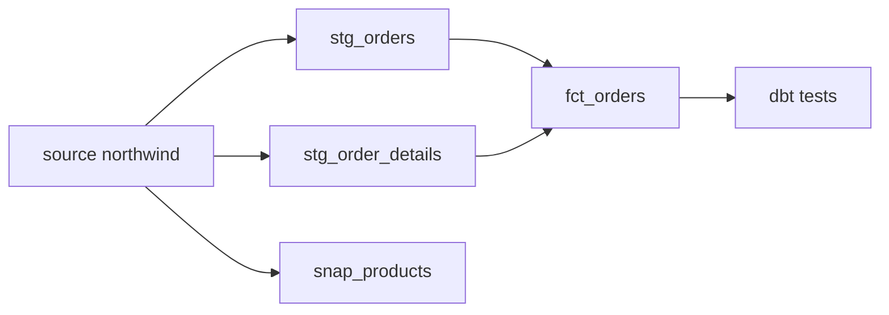

## Business problem

Analysts maintain dozens of copy-pasted SQL files against Northwind. Nobody knows which query feeds which dashboard, numbers drift between reports and nothing is tested. The team is adopting dbt to get layered models, tests, history and lineage.

## Learning objectives

- Layer models into staging and marts
- Read compiled SQL: how `ref()` and `source()` become table names
- Write dbt's generic tests (`unique`, `not_null`, `relationships`) as SQL
- Implement a `check` snapshot (SCD2) by hand
- Build the model DAG by parsing `ref()` calls

## Architecture

Sources feed staging views; marts build on staging. Tests and snapshots run against the models.



## Technologies

- **dbt Core** with the Postgres adapter
- **Jinja** for `ref`, `source` and macros
- **PostgreSQL** to validate compiled SQL
- **Python** `re` to parse model dependencies

## Dataset

**Northwind**: 100 orders, 250 order lines and 77 products. One order has a NULL `employee_id`, which one of the tests will catch.

The SQL tasks contain **compiled** SQL: `{{ ref('stg_orders') }}` has already been replaced by `stg_orders`.

## Tasks

Each SQL task is the compiled output of a dbt model or test. Each task runs in its own rolled-back transaction, so create every table the check needs in this task.

```task
{
 "id": "staging-models",
 "title": "Staging models as views",
 "type": "sql",
 "instructions": "Compiled from `models/staging/stg_orders.sql` and `stg_order_details.sql` (materialized as views):\n\n- `stg_orders`: `order_id, customer_id, employee_id, order_date, shipped_date, freight, ship_country` from `orders`\n- `stg_order_details`: `order_id, product_id, unit_price, quantity, discount` (cast to `numeric(4,2)`), plus `line_total = ROUND(unit_price * quantity * (1 - discount), 2)`",
 "starter": "CREATE TABLE stg_orders AS SELECT * FROM orders;  -- TODO: views, explicit columns, line_total",
 "solution": "CREATE VIEW stg_orders AS\nSELECT order_id, customer_id, employee_id, order_date, shipped_date, freight, ship_country\nFROM orders;\nCREATE VIEW stg_order_details AS\nSELECT order_id, product_id, unit_price, quantity, discount::numeric(4,2) AS discount,\n       ROUND(unit_price * quantity * (1 - discount::numeric), 2) AS line_total\nFROM order_details;",
 "check": "SELECT (COALESCE(((SELECT COUNT(*) FROM information_schema.views WHERE table_schema = current_schema() AND table_name IN ('stg_orders', 'stg_order_details')) = 2), FALSE) AND COALESCE(((SELECT COUNT(*) FROM information_schema.columns WHERE table_schema = current_schema() AND table_name = 'stg_order_details' AND column_name IN ('order_id','product_id','unit_price','quantity','discount','line_total')) = 6), FALSE) AND COALESCE(((SELECT COUNT(*) FROM information_schema.columns WHERE table_name = 'stg_orders') = 7), FALSE) AND COALESCE(((SELECT SUM(line_total) FROM stg_order_details) = (SELECT SUM(ROUND(unit_price*quantity*(1-discount::numeric),2)) FROM order_details)), FALSE)) AS ok, CASE WHEN NOT COALESCE(((SELECT COUNT(*) FROM information_schema.views WHERE table_schema = current_schema() AND table_name IN ('stg_orders', 'stg_order_details')) = 2), FALSE) THEN 'stg_orders and stg_order_details must be views' WHEN NOT COALESCE(((SELECT COUNT(*) FROM information_schema.columns WHERE table_schema = current_schema() AND table_name = 'stg_order_details' AND column_name IN ('order_id','product_id','unit_price','quantity','discount','line_total')) = 6), FALSE) THEN 'stg_order_details is missing a column' WHEN NOT COALESCE(((SELECT COUNT(*) FROM information_schema.columns WHERE table_name = 'stg_orders') = 7), FALSE) THEN 'stg_orders must select exactly the 7 listed columns' WHEN NOT COALESCE(((SELECT SUM(line_total) FROM stg_order_details) = (SELECT SUM(ROUND(unit_price*quantity*(1-discount::numeric),2)) FROM order_details)), FALSE) THEN 'line_total is wrong' ELSE 'Staging models are correct' END AS message"
}
```

```task
{
 "id": "fct-orders",
 "title": "The fct_orders mart",
 "type": "sql",
 "instructions": "Include the staging views, then build the compiled `models/marts/fct_orders.sql` (materialized as a table): one row per order that has lines, with `order_id, customer_id, employee_id, order_date, line_count, order_total` where `order_total = SUM(line_total)`.",
 "starter": "CREATE VIEW stg_orders AS\nSELECT order_id, customer_id, employee_id, order_date, shipped_date, freight, ship_country\nFROM orders;\nCREATE VIEW stg_order_details AS\nSELECT order_id, product_id, unit_price, quantity, discount::numeric(4,2) AS discount,\n       ROUND(unit_price * quantity * (1 - discount::numeric), 2) AS line_total\nFROM order_details;\n\nCREATE TABLE fct_orders AS SELECT * FROM stg_orders;  -- TODO",
 "solution": "CREATE VIEW stg_orders AS\nSELECT order_id, customer_id, employee_id, order_date, shipped_date, freight, ship_country\nFROM orders;\nCREATE VIEW stg_order_details AS\nSELECT order_id, product_id, unit_price, quantity, discount::numeric(4,2) AS discount,\n       ROUND(unit_price * quantity * (1 - discount::numeric), 2) AS line_total\nFROM order_details;\n\nCREATE TABLE fct_orders AS\nSELECT o.order_id, o.customer_id, o.employee_id, o.order_date,\n       COUNT(d.product_id)::int AS line_count,\n       SUM(d.line_total) AS order_total\nFROM stg_orders o\nJOIN stg_order_details d ON d.order_id = o.order_id\nGROUP BY o.order_id, o.customer_id, o.employee_id, o.order_date;",
 "check": "SELECT (COALESCE(((SELECT COUNT(*) FROM information_schema.columns WHERE table_schema = current_schema() AND table_name = 'fct_orders' AND column_name IN ('order_id','customer_id','employee_id','order_date','line_count','order_total')) = 6), FALSE) AND COALESCE(((SELECT COUNT(*) FROM fct_orders) = (SELECT COUNT(DISTINCT order_id) FROM order_details)), FALSE) AND COALESCE(((SELECT SUM(line_count) FROM fct_orders) = (SELECT COUNT(*) FROM order_details)), FALSE) AND COALESCE(((SELECT SUM(order_total) FROM fct_orders) = (SELECT SUM(ROUND(unit_price*quantity*(1-discount::numeric),2)) FROM order_details)), FALSE)) AS ok, CASE WHEN NOT COALESCE(((SELECT COUNT(*) FROM information_schema.columns WHERE table_schema = current_schema() AND table_name = 'fct_orders' AND column_name IN ('order_id','customer_id','employee_id','order_date','line_count','order_total')) = 6), FALSE) THEN 'fct_orders is missing a column' WHEN NOT COALESCE(((SELECT COUNT(*) FROM fct_orders) = (SELECT COUNT(DISTINCT order_id) FROM order_details)), FALSE) THEN 'one row per order with lines' WHEN NOT COALESCE(((SELECT SUM(line_count) FROM fct_orders) = (SELECT COUNT(*) FROM order_details)), FALSE) THEN 'line_count is wrong' WHEN NOT COALESCE(((SELECT SUM(order_total) FROM fct_orders) = (SELECT SUM(ROUND(unit_price*quantity*(1-discount::numeric),2)) FROM order_details)), FALSE) THEN 'order_total is wrong' ELSE 'fct_orders is correct' END AS message"
}
```

```task
{
 "id": "compiled-tests",
 "title": "Run the schema tests as SQL",
 "type": "sql",
 "instructions": "`schema.yml` declares on `fct_orders`: `unique` and `not_null` on `order_id`, `not_null` on `employee_id`, and `relationships` from `customer_id` to `customers.customer_id`.\n\nInclude the staging and fct SQL, then create `test_results(test_name TEXT, failures INTEGER)` with one row per test, named like dbt does: `unique_fct_orders_order_id`, `not_null_fct_orders_order_id`, `not_null_fct_orders_employee_id`, `relationships_fct_orders_customer_id`. `failures` is the number of rows the test query returns.",
 "starter": "CREATE VIEW stg_orders AS\nSELECT order_id, customer_id, employee_id, order_date, shipped_date, freight, ship_country\nFROM orders;\nCREATE VIEW stg_order_details AS\nSELECT order_id, product_id, unit_price, quantity, discount::numeric(4,2) AS discount,\n       ROUND(unit_price * quantity * (1 - discount::numeric), 2) AS line_total\nFROM order_details;\n\nCREATE TABLE fct_orders AS\nSELECT o.order_id, o.customer_id, o.employee_id, o.order_date,\n       COUNT(d.product_id)::int AS line_count,\n       SUM(d.line_total) AS order_total\nFROM stg_orders o\nJOIN stg_order_details d ON d.order_id = o.order_id\nGROUP BY o.order_id, o.customer_id, o.employee_id, o.order_date;\n\nCREATE TABLE test_results (test_name TEXT, failures INTEGER);\n-- TODO: one INSERT per test",
 "solution": "CREATE VIEW stg_orders AS\nSELECT order_id, customer_id, employee_id, order_date, shipped_date, freight, ship_country\nFROM orders;\nCREATE VIEW stg_order_details AS\nSELECT order_id, product_id, unit_price, quantity, discount::numeric(4,2) AS discount,\n       ROUND(unit_price * quantity * (1 - discount::numeric), 2) AS line_total\nFROM order_details;\n\nCREATE TABLE fct_orders AS\nSELECT o.order_id, o.customer_id, o.employee_id, o.order_date,\n       COUNT(d.product_id)::int AS line_count,\n       SUM(d.line_total) AS order_total\nFROM stg_orders o\nJOIN stg_order_details d ON d.order_id = o.order_id\nGROUP BY o.order_id, o.customer_id, o.employee_id, o.order_date;\n\nCREATE TABLE test_results (test_name TEXT, failures INTEGER);\nINSERT INTO test_results VALUES\n ('unique_fct_orders_order_id', (SELECT COUNT(*) FROM (SELECT order_id FROM fct_orders WHERE order_id IS NOT NULL GROUP BY order_id HAVING COUNT(*) > 1) t)),\n ('not_null_fct_orders_order_id', (SELECT COUNT(*) FROM fct_orders WHERE order_id IS NULL)),\n ('not_null_fct_orders_employee_id', (SELECT COUNT(*) FROM fct_orders WHERE employee_id IS NULL)),\n ('relationships_fct_orders_customer_id', (SELECT COUNT(*) FROM fct_orders f LEFT JOIN customers c ON c.customer_id = f.customer_id WHERE f.customer_id IS NOT NULL AND c.customer_id IS NULL));",
 "check": "SELECT (COALESCE(((SELECT COUNT(*) FROM test_results) = 4), FALSE) AND COALESCE(((SELECT failures FROM test_results WHERE test_name = 'not_null_fct_orders_employee_id') = (SELECT COUNT(*) FROM orders o WHERE employee_id IS NULL AND EXISTS (SELECT 1 FROM order_details d WHERE d.order_id = o.order_id))), FALSE) AND COALESCE(((SELECT SUM(failures) FROM test_results WHERE test_name IN ('unique_fct_orders_order_id', 'not_null_fct_orders_order_id', 'relationships_fct_orders_customer_id')) = 0), FALSE)) AS ok, CASE WHEN NOT COALESCE(((SELECT COUNT(*) FROM test_results) = 4), FALSE) THEN 'test_results needs 4 rows' WHEN NOT COALESCE(((SELECT failures FROM test_results WHERE test_name = 'not_null_fct_orders_employee_id') = (SELECT COUNT(*) FROM orders o WHERE employee_id IS NULL AND EXISTS (SELECT 1 FROM order_details d WHERE d.order_id = o.order_id))), FALSE) THEN 'not_null_fct_orders_employee_id should find the order with no employee' WHEN NOT COALESCE(((SELECT SUM(failures) FROM test_results WHERE test_name IN ('unique_fct_orders_order_id', 'not_null_fct_orders_order_id', 'relationships_fct_orders_customer_id')) = 0), FALSE) THEN 'the other three tests should pass with 0 failures' ELSE 'Tests compiled and run' END AS message"
}
```

```task
{
 "id": "check-snapshot",
 "title": "A check-strategy snapshot",
 "type": "sql",
 "instructions": "Create `snap_products(product_id, product_name, unit_price, dbt_valid_from TIMESTAMP, dbt_valid_to TIMESTAMP)` and take the first snapshot of `products` at `'2026-01-01'` (`dbt_valid_to` NULL).\n\nThen raise the price of products 1 and 2 by 10% (`UPDATE products …`) and take a second snapshot at `'2026-02-01'` with `check_cols=['unit_price']`: close changed rows (`dbt_valid_to = '2026-02-01'`) and insert their new versions.",
 "starter": "CREATE TABLE snap_products (\n  product_id INTEGER NOT NULL,\n  product_name VARCHAR(40) NOT NULL,\n  unit_price NUMERIC(10,2),\n  dbt_valid_from TIMESTAMP NOT NULL,\n  dbt_valid_to TIMESTAMP\n);\nINSERT INTO snap_products\nSELECT product_id, product_name, unit_price, TIMESTAMP '2026-01-01', NULL FROM products;\n\nUPDATE products SET unit_price = unit_price * 1.1 WHERE product_id IN (1, 2);\n-- TODO: second snapshot\nUPDATE snap_products s SET unit_price = p.unit_price FROM products p WHERE p.product_id = s.product_id;",
 "solution": "CREATE TABLE snap_products (\n  product_id INTEGER NOT NULL,\n  product_name VARCHAR(40) NOT NULL,\n  unit_price NUMERIC(10,2),\n  dbt_valid_from TIMESTAMP NOT NULL,\n  dbt_valid_to TIMESTAMP\n);\nINSERT INTO snap_products\nSELECT product_id, product_name, unit_price, TIMESTAMP '2026-01-01', NULL FROM products;\n\nUPDATE products SET unit_price = unit_price * 1.1 WHERE product_id IN (1, 2);\n\nCREATE TEMP TABLE snap_changed AS\nSELECT p.product_id, p.product_name, p.unit_price\nFROM products p JOIN snap_products s ON s.product_id = p.product_id AND s.dbt_valid_to IS NULL\nWHERE s.unit_price IS DISTINCT FROM p.unit_price;\nUPDATE snap_products s SET dbt_valid_to = TIMESTAMP '2026-02-01'\nFROM snap_changed c WHERE s.product_id = c.product_id AND s.dbt_valid_to IS NULL;\nINSERT INTO snap_products\nSELECT product_id, product_name, unit_price, TIMESTAMP '2026-02-01', NULL FROM snap_changed;",
 "check": "SELECT (COALESCE(((SELECT COUNT(*) FROM snap_products) = (SELECT COUNT(*) + 2 FROM products)), FALSE) AND COALESCE(((SELECT COUNT(*) FROM snap_products WHERE dbt_valid_to IS NULL) = (SELECT COUNT(*) FROM products)), FALSE) AND COALESCE(((SELECT unit_price FROM snap_products WHERE product_id = 1 AND dbt_valid_to IS NULL) = (SELECT unit_price FROM products WHERE product_id = 1)), FALSE) AND COALESCE(((SELECT COUNT(*) FROM snap_products WHERE product_id IN (1, 2) AND dbt_valid_to = TIMESTAMP '2026-02-01') = 2 AND (SELECT unit_price FROM snap_products WHERE product_id = 1 AND dbt_valid_to IS NOT NULL) < (SELECT unit_price FROM products WHERE product_id = 1)), FALSE)) AS ok, CASE WHEN NOT COALESCE(((SELECT COUNT(*) FROM snap_products) = (SELECT COUNT(*) + 2 FROM products)), FALSE) THEN 'two new versions expected' WHEN NOT COALESCE(((SELECT COUNT(*) FROM snap_products WHERE dbt_valid_to IS NULL) = (SELECT COUNT(*) FROM products)), FALSE) THEN 'one current version per product' WHEN NOT COALESCE(((SELECT unit_price FROM snap_products WHERE product_id = 1 AND dbt_valid_to IS NULL) = (SELECT unit_price FROM products WHERE product_id = 1)), FALSE) THEN 'the current version of product 1 must have the new price' WHEN NOT COALESCE(((SELECT COUNT(*) FROM snap_products WHERE product_id IN (1, 2) AND dbt_valid_to = TIMESTAMP '2026-02-01') = 2 AND (SELECT unit_price FROM snap_products WHERE product_id = 1 AND dbt_valid_to IS NOT NULL) < (SELECT unit_price FROM products WHERE product_id = 1)), FALSE) THEN 'the old versions must be closed at 2026-02-01 with the old price' ELSE 'Snapshot captured the change' END AS message"
}
```

```task
{
 "id": "ref-graph",
 "title": "Build the DAG from ref() calls",
 "type": "python",
 "instructions": "Write `parse_deps(sql)` returning a sorted list of model names used in `{{ ref('…') }}` (single or double quotes, any spacing), and `build_order(models)` that takes `{name: sql}` and returns the models in build order (dependencies first, ties alphabetical). `source()` calls are not model dependencies.",
 "starter": "import re\n\nMODELS = {\n    'stg_orders': \"select * from {{ source('northwind', 'orders') }}\",\n    'stg_order_details': \"select * from {{ source('northwind', 'order_details') }}\",\n    'fct_orders': \"select * from {{ ref('stg_orders') }} o join {{ref(\\\"stg_order_details\\\")}} d using (order_id)\",\n    'customer_ltv': \"select customer_id, sum(order_total) from {{ ref('fct_orders') }} group by 1\",\n}\n\ndef parse_deps(sql):\n    return []\n\ndef build_order(models):\n    return sorted(models)\n",
 "solution": "import re\n\nMODELS = {\n    'stg_orders': \"select * from {{ source('northwind', 'orders') }}\",\n    'stg_order_details': \"select * from {{ source('northwind', 'order_details') }}\",\n    'fct_orders': \"select * from {{ ref('stg_orders') }} o join {{ref(\\\"stg_order_details\\\")}} d using (order_id)\",\n    'customer_ltv': \"select customer_id, sum(order_total) from {{ ref('fct_orders') }} group by 1\",\n}\n\nREF = re.compile(r\"\\{\\{\\s*ref\\(\\s*['\\\"]([^'\\\"]+)['\\\"]\\s*\\)\\s*\\}\\}\")\n\ndef parse_deps(sql):\n    return sorted(set(REF.findall(sql)))\n\ndef build_order(models):\n    deps = {m: parse_deps(sql) for m, sql in models.items()}\n    done, order = set(), []\n    while len(order) < len(models):\n        ready = sorted(m for m in models if m not in done and all(d in done for d in deps[m]))\n        if not ready:\n            raise ValueError('cycle or missing model')\n        order.append(ready[0])\n        done.add(ready[0])\n    return order\n",
 "tests": "assert parse_deps(MODELS['fct_orders']) == ['stg_order_details', 'stg_orders']\nassert parse_deps(MODELS['stg_orders']) == []\nassert build_order(MODELS) == ['stg_order_details', 'stg_orders', 'fct_orders', 'customer_ltv']"
}
```

```task
{
 "id": "dbt-run",
 "title": "Run the real dbt project",
 "type": "checklist",
 "instructions": "Recreate the project with dbt Core.",
 "items": [
  "`pip install dbt-postgres` and run `dbt init northwind_analytics`",
  "Configure `profiles.yml` with dev and prod targets pointing at your Northwind database",
  "Declare the `northwind` source in `models/sources.yml`",
  "Add the staging and mart models using `ref()` and `source()`",
  "Add the four tests to `schema.yml` and run `dbt build`; confirm `not_null_fct_orders_employee_id` fails",
  "Add `snapshots/snap_products.sql` with `strategy='check'` and run `dbt snapshot` twice",
  "Run `dbt docs generate && dbt docs serve` and inspect the lineage graph"
 ]
}
```

## Design decisions

Real pipelines are mostly decisions. Pick the option that fits each scenario; every option explains itself once you answer.

```task
{
  "id": "d-materialization",
  "title": "Materialising a large model",
  "type": "decision",
  "instructions": "fct_events has 800 million rows and gains 2 million a day; a full rebuild takes 3 hours.",
  "options": [
    "view",
    "table rebuilt every run",
    "incremental model with a unique_key and an is_incremental() filter",
    "ephemeral"
  ],
  "answer": 2,
  "why": [
    "Every query re-scans the source: too slow for dashboards.",
    "Correct but rebuilds 800M rows nightly.",
    "Processes only new or changed rows and merges them on the unique key, keeping runs short.",
    "Ephemeral models are inlined CTEs and are never stored."
  ]
}
```

```task
{
  "id": "d-tests",
  "title": "Which tests protect a fact table",
  "type": "decision",
  "instructions": "fct_orders joins to dim_customers and must have one row per order.",
  "options": [
    "No tests: the SQL is reviewed",
    "unique and not_null on order_id, a relationships test to dim_customers, accepted_values on status",
    "Only a row-count test",
    "Visual check in the dashboard"
  ],
  "answer": 1,
  "why": [
    "Reviews don't catch data changes upstream.",
    "These encode the grain, the foreign key and the domain, so the build fails on the most common breakages.",
    "Doesn't detect duplicates or orphaned keys.",
    "Too late, and manual."
  ]
}
```

## Expected output

- `stg_orders` and `stg_order_details` are views
- `fct_orders`: 100 rows, total 138319.90
- `test_results`: `not_null_fct_orders_employee_id` fails with 1 row; the other tests pass
- `snap_products`: 79 rows after the price change

## Common mistakes

- Hard-coding schema-qualified table names instead of `ref()`, which breaks lineage and environments.
- Putting business logic in staging models; staging should only rename, cast and lightly clean.
- Writing tests that return a count instead of failing rows.
- Using `timestamp` snapshots on tables whose `updated_at` is not reliable; use the `check` strategy.

## Interview discussion questions

### What does ref() do?
It resolves to the right relation for the current target (dev or prod schema) and records a dependency edge, so dbt can build models in order and draw lineage.

### How does a dbt test work?
A test is a SELECT that returns failing rows. dbt wraps it in a count; zero rows passes. Severity and `warn_if`/`error_if` thresholds control the outcome.

### Snapshot or incremental model?
Snapshots keep history of a mutable source (SCD2 with `dbt_valid_from`/`dbt_valid_to`). Incremental models append or merge new facts efficiently, without history of changes.

## Summary

You built and tested a layered dbt project by hand, which makes it clear what dbt generates and why each feature exists.
