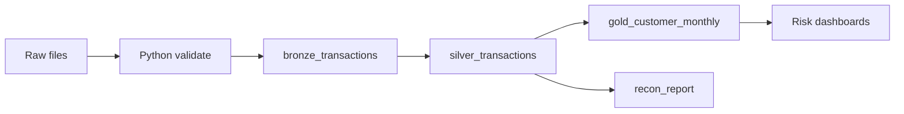

## Business problem

The bank wants one trustworthy pipeline from raw transaction files to a customer-level mart used by the risk team. Raw files arrive with duplicates and bad rows. Every run must be validated, reconciled against the source, logged and re-runnable.

## Learning objectives

- Validate and split an extract into good and rejected rows
- Land raw data as text (bronze), then type and deduplicate it (silver)
- Build a business-level gold mart
- Reconcile counts and amounts between layers
- Record run metadata and retries for monitoring

## Architecture

The medallion layout separates raw, cleaned and business-ready data. Each layer is reconciled with the previous one.



## Technologies

- **Python** and **pandas** for extract validation and run orchestration
- **PostgreSQL** for bronze, silver and gold layers
- **Airflow** and **Docker** to schedule and package it (checklist)

## Dataset

The **banking** dataset: 2304 transactions on 282 accounts of 201 customers. Bronze simulates a duplicated feed: every transaction whose id is a multiple of 250 arrives twice (9 duplicates).

## Tasks

Build the layers in order; each SQL task repeats the earlier layers it needs. Each task runs in its own rolled-back transaction, so create every table the check needs in this task.

```task
{
 "id": "validate-extract",
 "title": "Validate the raw extract",
 "type": "python",
 "instructions": "Write `validate_extract(text)` returning `(valid_df, rejects_df)`.\n\n- `valid_df` has typed columns: `transaction_id` int, `account_id` int, `txn_time` datetime64, `direction` str, `amount` float.\n- A row is rejected when `amount` is not a positive number, `direction` is not `C` or `D`, or `txn_time` cannot be parsed.\n- `rejects_df` keeps the original columns plus `reason`: the first failing rule of `bad_amount`, `bad_direction`, `bad_time` (checked in that order).",
 "starter": "import io\nimport pandas as pd\n\nRAW = \"\"\"transaction_id,account_id,txn_time,direction,amount\n1,100,2025-01-01 09:00:00,C,250.00\n2,100,2025-01-01 10:00:00,D,-5\n3,101,2025-01-02 11:00:00,X,10\n4,102,not a time,C,10\n5,102,2025-01-03 08:30:00,D,99.90\n6,103,2025-01-03 09:00:00,C,1e3\n\"\"\"\n\ndef validate_extract(text):\n    df = pd.read_csv(io.StringIO(text))\n    return df, df.iloc[0:0]\n",
 "solution": "import io\nimport pandas as pd\n\nRAW = \"\"\"transaction_id,account_id,txn_time,direction,amount\n1,100,2025-01-01 09:00:00,C,250.00\n2,100,2025-01-01 10:00:00,D,-5\n3,101,2025-01-02 11:00:00,X,10\n4,102,not a time,C,10\n5,102,2025-01-03 08:30:00,D,99.90\n6,103,2025-01-03 09:00:00,C,1e3\n\"\"\"\n\ndef validate_extract(text):\n    raw = pd.read_csv(io.StringIO(text), dtype=str)\n    amount = pd.to_numeric(raw['amount'], errors='coerce')\n    ts = pd.to_datetime(raw['txn_time'], format='%Y-%m-%d %H:%M:%S', errors='coerce')\n    reason = pd.Series(None, index=raw.index, dtype=object)\n    reason[ts.isna()] = 'bad_time'\n    reason[~raw['direction'].isin(['C', 'D'])] = 'bad_direction'\n    reason[~(amount > 0)] = 'bad_amount'\n    ok = reason.isna()\n    valid = pd.DataFrame({\n        'transaction_id': raw.loc[ok, 'transaction_id'].astype(int),\n        'account_id': raw.loc[ok, 'account_id'].astype(int),\n        'txn_time': ts[ok],\n        'direction': raw.loc[ok, 'direction'],\n        'amount': amount[ok].astype(float),\n    }).reset_index(drop=True)\n    rejects = raw[~ok].assign(reason=reason[~ok]).reset_index(drop=True)\n    return valid, rejects\n",
 "tests": "v, r = validate_extract(RAW)\nassert v['transaction_id'].tolist() == [1, 5, 6]\nassert v['amount'].tolist() == [250.0, 99.9, 1000.0]\nassert str(v['txn_time'].dtype).startswith('datetime64')\nassert r['transaction_id'].tolist() == ['2', '3', '4']\nassert r['reason'].tolist() == ['bad_amount', 'bad_direction', 'bad_time']"
}
```

```task
{
 "id": "bronze-silver",
 "title": "Bronze and silver layers",
 "type": "sql",
 "instructions": "**Bronze**: create `bronze_transactions` with every column as TEXT (`transaction_id, account_id, txn_time, txn_type, direction, amount`) plus `ingested_at TIMESTAMP`. Load all transactions, plus a second copy of those with `transaction_id % 250 = 0` (the duplicated feed).\n\n**Silver**: create `silver_transactions(transaction_id INT PRIMARY KEY, account_id INT, txn_time TIMESTAMP, txn_type, signed_amount NUMERIC(12,2))`, typed and deduplicated (keep the latest `ingested_at`). `signed_amount` is positive for `C`, negative for `D`.",
 "starter": "CREATE TABLE bronze_transactions AS\nSELECT transaction_id::text AS transaction_id, account_id::text AS account_id, txn_time::text AS txn_time,\n       txn_type::text AS txn_type, direction::text AS direction, amount::text AS amount, now() AS ingested_at\nFROM transactions\nUNION ALL\nSELECT transaction_id::text, account_id::text, txn_time::text, txn_type::text, direction::text, amount::text, now()\nFROM transactions WHERE transaction_id % 250 = 0;\n\nCREATE TABLE silver_transactions AS SELECT * FROM bronze_transactions;  -- TODO: type and dedupe",
 "solution": "CREATE TABLE bronze_transactions AS\nSELECT transaction_id::text AS transaction_id, account_id::text AS account_id, txn_time::text AS txn_time,\n       txn_type::text AS txn_type, direction::text AS direction, amount::text AS amount, now() AS ingested_at\nFROM transactions\nUNION ALL\nSELECT transaction_id::text, account_id::text, txn_time::text, txn_type::text, direction::text, amount::text, now()\nFROM transactions WHERE transaction_id % 250 = 0;\n\nCREATE TABLE silver_transactions AS\nSELECT DISTINCT ON (transaction_id::int)\n       transaction_id::int AS transaction_id,\n       account_id::int AS account_id,\n       txn_time::timestamp AS txn_time,\n       txn_type,\n       CASE direction WHEN 'C' THEN amount::numeric(12,2) ELSE -amount::numeric(12,2) END AS signed_amount\nFROM bronze_transactions\nORDER BY transaction_id::int, ingested_at DESC;\nALTER TABLE silver_transactions ADD PRIMARY KEY (transaction_id);",
 "check": "SELECT (COALESCE(((SELECT COUNT(*) FROM bronze_transactions) = (SELECT COUNT(*) + COUNT(*) FILTER (WHERE transaction_id % 250 = 0) FROM transactions)), FALSE) AND COALESCE(((SELECT COUNT(*) FROM information_schema.columns WHERE table_name = 'bronze_transactions' AND column_name = 'amount' AND data_type = 'text') = 1), FALSE) AND COALESCE(((SELECT COUNT(*) FROM silver_transactions) = (SELECT COUNT(*) FROM transactions)), FALSE) AND COALESCE(((SELECT data_type FROM information_schema.columns WHERE table_name = 'silver_transactions' AND column_name = 'txn_time') = 'timestamp without time zone'), FALSE) AND COALESCE(((SELECT SUM(signed_amount) FROM silver_transactions) = (SELECT SUM(CASE direction WHEN 'C' THEN amount ELSE -amount END) FROM transactions)), FALSE)) AS ok, CASE WHEN NOT COALESCE(((SELECT COUNT(*) FROM bronze_transactions) = (SELECT COUNT(*) + COUNT(*) FILTER (WHERE transaction_id % 250 = 0) FROM transactions)), FALSE) THEN 'bronze must include the duplicated rows' WHEN NOT COALESCE(((SELECT COUNT(*) FROM information_schema.columns WHERE table_name = 'bronze_transactions' AND column_name = 'amount' AND data_type = 'text') = 1), FALSE) THEN 'bronze columns must be TEXT' WHEN NOT COALESCE(((SELECT COUNT(*) FROM silver_transactions) = (SELECT COUNT(*) FROM transactions)), FALSE) THEN 'silver must hold each transaction once' WHEN NOT COALESCE(((SELECT data_type FROM information_schema.columns WHERE table_name = 'silver_transactions' AND column_name = 'txn_time') = 'timestamp without time zone'), FALSE) THEN 'silver txn_time must be a TIMESTAMP' WHEN NOT COALESCE(((SELECT SUM(signed_amount) FROM silver_transactions) = (SELECT SUM(CASE direction WHEN 'C' THEN amount ELSE -amount END) FROM transactions)), FALSE) THEN 'signed_amount totals do not match the source' ELSE 'Bronze and silver are correct' END AS message"
}
```

```task
{
 "id": "gold-mart",
 "title": "Gold: customer monthly flows",
 "type": "sql",
 "instructions": "Include bronze and silver, then create `gold_customer_monthly(customer_id, month DATE, credits, debits, net_flow, txn_count)` with one row per customer (via `accounts`) and month. `credits` is the sum of positive amounts, `debits` the sum of negative amounts as a **positive** number, `net_flow = credits - debits` (NULL-safe: `SUM(signed_amount)`).",
 "starter": "CREATE TABLE bronze_transactions AS\nSELECT transaction_id::text AS transaction_id, account_id::text AS account_id, txn_time::text AS txn_time,\n       txn_type::text AS txn_type, direction::text AS direction, amount::text AS amount, now() AS ingested_at\nFROM transactions\nUNION ALL\nSELECT transaction_id::text, account_id::text, txn_time::text, txn_type::text, direction::text, amount::text, now()\nFROM transactions WHERE transaction_id % 250 = 0;\n\nCREATE TABLE silver_transactions AS\nSELECT DISTINCT ON (transaction_id::int)\n       transaction_id::int AS transaction_id,\n       account_id::int AS account_id,\n       txn_time::timestamp AS txn_time,\n       txn_type,\n       CASE direction WHEN 'C' THEN amount::numeric(12,2) ELSE -amount::numeric(12,2) END AS signed_amount\nFROM bronze_transactions\nORDER BY transaction_id::int, ingested_at DESC;\nALTER TABLE silver_transactions ADD PRIMARY KEY (transaction_id);\n\nCREATE TABLE gold_customer_monthly AS\nSELECT s.account_id AS customer_id, SUM(s.signed_amount) AS net_flow\nFROM silver_transactions s GROUP BY 1;  -- TODO",
 "solution": "CREATE TABLE bronze_transactions AS\nSELECT transaction_id::text AS transaction_id, account_id::text AS account_id, txn_time::text AS txn_time,\n       txn_type::text AS txn_type, direction::text AS direction, amount::text AS amount, now() AS ingested_at\nFROM transactions\nUNION ALL\nSELECT transaction_id::text, account_id::text, txn_time::text, txn_type::text, direction::text, amount::text, now()\nFROM transactions WHERE transaction_id % 250 = 0;\n\nCREATE TABLE silver_transactions AS\nSELECT DISTINCT ON (transaction_id::int)\n       transaction_id::int AS transaction_id,\n       account_id::int AS account_id,\n       txn_time::timestamp AS txn_time,\n       txn_type,\n       CASE direction WHEN 'C' THEN amount::numeric(12,2) ELSE -amount::numeric(12,2) END AS signed_amount\nFROM bronze_transactions\nORDER BY transaction_id::int, ingested_at DESC;\nALTER TABLE silver_transactions ADD PRIMARY KEY (transaction_id);\n\nCREATE TABLE gold_customer_monthly AS\nSELECT a.customer_id,\n       date_trunc('month', s.txn_time)::date AS month,\n       SUM(s.signed_amount) FILTER (WHERE s.signed_amount > 0) AS credits,\n       -SUM(s.signed_amount) FILTER (WHERE s.signed_amount < 0) AS debits,\n       SUM(s.signed_amount) AS net_flow,\n       COUNT(*)::int AS txn_count\nFROM silver_transactions s\nJOIN accounts a ON a.account_id = s.account_id\nGROUP BY a.customer_id, date_trunc('month', s.txn_time);",
 "check": "SELECT (COALESCE(((SELECT COUNT(*) FROM information_schema.columns WHERE table_schema = current_schema() AND table_name = 'gold_customer_monthly' AND column_name IN ('customer_id','month','credits','debits','net_flow','txn_count')) = 6), FALSE) AND COALESCE(((SELECT COUNT(*) FROM gold_customer_monthly) = (SELECT COUNT(DISTINCT (a.customer_id, date_trunc('month', t.txn_time))) FROM transactions t JOIN accounts a USING (account_id))), FALSE) AND COALESCE(((SELECT SUM(net_flow) FROM gold_customer_monthly) = (SELECT SUM(CASE direction WHEN 'C' THEN amount ELSE -amount END) FROM transactions)), FALSE) AND COALESCE(((SELECT SUM(debits) FROM gold_customer_monthly) = (SELECT SUM(amount) FROM transactions WHERE direction = 'D')), FALSE) AND COALESCE(((SELECT SUM(txn_count) FROM gold_customer_monthly) = (SELECT COUNT(*) FROM transactions)), FALSE)) AS ok, CASE WHEN NOT COALESCE(((SELECT COUNT(*) FROM information_schema.columns WHERE table_schema = current_schema() AND table_name = 'gold_customer_monthly' AND column_name IN ('customer_id','month','credits','debits','net_flow','txn_count')) = 6), FALSE) THEN 'gold_customer_monthly is missing a column' WHEN NOT COALESCE(((SELECT COUNT(*) FROM gold_customer_monthly) = (SELECT COUNT(DISTINCT (a.customer_id, date_trunc('month', t.txn_time))) FROM transactions t JOIN accounts a USING (account_id))), FALSE) THEN 'one row per customer and month' WHEN NOT COALESCE(((SELECT SUM(net_flow) FROM gold_customer_monthly) = (SELECT SUM(CASE direction WHEN 'C' THEN amount ELSE -amount END) FROM transactions)), FALSE) THEN 'net_flow totals do not match' WHEN NOT COALESCE(((SELECT SUM(debits) FROM gold_customer_monthly) = (SELECT SUM(amount) FROM transactions WHERE direction = 'D')), FALSE) THEN 'debits must be a positive sum of debit amounts' WHEN NOT COALESCE(((SELECT SUM(txn_count) FROM gold_customer_monthly) = (SELECT COUNT(*) FROM transactions)), FALSE) THEN 'txn_count must count deduplicated transactions' ELSE 'Gold mart is correct' END AS message"
}
```

```task
{
 "id": "reconciliation",
 "title": "Reconcile source, silver and gold",
 "type": "sql",
 "instructions": "Include all layers, then create `recon_report(check_name TEXT, source_value NUMERIC, target_value NUMERIC, status TEXT)` with three rows:\n\n- `row_count`: `transactions` vs `silver_transactions`\n- `signed_amount`: signed source sum vs silver `signed_amount` sum\n- `gold_net_flow`: silver sum vs gold `net_flow` sum\n\n`status` is `match` when the values are equal, else `mismatch`.",
 "starter": "CREATE TABLE bronze_transactions AS\nSELECT transaction_id::text AS transaction_id, account_id::text AS account_id, txn_time::text AS txn_time,\n       txn_type::text AS txn_type, direction::text AS direction, amount::text AS amount, now() AS ingested_at\nFROM transactions\nUNION ALL\nSELECT transaction_id::text, account_id::text, txn_time::text, txn_type::text, direction::text, amount::text, now()\nFROM transactions WHERE transaction_id % 250 = 0;\n\nCREATE TABLE silver_transactions AS\nSELECT DISTINCT ON (transaction_id::int)\n       transaction_id::int AS transaction_id,\n       account_id::int AS account_id,\n       txn_time::timestamp AS txn_time,\n       txn_type,\n       CASE direction WHEN 'C' THEN amount::numeric(12,2) ELSE -amount::numeric(12,2) END AS signed_amount\nFROM bronze_transactions\nORDER BY transaction_id::int, ingested_at DESC;\nALTER TABLE silver_transactions ADD PRIMARY KEY (transaction_id);\n\nCREATE TABLE gold_customer_monthly AS\nSELECT a.customer_id,\n       date_trunc('month', s.txn_time)::date AS month,\n       SUM(s.signed_amount) FILTER (WHERE s.signed_amount > 0) AS credits,\n       -SUM(s.signed_amount) FILTER (WHERE s.signed_amount < 0) AS debits,\n       SUM(s.signed_amount) AS net_flow,\n       COUNT(*)::int AS txn_count\nFROM silver_transactions s\nJOIN accounts a ON a.account_id = s.account_id\nGROUP BY a.customer_id, date_trunc('month', s.txn_time);\n\nCREATE TABLE recon_report (check_name TEXT, source_value NUMERIC, target_value NUMERIC, status TEXT);\nINSERT INTO recon_report VALUES ('row_count', (SELECT COUNT(*) FROM transactions), (SELECT COUNT(*) FROM bronze_transactions), 'match');  -- TODO",
 "solution": "CREATE TABLE bronze_transactions AS\nSELECT transaction_id::text AS transaction_id, account_id::text AS account_id, txn_time::text AS txn_time,\n       txn_type::text AS txn_type, direction::text AS direction, amount::text AS amount, now() AS ingested_at\nFROM transactions\nUNION ALL\nSELECT transaction_id::text, account_id::text, txn_time::text, txn_type::text, direction::text, amount::text, now()\nFROM transactions WHERE transaction_id % 250 = 0;\n\nCREATE TABLE silver_transactions AS\nSELECT DISTINCT ON (transaction_id::int)\n       transaction_id::int AS transaction_id,\n       account_id::int AS account_id,\n       txn_time::timestamp AS txn_time,\n       txn_type,\n       CASE direction WHEN 'C' THEN amount::numeric(12,2) ELSE -amount::numeric(12,2) END AS signed_amount\nFROM bronze_transactions\nORDER BY transaction_id::int, ingested_at DESC;\nALTER TABLE silver_transactions ADD PRIMARY KEY (transaction_id);\n\nCREATE TABLE gold_customer_monthly AS\nSELECT a.customer_id,\n       date_trunc('month', s.txn_time)::date AS month,\n       SUM(s.signed_amount) FILTER (WHERE s.signed_amount > 0) AS credits,\n       -SUM(s.signed_amount) FILTER (WHERE s.signed_amount < 0) AS debits,\n       SUM(s.signed_amount) AS net_flow,\n       COUNT(*)::int AS txn_count\nFROM silver_transactions s\nJOIN accounts a ON a.account_id = s.account_id\nGROUP BY a.customer_id, date_trunc('month', s.txn_time);\n\nCREATE TABLE recon_report AS\nSELECT check_name, source_value, target_value,\n       CASE WHEN source_value = target_value THEN 'match' ELSE 'mismatch' END AS status\nFROM (VALUES\n  ('row_count', (SELECT COUNT(*)::numeric FROM transactions), (SELECT COUNT(*)::numeric FROM silver_transactions)),\n  ('signed_amount', (SELECT SUM(CASE direction WHEN 'C' THEN amount ELSE -amount END) FROM transactions), (SELECT SUM(signed_amount) FROM silver_transactions)),\n  ('gold_net_flow', (SELECT SUM(signed_amount) FROM silver_transactions), (SELECT SUM(net_flow) FROM gold_customer_monthly))\n) AS r(check_name, source_value, target_value);",
 "check": "SELECT (COALESCE(((SELECT COUNT(*) FROM recon_report) = 3), FALSE) AND COALESCE(((SELECT target_value FROM recon_report WHERE check_name = 'row_count') = (SELECT COUNT(*) FROM transactions)), FALSE) AND COALESCE((NOT EXISTS (SELECT 1 FROM recon_report WHERE status <> CASE WHEN source_value = target_value THEN 'match' ELSE 'mismatch' END)), FALSE) AND COALESCE(((SELECT COUNT(*) FROM recon_report WHERE status = 'match') = 3), FALSE)) AS ok, CASE WHEN NOT COALESCE(((SELECT COUNT(*) FROM recon_report) = 3), FALSE) THEN 'recon_report needs 3 rows' WHEN NOT COALESCE(((SELECT target_value FROM recon_report WHERE check_name = 'row_count') = (SELECT COUNT(*) FROM transactions)), FALSE) THEN 'row_count must compare against silver_transactions' WHEN NOT COALESCE((NOT EXISTS (SELECT 1 FROM recon_report WHERE status <> CASE WHEN source_value = target_value THEN 'match' ELSE 'mismatch' END)), FALSE) THEN 'status must reflect the comparison' WHEN NOT COALESCE(((SELECT COUNT(*) FROM recon_report WHERE status = 'match') = 3), FALSE) THEN 'all three checks should match' ELSE 'Reconciliation passes' END AS message"
}
```

```task
{
 "id": "run-log",
 "title": "Run steps with retries and a run log",
 "type": "python",
 "instructions": "Write `run_pipeline(steps, max_retries=2)` where `steps` is a list of `(name, fn)`. Run them in order. Retry a step that raises up to `max_retries` times. Return a list of log dicts `{'step', 'status', 'attempts'}`, where status is `success`, `failed` or `skipped`. After a failed step, every later step is `skipped` with 0 attempts.",
 "starter": "def run_pipeline(steps, max_retries=2):\n    log = []\n    for name, fn in steps:\n        fn()\n        log.append({'step': name, 'status': 'success', 'attempts': 1})\n    return log\n",
 "solution": "def run_pipeline(steps, max_retries=2):\n    log, failed = [], False\n    for name, fn in steps:\n        if failed:\n            log.append({'step': name, 'status': 'skipped', 'attempts': 0})\n            continue\n        attempts = 0\n        while True:\n            attempts += 1\n            try:\n                fn()\n                log.append({'step': name, 'status': 'success', 'attempts': attempts})\n                break\n            except Exception:\n                if attempts > max_retries:\n                    log.append({'step': name, 'status': 'failed', 'attempts': attempts})\n                    failed = True\n                    break\n    return log\n",
 "tests": "def flaky(n):\n    s = {'c': 0}\n    def fn():\n        s['c'] += 1\n        if s['c'] <= n:\n            raise RuntimeError('boom')\n    return fn\nlog = run_pipeline([('extract', flaky(0)), ('silver', flaky(1)), ('gold', flaky(5)), ('publish', flaky(0))])\nassert log == [\n    {'step': 'extract', 'status': 'success', 'attempts': 1},\n    {'step': 'silver', 'status': 'success', 'attempts': 2},\n    {'step': 'gold', 'status': 'failed', 'attempts': 3},\n    {'step': 'publish', 'status': 'skipped', 'attempts': 0},\n], log"
}
```

```task
{
 "id": "ship-it",
 "title": "Package, schedule and publish",
 "type": "checklist",
 "instructions": "Make the pipeline production-shaped.",
 "items": [
  "Put the Python and SQL in a repository with `src/`, `sql/` and `tests/` folders",
  "Write a `docker-compose.yml` with PostgreSQL and Airflow",
  "Create an Airflow DAG: validate >> bronze >> silver >> gold >> reconcile, failing the run on any `mismatch`",
  "Store raw files in object storage (or a local MinIO bucket) instead of the database",
  "Add a GitHub Actions workflow that runs the Python tests and the SQL checks",
  "Push the repository to GitHub with a README and an architecture diagram"
 ]
}
```

## Expected output

- `validate_extract`: 3 valid rows and 3 rejects with reasons
- `bronze_transactions`: 2313 rows; `silver_transactions`: 2304
- `gold_customer_monthly`: net flow 957958.61
- `recon_report`: every check `match`

## Common mistakes

- Typing data in bronze; one bad value then blocks the whole load and the raw evidence is lost.
- Deduplicating with `DISTINCT` on all columns when duplicates differ in ingestion time.
- Reconciling only row counts; amounts can drift while counts match.
- Logging only failures, so you cannot tell a slow run from a normal one.

## Interview discussion questions

### Why bronze, silver and gold?
Bronze keeps raw data for replay and audit. Silver is typed, deduplicated and conformed. Gold is modelled for a business use. Each layer can be rebuilt from the one before.

### What do you reconcile?
Row counts, sums of key measures and distinct keys between source and each layer, with tolerances agreed with the business. Failures stop publication.

### How do you monitor a pipeline?
Record each run's start, end, status, row counts and retries. Alert on failures, on missing runs (freshness) and on unusual volumes.

## Summary

You built a full medallion pipeline with validation, deduplication, a gold mart, reconciliation and run logging: the shape of most production data platforms.
