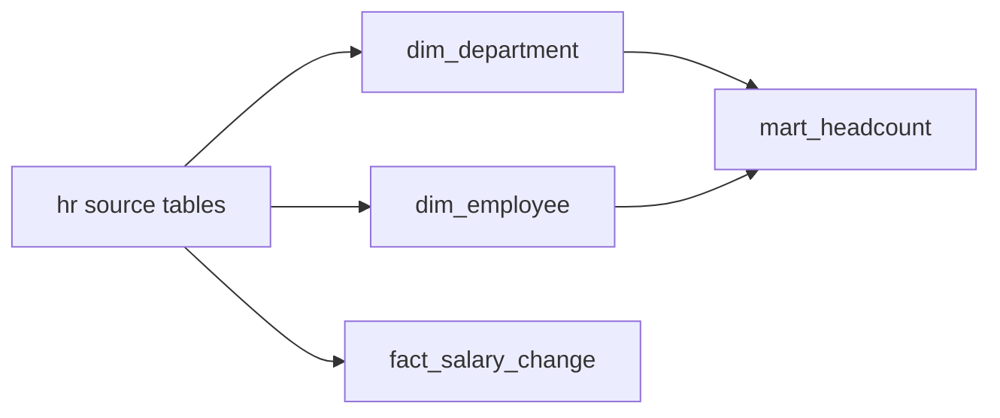

## Business problem

The people team answers the same questions every month: headcount per department, salary growth, and how many people left. Today each answer is a hand-written query against the HR system. They want a small warehouse with clear dimensions and facts that any analyst can query.

## Learning objectives

- Build dimensions with surrogate keys and natural keys
- Add an `Unknown` member so facts never have NULL foreign keys
- Model a fact table at a clear grain (one salary change)
- Build an aggregated mart for reporting
- Compute attrition with pandas

## Architecture

Source tables feed two dimensions and one fact. A mart aggregates them for dashboards.



## Technologies

- **PostgreSQL 16** for dimensions, facts and marts
- **Window functions** (`ROW_NUMBER`) to assign surrogate keys
- **pandas** for an attrition calculation

## Dataset

The **hr** dataset: 10 departments, 200 employees and 359 salary-history rows. Research has no employees and no location; one employee has no department; hire rows in `salary_history` have NULL `old_salary`.

## Tasks

Build the warehouse layer by layer. Each task runs in its own rolled-back transaction, so create every table the check needs in this task.

```task
{
 "id": "dim-department",
 "title": "Build dim_department with an Unknown member",
 "type": "sql",
 "instructions": "Create `dim_department(department_key INTEGER PRIMARY KEY, department_id INTEGER UNIQUE, department_name, city, country)`.\n\n- Assign `department_key` 1, 2, 3… in `department_id` order.\n- Take city and country from `locations` (Research has none: keep it with NULLs).\n- Add a member `(-1, NULL, 'Unknown', NULL, NULL)`.",
 "starter": "CREATE TABLE dim_department AS\nSELECT department_id AS department_key, department_id, department_name\nFROM departments;  -- TODO",
 "solution": "CREATE TABLE dim_department (\n  department_key INTEGER PRIMARY KEY,\n  department_id INTEGER UNIQUE,\n  department_name VARCHAR(60) NOT NULL,\n  city VARCHAR(60),\n  country VARCHAR(60)\n);\nINSERT INTO dim_department\nSELECT ROW_NUMBER() OVER (ORDER BY d.department_id), d.department_id, d.department_name, l.city, l.country\nFROM departments d LEFT JOIN locations l ON l.location_id = d.location_id;\nINSERT INTO dim_department VALUES (-1, NULL, 'Unknown', NULL, NULL);",
 "check": "SELECT (COALESCE(((SELECT COUNT(*) FROM information_schema.columns WHERE table_schema = current_schema() AND table_name = 'dim_department' AND column_name IN ('department_key','department_id','department_name','city','country')) = 5), FALSE) AND COALESCE(((SELECT COUNT(*) FROM dim_department) = (SELECT COUNT(*) + 1 FROM departments)), FALSE) AND COALESCE((EXISTS (SELECT 1 FROM dim_department WHERE department_key = -1 AND department_name = 'Unknown')), FALSE) AND COALESCE(((SELECT COUNT(DISTINCT department_key) FROM dim_department) = (SELECT COUNT(*) FROM dim_department)), FALSE) AND COALESCE(((SELECT COUNT(*) FROM dim_department WHERE city IS NOT NULL) = (SELECT COUNT(*) FROM departments WHERE location_id IS NOT NULL)), FALSE)) AS ok, CASE WHEN NOT COALESCE(((SELECT COUNT(*) FROM information_schema.columns WHERE table_schema = current_schema() AND table_name = 'dim_department' AND column_name IN ('department_key','department_id','department_name','city','country')) = 5), FALSE) THEN 'dim_department is missing a column' WHEN NOT COALESCE(((SELECT COUNT(*) FROM dim_department) = (SELECT COUNT(*) + 1 FROM departments)), FALSE) THEN 'one row per department plus the Unknown member' WHEN NOT COALESCE((EXISTS (SELECT 1 FROM dim_department WHERE department_key = -1 AND department_name = 'Unknown')), FALSE) THEN 'add the -1 Unknown member' WHEN NOT COALESCE(((SELECT COUNT(DISTINCT department_key) FROM dim_department) = (SELECT COUNT(*) FROM dim_department)), FALSE) THEN 'department_key must be unique' WHEN NOT COALESCE(((SELECT COUNT(*) FROM dim_department WHERE city IS NOT NULL) = (SELECT COUNT(*) FROM departments WHERE location_id IS NOT NULL)), FALSE) THEN 'city must come from locations' ELSE 'dim_department is ready' END AS message"
}
```

```task
{
 "id": "dim-employee",
 "title": "Build dim_employee",
 "type": "sql",
 "instructions": "Include the `dim_department` build, then create `dim_employee(employee_key, employee_id, full_name, job_title, department_key, hire_date, is_active)`.\n\n- `employee_key` = `ROW_NUMBER()` over `employee_id`.\n- `department_key` comes from `dim_department`; use `-1` when the employee has no department.",
 "starter": "CREATE TABLE dim_department (\n  department_key INTEGER PRIMARY KEY,\n  department_id INTEGER UNIQUE,\n  department_name VARCHAR(60) NOT NULL,\n  city VARCHAR(60),\n  country VARCHAR(60)\n);\nINSERT INTO dim_department\nSELECT ROW_NUMBER() OVER (ORDER BY d.department_id), d.department_id, d.department_name, l.city, l.country\nFROM departments d LEFT JOIN locations l ON l.location_id = d.location_id;\nINSERT INTO dim_department VALUES (-1, NULL, 'Unknown', NULL, NULL);\n\nCREATE TABLE dim_employee AS\nSELECT e.employee_id AS employee_key, e.employee_id, e.first_name AS full_name, NULL::text AS job_title, d.department_key, e.hire_date, e.is_active\nFROM employees e LEFT JOIN dim_department d ON d.department_id = e.department_id;  -- TODO",
 "solution": "CREATE TABLE dim_department (\n  department_key INTEGER PRIMARY KEY,\n  department_id INTEGER UNIQUE,\n  department_name VARCHAR(60) NOT NULL,\n  city VARCHAR(60),\n  country VARCHAR(60)\n);\nINSERT INTO dim_department\nSELECT ROW_NUMBER() OVER (ORDER BY d.department_id), d.department_id, d.department_name, l.city, l.country\nFROM departments d LEFT JOIN locations l ON l.location_id = d.location_id;\nINSERT INTO dim_department VALUES (-1, NULL, 'Unknown', NULL, NULL);\n\nCREATE TABLE dim_employee AS\nSELECT ROW_NUMBER() OVER (ORDER BY e.employee_id)::int AS employee_key,\n       e.employee_id,\n       e.first_name || ' ' || e.last_name AS full_name,\n       j.job_title,\n       COALESCE(d.department_key, -1) AS department_key,\n       e.hire_date,\n       e.is_active\nFROM employees e\nJOIN jobs j ON j.job_id = e.job_id\nLEFT JOIN dim_department d ON d.department_id = e.department_id;",
 "check": "SELECT (COALESCE(((SELECT COUNT(*) FROM information_schema.columns WHERE table_schema = current_schema() AND table_name = 'dim_employee' AND column_name IN ('employee_key','employee_id','full_name','job_title','department_key','hire_date','is_active')) = 7), FALSE) AND COALESCE(((SELECT COUNT(*) FROM dim_employee) = (SELECT COUNT(*) FROM employees)), FALSE) AND COALESCE((NOT EXISTS (SELECT 1 FROM dim_employee WHERE department_key IS NULL OR job_title IS NULL)), FALSE) AND COALESCE((NOT EXISTS (SELECT 1 FROM dim_employee e LEFT JOIN dim_department d USING (department_key) WHERE d.department_key IS NULL)), FALSE) AND COALESCE(((SELECT COUNT(*) FROM dim_employee WHERE department_key = -1) = (SELECT COUNT(*) FROM employees WHERE department_id IS NULL)), FALSE)) AS ok, CASE WHEN NOT COALESCE(((SELECT COUNT(*) FROM information_schema.columns WHERE table_schema = current_schema() AND table_name = 'dim_employee' AND column_name IN ('employee_key','employee_id','full_name','job_title','department_key','hire_date','is_active')) = 7), FALSE) THEN 'dim_employee is missing a column' WHEN NOT COALESCE(((SELECT COUNT(*) FROM dim_employee) = (SELECT COUNT(*) FROM employees)), FALSE) THEN 'one row per employee' WHEN NOT COALESCE((NOT EXISTS (SELECT 1 FROM dim_employee WHERE department_key IS NULL OR job_title IS NULL)), FALSE) THEN 'department_key and job_title must never be NULL (use -1 for no department)' WHEN NOT COALESCE((NOT EXISTS (SELECT 1 FROM dim_employee e LEFT JOIN dim_department d USING (department_key) WHERE d.department_key IS NULL)), FALSE) THEN 'every department_key must exist in dim_department' WHEN NOT COALESCE(((SELECT COUNT(*) FROM dim_employee WHERE department_key = -1) = (SELECT COUNT(*) FROM employees WHERE department_id IS NULL)), FALSE) THEN 'only employees without a department get -1' ELSE 'dim_employee is ready' END AS message"
}
```

```task
{
 "id": "fact-salary-change",
 "title": "Build fact_salary_change",
 "type": "sql",
 "instructions": "Grain: one row per `salary_history` row. Create `fact_salary_change(employee_id, date_key, reason, old_salary, new_salary, change_amount, change_pct)`.\n\n- `date_key` is the effective date as an integer `YYYYMMDD`.\n- `change_amount` = `new_salary - COALESCE(old_salary, 0)`.\n- `change_pct` = change / old salary × 100 rounded to 2 decimals, NULL for hire rows.",
 "starter": "CREATE TABLE fact_salary_change AS\nSELECT employee_id, effective_date AS date_key, reason, old_salary, new_salary\nFROM salary_history;  -- TODO",
 "solution": "CREATE TABLE fact_salary_change AS\nSELECT employee_id,\n       to_char(effective_date, 'YYYYMMDD')::int AS date_key,\n       reason, old_salary, new_salary,\n       new_salary - COALESCE(old_salary, 0) AS change_amount,\n       ROUND(100 * (new_salary - old_salary) / NULLIF(old_salary, 0), 2) AS change_pct\nFROM salary_history;",
 "check": "SELECT (COALESCE(((SELECT COUNT(*) FROM information_schema.columns WHERE table_schema = current_schema() AND table_name = 'fact_salary_change' AND column_name IN ('employee_id','date_key','reason','old_salary','new_salary','change_amount','change_pct')) = 7), FALSE) AND COALESCE(((SELECT data_type FROM information_schema.columns WHERE table_name = 'fact_salary_change' AND column_name = 'date_key') = 'integer'), FALSE) AND COALESCE(((SELECT COUNT(*) FROM fact_salary_change) = (SELECT COUNT(*) FROM salary_history)), FALSE) AND COALESCE(((SELECT SUM(change_amount) FROM fact_salary_change) = (SELECT SUM(new_salary - COALESCE(old_salary, 0)) FROM salary_history)), FALSE) AND COALESCE((NOT EXISTS (SELECT 1 FROM fact_salary_change WHERE (old_salary IS NULL) <> (change_pct IS NULL))), FALSE) AND COALESCE(((SELECT MIN(date_key) FROM fact_salary_change) = (SELECT to_char(MIN(effective_date), 'YYYYMMDD')::int FROM salary_history)), FALSE)) AS ok, CASE WHEN NOT COALESCE(((SELECT COUNT(*) FROM information_schema.columns WHERE table_schema = current_schema() AND table_name = 'fact_salary_change' AND column_name IN ('employee_id','date_key','reason','old_salary','new_salary','change_amount','change_pct')) = 7), FALSE) THEN 'fact_salary_change is missing a column' WHEN NOT COALESCE(((SELECT data_type FROM information_schema.columns WHERE table_name = 'fact_salary_change' AND column_name = 'date_key') = 'integer'), FALSE) THEN 'date_key must be an INTEGER like 20240115' WHEN NOT COALESCE(((SELECT COUNT(*) FROM fact_salary_change) = (SELECT COUNT(*) FROM salary_history)), FALSE) THEN 'one row per salary_history row' WHEN NOT COALESCE(((SELECT SUM(change_amount) FROM fact_salary_change) = (SELECT SUM(new_salary - COALESCE(old_salary, 0)) FROM salary_history)), FALSE) THEN 'change_amount totals do not match' WHEN NOT COALESCE((NOT EXISTS (SELECT 1 FROM fact_salary_change WHERE (old_salary IS NULL) <> (change_pct IS NULL))), FALSE) THEN 'change_pct must be NULL exactly for hire rows' WHEN NOT COALESCE(((SELECT MIN(date_key) FROM fact_salary_change) = (SELECT to_char(MIN(effective_date), 'YYYYMMDD')::int FROM salary_history)), FALSE) THEN 'date_key must encode the effective date' ELSE 'fact_salary_change is correct' END AS message"
}
```

```task
{
 "id": "mart-headcount",
 "title": "Build the headcount mart",
 "type": "sql",
 "instructions": "Create `mart_headcount(department_name, active_headcount, terminated_count, avg_active_salary)` with one row per department in `departments` (including those with no staff) plus `'Unassigned'` for employees without a department.\n\n`avg_active_salary` is rounded to 2 decimals and NULL when there are no active employees.",
 "starter": "CREATE TABLE mart_headcount AS\nSELECT d.department_name, COUNT(*) AS active_headcount\nFROM employees e JOIN departments d ON d.department_id = e.department_id\nGROUP BY d.department_name;  -- TODO",
 "solution": "CREATE TABLE mart_headcount AS\nSELECT COALESCE(d.department_name, 'Unassigned') AS department_name,\n       COUNT(e.employee_id) FILTER (WHERE e.is_active) AS active_headcount,\n       COUNT(e.employee_id) FILTER (WHERE NOT e.is_active) AS terminated_count,\n       ROUND(AVG(e.salary) FILTER (WHERE e.is_active), 2) AS avg_active_salary\nFROM departments d\nFULL JOIN employees e ON e.department_id = d.department_id\nGROUP BY COALESCE(d.department_name, 'Unassigned');",
 "check": "SELECT (COALESCE(((SELECT COUNT(*) FROM mart_headcount) = (SELECT COUNT(*) + 1 FROM departments)), FALSE) AND COALESCE(((SELECT SUM(active_headcount) FROM mart_headcount) = (SELECT COUNT(*) FROM employees WHERE is_active)), FALSE) AND COALESCE(((SELECT SUM(terminated_count) FROM mart_headcount) = (SELECT COUNT(*) FROM employees WHERE NOT is_active)), FALSE) AND COALESCE(((SELECT active_headcount FROM mart_headcount WHERE department_name = 'Research') = 0), FALSE) AND COALESCE(((SELECT avg_active_salary FROM mart_headcount WHERE department_name = 'Sales') = (SELECT ROUND(AVG(salary), 2) FROM employees e JOIN departments d USING (department_id) WHERE d.department_name = 'Sales' AND e.is_active)), FALSE)) AS ok, CASE WHEN NOT COALESCE(((SELECT COUNT(*) FROM mart_headcount) = (SELECT COUNT(*) + 1 FROM departments)), FALSE) THEN 'one row per department plus Unassigned' WHEN NOT COALESCE(((SELECT SUM(active_headcount) FROM mart_headcount) = (SELECT COUNT(*) FROM employees WHERE is_active)), FALSE) THEN 'active_headcount must count only active employees' WHEN NOT COALESCE(((SELECT SUM(terminated_count) FROM mart_headcount) = (SELECT COUNT(*) FROM employees WHERE NOT is_active)), FALSE) THEN 'terminated_count is wrong' WHEN NOT COALESCE(((SELECT active_headcount FROM mart_headcount WHERE department_name = 'Research') = 0), FALSE) THEN 'departments without staff must appear with 0' WHEN NOT COALESCE(((SELECT avg_active_salary FROM mart_headcount WHERE department_name = 'Sales') = (SELECT ROUND(AVG(salary), 2) FROM employees e JOIN departments d USING (department_id) WHERE d.department_name = 'Sales' AND e.is_active)), FALSE) THEN 'avg_active_salary for Sales is wrong' ELSE 'mart_headcount is correct' END AS message"
}
```

```task
{
 "id": "attrition-rate",
 "title": "Compute yearly attrition in pandas",
 "type": "python",
 "instructions": "Write `attrition_by_year(df, years)` returning a dict `{year: rate}`.\n\n- Headcount at the start of a year = employees hired before 1 January of that year and not terminated before it.\n- Leavers = employees whose `termination_date` falls in that year.\n- Rate = leavers / starting headcount × 100, rounded to 1 decimal (0.0 if headcount is 0).",
 "starter": "import io\nimport pandas as pd\n\nCSV = \"\"\"employee_id,hire_date,termination_date\n1,2020-01-10,\n2,2020-05-01,2022-03-15\n3,2021-02-01,\n4,2021-06-01,2023-01-20\n5,2022-01-01,\n6,2022-08-01,2022-12-01\n\"\"\"\ndf = pd.read_csv(io.StringIO(CSV), parse_dates=['hire_date', 'termination_date'])\n\ndef attrition_by_year(df, years):\n    return {y: 0.0 for y in years}\n",
 "solution": "import io\nimport pandas as pd\n\nCSV = \"\"\"employee_id,hire_date,termination_date\n1,2020-01-10,\n2,2020-05-01,2022-03-15\n3,2021-02-01,\n4,2021-06-01,2023-01-20\n5,2022-01-01,\n6,2022-08-01,2022-12-01\n\"\"\"\ndf = pd.read_csv(io.StringIO(CSV), parse_dates=['hire_date', 'termination_date'])\n\ndef attrition_by_year(df, years):\n    out = {}\n    for y in years:\n        start = pd.Timestamp(year=y, month=1, day=1)\n        active = (df['hire_date'] < start) & (df['termination_date'].isna() | (df['termination_date'] >= start))\n        leavers = (df['termination_date'].dt.year == y).sum()\n        hc = int(active.sum())\n        out[y] = round(100.0 * leavers / hc, 1) if hc else 0.0\n    return out\n",
 "tests": "r = attrition_by_year(df, [2021, 2022, 2023])\nassert r == {2021: 0.0, 2022: 50.0, 2023: 25.0}, r"
}
```

## Design decisions

Real pipelines are mostly decisions. Pick the option that fits each scenario; every option explains itself once you answer.

```task
{
  "id": "d-scd",
  "title": "Tracking department changes",
  "type": "decision",
  "instructions": "Employees move between departments. HR wants headcount by department as it was at any month end.",
  "options": [
    "Overwrite the department on the employee row (SCD type 1)",
    "Add a new dimension row per change with valid_from/valid_to (SCD type 2)",
    "Keep only the hire department",
    "Recompute from emails"
  ],
  "answer": 1,
  "why": [
    "History is lost: past headcounts move with each transfer.",
    "Each version keeps its validity period, so any month end can be reconstructed with a date-range join.",
    "Wrong for anyone who has moved.",
    "Not a reliable source of organisational data."
  ]
}
```

```task
{
  "id": "d-pii",
  "title": "Personal data in the warehouse",
  "type": "decision",
  "instructions": "Analysts need headcount and salary bands. A few HR staff need individual salaries.",
  "options": [
    "Give everyone the full employee table",
    "Expose aggregated views and salary bands broadly; restrict raw salary columns to an HR role",
    "Delete salaries from the warehouse",
    "Share an export file by email"
  ],
  "answer": 1,
  "why": [
    "Exposes sensitive personal data to everyone who can query.",
    "Least privilege: most users get what they need from aggregates, and access to raw values is limited and auditable.",
    "Blocks legitimate HR analysis.",
    "Uncontrolled copies of personal data."
  ]
}
```

## Expected output

- `dim_department`: 11 rows including the `-1 Unknown` member
- `dim_employee`: 200 rows, none with a NULL `department_key`
- `fact_salary_change`: 359 rows; total `change_amount` 4832300.00
- `mart_headcount`: 189 active employees across all departments

## Common mistakes

- Using the natural key as the fact's foreign key; history breaks when the source re-uses ids.
- Leaving NULL foreign keys in facts, which drop out of inner joins.
- Mixing grains: putting headcount and salary changes in one fact.
- Counting terminated employees as headcount.

## Interview discussion questions

### Why use surrogate keys?
They are stable, compact and independent of source systems. They also let one natural key have several versions in a type 2 dimension.

### What is an Unknown member?
A dimension row (often key -1) that facts point to when the real value is missing. Joins stay inner and reports show `Unknown` instead of losing rows.

### How do you define fact grain?
State in one sentence what one row means, e.g. "one salary change for one employee on one date". Every measure and key must fit that sentence.

## Summary

You built two dimensions with surrogate keys, a fact table at a clear grain, a reporting mart and an attrition metric. Together these form a tiny star schema.
