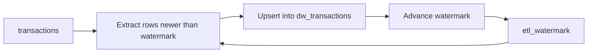

## Business problem

The bank's transactions table grows by thousands of rows a day. Copying it in full every night is slow and puts load on the core system. The warehouse team wants to copy only new rows, apply corrections to rows that changed, and re-run a failed night without creating duplicates.

## Learning objectives

- Do a first full load and record a high-water mark
- Load only rows newer than the watermark
- Upsert corrections with `INSERT … ON CONFLICT DO UPDATE`
- Prove a load is idempotent by running it twice
- Handle late-arriving data with a lookback window

## Architecture

A watermark table remembers how far the last run got. Each run reads only newer source rows and merges them into the warehouse table.



## Technologies

- **PostgreSQL 16**: `ON CONFLICT`, `UPDATE … FROM`, transactional DDL
- **Python** for the lookback-window logic

## Dataset

The **banking** dataset: 2304 transactions from 2024-01-01 to 2025-12-31. `direction` is `C` (credit) or `D` (debit) and `amount` is always positive. The initial load takes everything before 2025-07-01 (1499 rows).

## Tasks

Each task builds on the previous one; paste the earlier SQL at the top. Each task runs in its own rolled-back transaction, so create every table the check needs in this task.

```task
{
 "id": "initial-load",
 "title": "Initial full load and watermark",
 "type": "sql",
 "instructions": "Create:\n\n- `etl_watermark(table_name TEXT PRIMARY KEY, last_loaded_at TIMESTAMP)`\n- `dw_transactions(transaction_id INTEGER PRIMARY KEY, account_id, txn_time, txn_type, signed_amount NUMERIC(12,2), description, loaded_at TIMESTAMP DEFAULT now())`\n\nLoad every transaction with `txn_time < '2025-07-01'`. `signed_amount` is `+amount` for `C` and `-amount` for `D`. Then insert the watermark row `('transactions', <max txn_time loaded>)`.",
 "starter": "CREATE TABLE etl_watermark (table_name TEXT PRIMARY KEY, last_loaded_at TIMESTAMP);\nCREATE TABLE dw_transactions AS SELECT * FROM transactions;  -- TODO: typed table, filter, signed_amount, watermark",
 "solution": "CREATE TABLE etl_watermark (table_name TEXT PRIMARY KEY, last_loaded_at TIMESTAMP NOT NULL);\nCREATE TABLE dw_transactions (\n  transaction_id INTEGER PRIMARY KEY,\n  account_id INTEGER NOT NULL,\n  txn_time TIMESTAMP NOT NULL,\n  txn_type VARCHAR(12) NOT NULL,\n  signed_amount NUMERIC(12,2) NOT NULL,\n  description VARCHAR(120),\n  loaded_at TIMESTAMP NOT NULL DEFAULT now()\n);\nINSERT INTO dw_transactions (transaction_id, account_id, txn_time, txn_type, signed_amount, description)\nSELECT transaction_id, account_id, txn_time, txn_type,\n       CASE direction WHEN 'C' THEN amount ELSE -amount END, description\nFROM transactions\nWHERE txn_time < '2025-07-01';\nINSERT INTO etl_watermark VALUES ('transactions', (SELECT MAX(txn_time) FROM dw_transactions));",
 "check": "SELECT (COALESCE(((SELECT COUNT(*) FROM information_schema.columns WHERE table_schema = current_schema() AND table_name = 'dw_transactions' AND column_name IN ('transaction_id','account_id','txn_time','txn_type','signed_amount','description','loaded_at')) = 7), FALSE) AND COALESCE(((SELECT COUNT(*) FROM dw_transactions) = (SELECT COUNT(*) FROM transactions WHERE txn_time < '2025-07-01')), FALSE) AND COALESCE(((SELECT SUM(signed_amount) FROM dw_transactions) = (SELECT SUM(CASE direction WHEN 'C' THEN amount ELSE -amount END) FROM transactions WHERE txn_time < '2025-07-01')), FALSE) AND COALESCE(((SELECT last_loaded_at FROM etl_watermark WHERE table_name = 'transactions') = (SELECT MAX(txn_time) FROM transactions WHERE txn_time < '2025-07-01')), FALSE)) AS ok, CASE WHEN NOT COALESCE(((SELECT COUNT(*) FROM information_schema.columns WHERE table_schema = current_schema() AND table_name = 'dw_transactions' AND column_name IN ('transaction_id','account_id','txn_time','txn_type','signed_amount','description','loaded_at')) = 7), FALSE) THEN 'dw_transactions is missing a column' WHEN NOT COALESCE(((SELECT COUNT(*) FROM dw_transactions) = (SELECT COUNT(*) FROM transactions WHERE txn_time < '2025-07-01')), FALSE) THEN 'load only rows before 2025-07-01' WHEN NOT COALESCE(((SELECT SUM(signed_amount) FROM dw_transactions) = (SELECT SUM(CASE direction WHEN 'C' THEN amount ELSE -amount END) FROM transactions WHERE txn_time < '2025-07-01')), FALSE) THEN 'signed_amount is wrong (credits positive, debits negative)' WHEN NOT COALESCE(((SELECT last_loaded_at FROM etl_watermark WHERE table_name = 'transactions') = (SELECT MAX(txn_time) FROM transactions WHERE txn_time < '2025-07-01')), FALSE) THEN 'the watermark must equal the max txn_time loaded' ELSE 'Initial load done' END AS message"
}
```

```task
{
 "id": "incremental-run",
 "title": "Incremental run from the watermark",
 "type": "sql",
 "instructions": "Paste the initial load, then write the incremental step:\n\n1. Insert only transactions with `txn_time` greater than the stored watermark.\n2. Advance the watermark to the new max `txn_time` in `dw_transactions`.",
 "starter": "CREATE TABLE etl_watermark (table_name TEXT PRIMARY KEY, last_loaded_at TIMESTAMP NOT NULL);\nCREATE TABLE dw_transactions (\n  transaction_id INTEGER PRIMARY KEY,\n  account_id INTEGER NOT NULL,\n  txn_time TIMESTAMP NOT NULL,\n  txn_type VARCHAR(12) NOT NULL,\n  signed_amount NUMERIC(12,2) NOT NULL,\n  description VARCHAR(120),\n  loaded_at TIMESTAMP NOT NULL DEFAULT now()\n);\nINSERT INTO dw_transactions (transaction_id, account_id, txn_time, txn_type, signed_amount, description)\nSELECT transaction_id, account_id, txn_time, txn_type,\n       CASE direction WHEN 'C' THEN amount ELSE -amount END, description\nFROM transactions\nWHERE txn_time < '2025-07-01';\nINSERT INTO etl_watermark VALUES ('transactions', (SELECT MAX(txn_time) FROM dw_transactions));\n\n-- TODO: incremental step\n",
 "solution": "CREATE TABLE etl_watermark (table_name TEXT PRIMARY KEY, last_loaded_at TIMESTAMP NOT NULL);\nCREATE TABLE dw_transactions (\n  transaction_id INTEGER PRIMARY KEY,\n  account_id INTEGER NOT NULL,\n  txn_time TIMESTAMP NOT NULL,\n  txn_type VARCHAR(12) NOT NULL,\n  signed_amount NUMERIC(12,2) NOT NULL,\n  description VARCHAR(120),\n  loaded_at TIMESTAMP NOT NULL DEFAULT now()\n);\nINSERT INTO dw_transactions (transaction_id, account_id, txn_time, txn_type, signed_amount, description)\nSELECT transaction_id, account_id, txn_time, txn_type,\n       CASE direction WHEN 'C' THEN amount ELSE -amount END, description\nFROM transactions\nWHERE txn_time < '2025-07-01';\nINSERT INTO etl_watermark VALUES ('transactions', (SELECT MAX(txn_time) FROM dw_transactions));\n\nINSERT INTO dw_transactions (transaction_id, account_id, txn_time, txn_type, signed_amount, description)\nSELECT transaction_id, account_id, txn_time, txn_type,\n       CASE direction WHEN 'C' THEN amount ELSE -amount END, description\nFROM transactions\nWHERE txn_time > (SELECT last_loaded_at FROM etl_watermark WHERE table_name = 'transactions')\nON CONFLICT (transaction_id) DO NOTHING;\nUPDATE etl_watermark\nSET last_loaded_at = (SELECT MAX(txn_time) FROM dw_transactions)\nWHERE table_name = 'transactions';",
 "check": "SELECT (COALESCE(((SELECT COUNT(*) FROM dw_transactions) = (SELECT COUNT(*) FROM transactions)), FALSE) AND COALESCE(((SELECT last_loaded_at FROM etl_watermark WHERE table_name = 'transactions') = (SELECT MAX(txn_time) FROM transactions)), FALSE) AND COALESCE(((SELECT SUM(signed_amount) FROM dw_transactions) = (SELECT SUM(CASE direction WHEN 'C' THEN amount ELSE -amount END) FROM transactions)), FALSE)) AS ok, CASE WHEN NOT COALESCE(((SELECT COUNT(*) FROM dw_transactions) = (SELECT COUNT(*) FROM transactions)), FALSE) THEN 'after the incremental run every transaction should be loaded' WHEN NOT COALESCE(((SELECT last_loaded_at FROM etl_watermark WHERE table_name = 'transactions') = (SELECT MAX(txn_time) FROM transactions)), FALSE) THEN 'advance the watermark' WHEN NOT COALESCE(((SELECT SUM(signed_amount) FROM dw_transactions) = (SELECT SUM(CASE direction WHEN 'C' THEN amount ELSE -amount END) FROM transactions)), FALSE) THEN 'signed totals do not match the source' ELSE 'Incremental load works' END AS message"
}
```

```task
{
 "id": "upsert-corrections",
 "title": "Upsert a correction batch",
 "type": "sql",
 "instructions": "After the full + incremental load, the source sends a correction batch. Build it as\n\n```sql\nCREATE TEMP TABLE txn_corrections AS\nSELECT transaction_id, account_id, txn_time, txn_type,\n       CASE direction WHEN 'C' THEN amount ELSE -amount END AS signed_amount,\n       'corrected'::varchar(120) AS description\nFROM transactions WHERE transaction_id % 100 = 0;\n```\n\nMerge it into `dw_transactions` with `INSERT … ON CONFLICT (transaction_id) DO UPDATE`, setting `description` and `loaded_at = now()`. Only update rows whose description actually changed.",
 "starter": "CREATE TABLE etl_watermark (table_name TEXT PRIMARY KEY, last_loaded_at TIMESTAMP NOT NULL);\nCREATE TABLE dw_transactions (\n  transaction_id INTEGER PRIMARY KEY,\n  account_id INTEGER NOT NULL,\n  txn_time TIMESTAMP NOT NULL,\n  txn_type VARCHAR(12) NOT NULL,\n  signed_amount NUMERIC(12,2) NOT NULL,\n  description VARCHAR(120),\n  loaded_at TIMESTAMP NOT NULL DEFAULT now()\n);\nINSERT INTO dw_transactions (transaction_id, account_id, txn_time, txn_type, signed_amount, description)\nSELECT transaction_id, account_id, txn_time, txn_type,\n       CASE direction WHEN 'C' THEN amount ELSE -amount END, description\nFROM transactions\nWHERE txn_time < '2025-07-01';\nINSERT INTO etl_watermark VALUES ('transactions', (SELECT MAX(txn_time) FROM dw_transactions));\n\nINSERT INTO dw_transactions (transaction_id, account_id, txn_time, txn_type, signed_amount, description)\nSELECT transaction_id, account_id, txn_time, txn_type,\n       CASE direction WHEN 'C' THEN amount ELSE -amount END, description\nFROM transactions\nWHERE txn_time > (SELECT last_loaded_at FROM etl_watermark WHERE table_name = 'transactions')\nON CONFLICT (transaction_id) DO NOTHING;\nUPDATE etl_watermark\nSET last_loaded_at = (SELECT MAX(txn_time) FROM dw_transactions)\nWHERE table_name = 'transactions';\n\nCREATE TEMP TABLE txn_corrections AS\nSELECT transaction_id, account_id, txn_time, txn_type,\n       CASE direction WHEN 'C' THEN amount ELSE -amount END AS signed_amount,\n       'corrected'::varchar(120) AS description\nFROM transactions WHERE transaction_id % 100 = 0;\n\n-- TODO: merge txn_corrections into dw_transactions\nINSERT INTO dw_transactions (transaction_id, account_id, txn_time, txn_type, signed_amount, description)\nSELECT transaction_id, account_id, txn_time, txn_type, signed_amount, description FROM txn_corrections\nON CONFLICT DO NOTHING;",
 "solution": "CREATE TABLE etl_watermark (table_name TEXT PRIMARY KEY, last_loaded_at TIMESTAMP NOT NULL);\nCREATE TABLE dw_transactions (\n  transaction_id INTEGER PRIMARY KEY,\n  account_id INTEGER NOT NULL,\n  txn_time TIMESTAMP NOT NULL,\n  txn_type VARCHAR(12) NOT NULL,\n  signed_amount NUMERIC(12,2) NOT NULL,\n  description VARCHAR(120),\n  loaded_at TIMESTAMP NOT NULL DEFAULT now()\n);\nINSERT INTO dw_transactions (transaction_id, account_id, txn_time, txn_type, signed_amount, description)\nSELECT transaction_id, account_id, txn_time, txn_type,\n       CASE direction WHEN 'C' THEN amount ELSE -amount END, description\nFROM transactions\nWHERE txn_time < '2025-07-01';\nINSERT INTO etl_watermark VALUES ('transactions', (SELECT MAX(txn_time) FROM dw_transactions));\n\nINSERT INTO dw_transactions (transaction_id, account_id, txn_time, txn_type, signed_amount, description)\nSELECT transaction_id, account_id, txn_time, txn_type,\n       CASE direction WHEN 'C' THEN amount ELSE -amount END, description\nFROM transactions\nWHERE txn_time > (SELECT last_loaded_at FROM etl_watermark WHERE table_name = 'transactions')\nON CONFLICT (transaction_id) DO NOTHING;\nUPDATE etl_watermark\nSET last_loaded_at = (SELECT MAX(txn_time) FROM dw_transactions)\nWHERE table_name = 'transactions';\n\nCREATE TEMP TABLE txn_corrections AS\nSELECT transaction_id, account_id, txn_time, txn_type,\n       CASE direction WHEN 'C' THEN amount ELSE -amount END AS signed_amount,\n       'corrected'::varchar(120) AS description\nFROM transactions WHERE transaction_id % 100 = 0;\n\nINSERT INTO dw_transactions (transaction_id, account_id, txn_time, txn_type, signed_amount, description)\nSELECT transaction_id, account_id, txn_time, txn_type, signed_amount, description FROM txn_corrections\nON CONFLICT (transaction_id) DO UPDATE\nSET description = EXCLUDED.description, loaded_at = now()\nWHERE dw_transactions.description IS DISTINCT FROM EXCLUDED.description;",
 "check": "SELECT (COALESCE(((SELECT COUNT(*) FROM dw_transactions) = (SELECT COUNT(*) FROM transactions)), FALSE) AND COALESCE(((SELECT COUNT(*) FROM dw_transactions WHERE description = 'corrected') = (SELECT COUNT(*) FROM transactions WHERE transaction_id % 100 = 0)), FALSE) AND COALESCE((NOT EXISTS (SELECT 1 FROM dw_transactions WHERE description = 'corrected' AND transaction_id % 100 <> 0)), FALSE)) AS ok, CASE WHEN NOT COALESCE(((SELECT COUNT(*) FROM dw_transactions) = (SELECT COUNT(*) FROM transactions)), FALSE) THEN 'the merge must not add rows' WHEN NOT COALESCE(((SELECT COUNT(*) FROM dw_transactions WHERE description = 'corrected') = (SELECT COUNT(*) FROM transactions WHERE transaction_id % 100 = 0)), FALSE) THEN 'every corrected row must have description ''corrected''' WHEN NOT COALESCE((NOT EXISTS (SELECT 1 FROM dw_transactions WHERE description = 'corrected' AND transaction_id % 100 <> 0)), FALSE) THEN 'only rows in the batch may change' ELSE 'Corrections merged' END AS message"
}
```

```task
{
 "id": "idempotency",
 "title": "Prove the incremental step is idempotent",
 "type": "sql",
 "instructions": "Paste the initial load, then run the incremental step **twice in a row**. The second run must succeed and leave the table unchanged. (A plain `INSERT … WHERE txn_time >= watermark` reloads the boundary row and fails on the primary key.)",
 "starter": "CREATE TABLE etl_watermark (table_name TEXT PRIMARY KEY, last_loaded_at TIMESTAMP NOT NULL);\nCREATE TABLE dw_transactions (\n  transaction_id INTEGER PRIMARY KEY,\n  account_id INTEGER NOT NULL,\n  txn_time TIMESTAMP NOT NULL,\n  txn_type VARCHAR(12) NOT NULL,\n  signed_amount NUMERIC(12,2) NOT NULL,\n  description VARCHAR(120),\n  loaded_at TIMESTAMP NOT NULL DEFAULT now()\n);\nINSERT INTO dw_transactions (transaction_id, account_id, txn_time, txn_type, signed_amount, description)\nSELECT transaction_id, account_id, txn_time, txn_type,\n       CASE direction WHEN 'C' THEN amount ELSE -amount END, description\nFROM transactions\nWHERE txn_time < '2025-07-01';\nINSERT INTO etl_watermark VALUES ('transactions', (SELECT MAX(txn_time) FROM dw_transactions));\n\n-- run 1\nINSERT INTO dw_transactions (transaction_id, account_id, txn_time, txn_type, signed_amount, description)\nSELECT transaction_id, account_id, txn_time, txn_type, CASE direction WHEN 'C' THEN amount ELSE -amount END, description\nFROM transactions WHERE txn_time >= (SELECT last_loaded_at FROM etl_watermark);\n-- run 2\nINSERT INTO dw_transactions (transaction_id, account_id, txn_time, txn_type, signed_amount, description)\nSELECT transaction_id, account_id, txn_time, txn_type, CASE direction WHEN 'C' THEN amount ELSE -amount END, description\nFROM transactions WHERE txn_time >= (SELECT last_loaded_at FROM etl_watermark);",
 "solution": "CREATE TABLE etl_watermark (table_name TEXT PRIMARY KEY, last_loaded_at TIMESTAMP NOT NULL);\nCREATE TABLE dw_transactions (\n  transaction_id INTEGER PRIMARY KEY,\n  account_id INTEGER NOT NULL,\n  txn_time TIMESTAMP NOT NULL,\n  txn_type VARCHAR(12) NOT NULL,\n  signed_amount NUMERIC(12,2) NOT NULL,\n  description VARCHAR(120),\n  loaded_at TIMESTAMP NOT NULL DEFAULT now()\n);\nINSERT INTO dw_transactions (transaction_id, account_id, txn_time, txn_type, signed_amount, description)\nSELECT transaction_id, account_id, txn_time, txn_type,\n       CASE direction WHEN 'C' THEN amount ELSE -amount END, description\nFROM transactions\nWHERE txn_time < '2025-07-01';\nINSERT INTO etl_watermark VALUES ('transactions', (SELECT MAX(txn_time) FROM dw_transactions));\n\n-- run 1\nINSERT INTO dw_transactions (transaction_id, account_id, txn_time, txn_type, signed_amount, description)\nSELECT transaction_id, account_id, txn_time, txn_type,\n       CASE direction WHEN 'C' THEN amount ELSE -amount END, description\nFROM transactions\nWHERE txn_time > (SELECT last_loaded_at FROM etl_watermark WHERE table_name = 'transactions')\nON CONFLICT (transaction_id) DO NOTHING;\nUPDATE etl_watermark\nSET last_loaded_at = (SELECT MAX(txn_time) FROM dw_transactions)\nWHERE table_name = 'transactions';\n-- run 2\nINSERT INTO dw_transactions (transaction_id, account_id, txn_time, txn_type, signed_amount, description)\nSELECT transaction_id, account_id, txn_time, txn_type,\n       CASE direction WHEN 'C' THEN amount ELSE -amount END, description\nFROM transactions\nWHERE txn_time > (SELECT last_loaded_at FROM etl_watermark WHERE table_name = 'transactions')\nON CONFLICT (transaction_id) DO NOTHING;\nUPDATE etl_watermark\nSET last_loaded_at = (SELECT MAX(txn_time) FROM dw_transactions)\nWHERE table_name = 'transactions';",
 "check": "SELECT (COALESCE(((SELECT COUNT(*) FROM dw_transactions) = (SELECT COUNT(*) FROM transactions)), FALSE) AND COALESCE(((SELECT SUM(signed_amount) FROM dw_transactions) = (SELECT SUM(CASE direction WHEN 'C' THEN amount ELSE -amount END) FROM transactions)), FALSE) AND COALESCE(((SELECT last_loaded_at FROM etl_watermark) = (SELECT MAX(txn_time) FROM transactions)), FALSE)) AS ok, CASE WHEN NOT COALESCE(((SELECT COUNT(*) FROM dw_transactions) = (SELECT COUNT(*) FROM transactions)), FALSE) THEN 'two runs must load each transaction exactly once' WHEN NOT COALESCE(((SELECT SUM(signed_amount) FROM dw_transactions) = (SELECT SUM(CASE direction WHEN 'C' THEN amount ELSE -amount END) FROM transactions)), FALSE) THEN 'totals changed after the second run' WHEN NOT COALESCE(((SELECT last_loaded_at FROM etl_watermark) = (SELECT MAX(txn_time) FROM transactions)), FALSE) THEN 'the watermark must end at the max txn_time' ELSE 'The incremental step is idempotent' END AS message"
}
```

```task
{
 "id": "lookback-window",
 "title": "Late-arriving data with a lookback window",
 "type": "python",
 "instructions": "Rows can be committed after the watermark has passed them. Write:\n\n- `extract(rows, watermark, lookback)` returning rows with `ts > watermark - lookback` (both `datetime`/`timedelta`).\n- `merge(target, batch)` that upserts the batch into the dict `target` keyed by `id` and returns the number of inserted **or changed** rows.\n- `new_watermark(target)` returning the max `ts` in `target`.",
 "starter": "from datetime import datetime, timedelta\n\ndef extract(rows, watermark, lookback):\n    return [r for r in rows if r['ts'] > watermark]\n\ndef merge(target, batch):\n    for r in batch:\n        target[r['id']] = r\n    return len(batch)\n\ndef new_watermark(target):\n    return None\n",
 "solution": "from datetime import datetime, timedelta\n\ndef extract(rows, watermark, lookback):\n    since = watermark - lookback\n    return [r for r in rows if r['ts'] > since]\n\ndef merge(target, batch):\n    changed = 0\n    for r in batch:\n        if target.get(r['id']) != r:\n            target[r['id']] = dict(r)\n            changed += 1\n    return changed\n\ndef new_watermark(target):\n    return max(r['ts'] for r in target.values())\n",
 "tests": "t0 = datetime(2025, 7, 1, 12, 0)\nsource = [{'id': 1, 'ts': t0, 'amt': 10}, {'id': 2, 'ts': t0 + timedelta(minutes=30), 'amt': 20}]\ntarget = {}\nassert merge(target, extract(source, datetime(2025, 1, 1), timedelta(0))) == 2\nwm = new_watermark(target)\nassert wm == t0 + timedelta(minutes=30)\n# a late row arrives with a timestamp before the watermark\nsource.append({'id': 3, 'ts': t0 + timedelta(minutes=10), 'amt': 5})\nbatch = extract(source, wm, timedelta(hours=1))\nassert {r['id'] for r in batch} == {1, 2, 3}\nassert merge(target, batch) == 1, 'only the late row is new'\nassert merge(target, batch) == 0, 'second run changes nothing'\nassert sorted(target) == [1, 2, 3]"
}
```

## Expected output

- After the initial load: 1499 rows and a watermark of 2025-06-30 12:09:43
- After the incremental run: 2304 rows and a watermark of 2025-12-31 18:46:40
- After the correction batch: 23 rows say `corrected`
- Running the incremental step twice changes nothing

## Common mistakes

- Using `>=` on the watermark without a unique key, which reloads the boundary row.
- Advancing the watermark to `now()` instead of the max loaded value; rows committed late are lost.
- Updating the watermark in a separate transaction from the data.
- Upserting without checking whether anything changed, which rewrites every row.

## Interview discussion questions

### Watermark or CDC?
A timestamp watermark is simple but misses deletes and rows whose timestamp is not updated. Log-based CDC (Debezium, logical replication) captures every insert, update and delete, at the cost of more infrastructure.

### How do you handle late-arriving rows?
Re-read a lookback window (e.g. the last 2 hours) behind the watermark and rely on an idempotent upsert to absorb the overlap.

### What makes a load idempotent?
Running it twice with the same input leaves the same result. A natural key plus `ON CONFLICT`, or delete-then-insert of a partition in one transaction, both achieve this.

## Summary

You built a watermark-driven incremental load, merged corrections, and proved the job can be retried safely.
