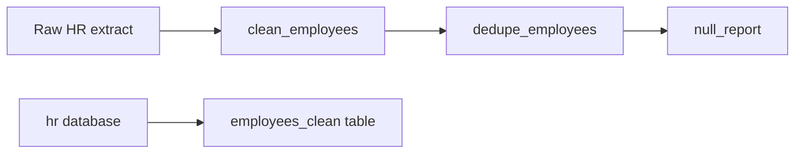

## Business problem

HR exports employee data from three systems. Names come in random case, emails have spaces, salaries arrive as `"$85,000"` and the same person can appear twice. Before anyone builds a report, the data has to be cleaned and its quality measured.

## Learning objectives

- Normalise strings with pandas `.str` methods
- Parse dates and currency safely with `errors='coerce'`
- Deduplicate on a normalised key and keep the latest record
- Produce a null-percentage report
- Express the same cleaning rules in SQL

## Architecture

Raw extracts are cleaned in pandas. Cleaning rules are mirrored in SQL so the warehouse and the scripts agree.



## Technologies

- **pandas** for vectorised cleaning
- **re** for phone normalisation
- **PostgreSQL** string functions: `initcap`, `lower`, `regexp_replace`, `COALESCE`

## Dataset

Python tasks use a small inline CSV. SQL tasks use the **hr** dataset: 200 employees, of which 8 have no email, 49 have no phone and 1 has no department.

## Tasks

Start with the pandas tasks, then port the rules to SQL. Each task runs in its own rolled-back transaction, so create every table the check needs in this task.

```task
{
 "id": "clean-columns",
 "title": "Normalise names, emails, phones, dates and salary",
 "type": "python",
 "instructions": "Write `clean_employees(df)` that returns a new DataFrame:\n\n- `first_name` and `last_name`: stripped and title-cased\n- `email`: stripped and lowercased; values without a `.` after the `@` become `None`/NaN\n- `phone`: digits only; empty becomes NaN\n- `hire_date`: `datetime64`, invalid dates become NaT\n- `salary`: float, `$` and `,` removed",
 "starter": "import io\nimport pandas as pd\nimport numpy as np\nRAW = \"\"\"first_name,last_name,email,phone,hire_date,salary\n  aNNa ,smith , Anna.Smith@Corp.com ,(555) 010-2000,2021-03-01,\\\"$85,000\\\"\nraj,PATEL,raj.patel@corp,555.010.2001,2020-07-15,72000\nAnna,Smith,anna.smith@corp.com,,2023-01-10,\\\"$90,000\\\"\nli,wei,,555-010-2003,not a date,64000\n\"\"\"\ndf = pd.read_csv(io.StringIO(RAW), dtype=str)\n\ndef clean_employees(df):\n    out = df.copy()\n    # TODO\n    return out\n",
 "solution": "import io\nimport pandas as pd\nimport numpy as np\nRAW = \"\"\"first_name,last_name,email,phone,hire_date,salary\n  aNNa ,smith , Anna.Smith@Corp.com ,(555) 010-2000,2021-03-01,\\\"$85,000\\\"\nraj,PATEL,raj.patel@corp,555.010.2001,2020-07-15,72000\nAnna,Smith,anna.smith@corp.com,,2023-01-10,\\\"$90,000\\\"\nli,wei,,555-010-2003,not a date,64000\n\"\"\"\ndf = pd.read_csv(io.StringIO(RAW), dtype=str)\n\ndef clean_employees(df):\n    out = df.copy()\n    for c in ['first_name', 'last_name']:\n        out[c] = out[c].str.strip().str.title()\n    email = out['email'].str.strip().str.lower()\n    out['email'] = email.where(email.str.contains(r'^[^@\\s]+@[^@\\s]+\\.[^@\\s]+$', na=False))\n    phone = out['phone'].str.replace(r'\\D', '', regex=True)\n    out['phone'] = phone.replace('', np.nan)\n    out['hire_date'] = pd.to_datetime(out['hire_date'].str.strip(), format='%Y-%m-%d', errors='coerce')\n    out['salary'] = pd.to_numeric(out['salary'].str.replace(r'[$,]', '', regex=True), errors='coerce').astype(float)\n    return out\n",
 "tests": "c = clean_employees(df)\nassert list(c['first_name']) == ['Anna', 'Raj', 'Anna', 'Li']\nassert c.loc[0, 'email'] == 'anna.smith@corp.com'\nassert pd.isna(c.loc[1, 'email']) and pd.isna(c.loc[3, 'email'])\nassert c.loc[0, 'phone'] == '5550102000' and pd.isna(c.loc[2, 'phone'])\nassert pd.isna(c.loc[3, 'hire_date']) and c.loc[0, 'hire_date'] == pd.Timestamp('2021-03-01')\nassert c['salary'].tolist() == [85000.0, 72000.0, 90000.0, 64000.0]\nassert df.loc[0, 'first_name'] == '  aNNa ', 'do not modify the input'"
}
```

```task
{
 "id": "dedupe-people",
 "title": "Deduplicate people, keep the latest record",
 "type": "python",
 "instructions": "Write `dedupe_employees(df)` for a cleaned DataFrame. Two rows are the same person when lowercased `first_name` + `last_name` match. Keep the row with the latest `hire_date` and return the result sorted by `last_name`, `first_name`, with a fresh index.",
 "starter": "import pandas as pd\n\ndf = pd.DataFrame({'first_name': ['Anna', 'Raj', 'Anna', 'Li'], 'last_name': ['Smith', 'Patel', 'Smith', 'Wei'],\n                   'hire_date': pd.to_datetime(['2021-03-01', '2020-07-15', '2023-01-10', None]), 'salary': [85000.0, 72000.0, 90000.0, 64000.0]})\n\ndef dedupe_employees(df):\n    return df  # TODO\n",
 "solution": "import pandas as pd\n\ndf = pd.DataFrame({'first_name': ['Anna', 'Raj', 'Anna', 'Li'], 'last_name': ['Smith', 'Patel', 'Smith', 'Wei'],\n                   'hire_date': pd.to_datetime(['2021-03-01', '2020-07-15', '2023-01-10', None]), 'salary': [85000.0, 72000.0, 90000.0, 64000.0]})\n\ndef dedupe_employees(df):\n    key = df['first_name'].str.lower() + '|' + df['last_name'].str.lower()\n    out = (df.assign(_key=key)\n             .sort_values('hire_date', na_position='first')\n             .drop_duplicates('_key', keep='last')\n             .drop(columns='_key')\n             .sort_values(['last_name', 'first_name'])\n             .reset_index(drop=True))\n    return out\n",
 "tests": "d = dedupe_employees(df)\nassert len(d) == 3\nassert list(d['last_name']) == ['Patel', 'Smith', 'Wei']\nassert d.loc[1, 'salary'] == 90000.0, 'keep the 2023 Anna Smith row'\nassert list(d.index) == [0, 1, 2]"
}
```

```task
{
 "id": "null-report",
 "title": "Report null percentages",
 "type": "python",
 "instructions": "Write `null_report(df)` returning a dict `{column: percent_null}` where the percentage is rounded to 1 decimal. Include every column, even those with 0.0.",
 "starter": "import pandas as pd\nimport numpy as np\n\ndf = pd.DataFrame({'email': ['a@x.com', None, None], 'phone': ['1', '2', '3'], 'salary': [1.0, np.nan, 3.0]})\n\ndef null_report(df):\n    return {}\n",
 "solution": "import pandas as pd\nimport numpy as np\n\ndf = pd.DataFrame({'email': ['a@x.com', None, None], 'phone': ['1', '2', '3'], 'salary': [1.0, np.nan, 3.0]})\n\ndef null_report(df):\n    return {c: round(float(v), 1) for c, v in (df.isna().mean() * 100).items()}\n",
 "tests": "r = null_report(df)\nassert r == {'email': 66.7, 'phone': 0.0, 'salary': 33.3}, r"
}
```

```task
{
 "id": "sql-employees-clean",
 "title": "Port the cleaning rules to SQL",
 "type": "sql",
 "instructions": "Create `employees_clean` with one row per employee and columns:\n\n- `employee_id`\n- `full_name`: `initcap` of trimmed first and last name joined by a space\n- `email`: lowercased (NULL stays NULL)\n- `phone_digits`: `phone` with every non-digit removed\n- `department_name`: from `departments`, or `'Unassigned'` when the employee has no department\n- `salary`",
 "starter": "CREATE TABLE employees_clean AS\nSELECT employee_id, first_name || ' ' || last_name AS full_name, email, phone AS phone_digits, salary\nFROM employees;  -- TODO: finish the rules",
 "solution": "CREATE TABLE employees_clean AS\nSELECT e.employee_id,\n       initcap(trim(e.first_name) || ' ' || trim(e.last_name)) AS full_name,\n       lower(e.email) AS email,\n       regexp_replace(e.phone, '\\D', '', 'g') AS phone_digits,\n       COALESCE(d.department_name, 'Unassigned') AS department_name,\n       e.salary\nFROM employees e\nLEFT JOIN departments d ON d.department_id = e.department_id;",
 "check": "SELECT (COALESCE(((SELECT COUNT(*) FROM information_schema.columns WHERE table_schema = current_schema() AND table_name = 'employees_clean' AND column_name IN ('employee_id','full_name','email','phone_digits','department_name','salary')) = 6), FALSE) AND COALESCE(((SELECT COUNT(*) FROM employees_clean) = (SELECT COUNT(*) FROM employees)), FALSE) AND COALESCE(((SELECT COUNT(*) FROM employees_clean WHERE department_name = 'Unassigned') = (SELECT COUNT(*) FROM employees WHERE department_id IS NULL)), FALSE) AND COALESCE((NOT EXISTS (SELECT 1 FROM employees_clean WHERE email <> lower(email) OR phone_digits ~ '\\D')), FALSE) AND COALESCE(((SELECT COUNT(*) FROM employees_clean WHERE email IS NULL) = (SELECT COUNT(*) FROM employees WHERE email IS NULL)), FALSE)) AS ok, CASE WHEN NOT COALESCE(((SELECT COUNT(*) FROM information_schema.columns WHERE table_schema = current_schema() AND table_name = 'employees_clean' AND column_name IN ('employee_id','full_name','email','phone_digits','department_name','salary')) = 6), FALSE) THEN 'employees_clean is missing a column' WHEN NOT COALESCE(((SELECT COUNT(*) FROM employees_clean) = (SELECT COUNT(*) FROM employees)), FALSE) THEN 'keep every employee (use a LEFT JOIN)' WHEN NOT COALESCE(((SELECT COUNT(*) FROM employees_clean WHERE department_name = 'Unassigned') = (SELECT COUNT(*) FROM employees WHERE department_id IS NULL)), FALSE) THEN 'employees without a department must be ''Unassigned''' WHEN NOT COALESCE((NOT EXISTS (SELECT 1 FROM employees_clean WHERE email <> lower(email) OR phone_digits ~ '\\D')), FALSE) THEN 'emails must be lowercase and phones digits only' WHEN NOT COALESCE(((SELECT COUNT(*) FROM employees_clean WHERE email IS NULL) = (SELECT COUNT(*) FROM employees WHERE email IS NULL)), FALSE) THEN 'missing emails must stay NULL' ELSE 'employees_clean follows every rule' END AS message"
}
```

```task
{
 "id": "sql-dq-summary",
 "title": "Build a data-quality summary table",
 "type": "sql",
 "instructions": "Create `dq_summary(column_name TEXT, null_count INTEGER, null_pct NUMERIC(5,1))` with one row each for the `employees` columns `email`, `phone`, `department_id` and `manager_id`. `null_pct` is the share of NULLs × 100, rounded to 1 decimal.",
 "starter": "CREATE TABLE dq_summary (column_name TEXT, null_count INTEGER, null_pct NUMERIC(5,1));\n-- TODO: INSERT one row per column\n",
 "solution": "CREATE TABLE dq_summary (column_name TEXT, null_count INTEGER, null_pct NUMERIC(5,1));\nINSERT INTO dq_summary\nSELECT c.column_name, c.n, ROUND(100.0 * c.n / t.total, 1)\nFROM (SELECT COUNT(*) AS total FROM employees) t,\n LATERAL (VALUES\n   ('email', (SELECT COUNT(*) FROM employees WHERE email IS NULL)),\n   ('phone', (SELECT COUNT(*) FROM employees WHERE phone IS NULL)),\n   ('department_id', (SELECT COUNT(*) FROM employees WHERE department_id IS NULL)),\n   ('manager_id', (SELECT COUNT(*) FROM employees WHERE manager_id IS NULL))\n ) AS c(column_name, n);",
 "check": "SELECT (COALESCE(((SELECT COUNT(*) FROM dq_summary) = 4), FALSE) AND COALESCE(((SELECT null_count FROM dq_summary WHERE column_name = 'email') = (SELECT COUNT(*) FROM employees WHERE email IS NULL)), FALSE) AND COALESCE(((SELECT null_count FROM dq_summary WHERE column_name = 'manager_id') = (SELECT COUNT(*) FROM employees WHERE manager_id IS NULL)), FALSE) AND COALESCE(((SELECT null_pct FROM dq_summary WHERE column_name = 'phone') = (SELECT ROUND(100.0 * COUNT(*) FILTER (WHERE phone IS NULL) / COUNT(*), 1) FROM employees)), FALSE)) AS ok, CASE WHEN NOT COALESCE(((SELECT COUNT(*) FROM dq_summary) = 4), FALSE) THEN 'dq_summary needs exactly 4 rows' WHEN NOT COALESCE(((SELECT null_count FROM dq_summary WHERE column_name = 'email') = (SELECT COUNT(*) FROM employees WHERE email IS NULL)), FALSE) THEN 'email null_count is wrong' WHEN NOT COALESCE(((SELECT null_count FROM dq_summary WHERE column_name = 'manager_id') = (SELECT COUNT(*) FROM employees WHERE manager_id IS NULL)), FALSE) THEN 'manager_id null_count is wrong' WHEN NOT COALESCE(((SELECT null_pct FROM dq_summary WHERE column_name = 'phone') = (SELECT ROUND(100.0 * COUNT(*) FILTER (WHERE phone IS NULL) / COUNT(*), 1) FROM employees)), FALSE) THEN 'phone null_pct is wrong' ELSE 'dq_summary is correct' END AS message"
}
```

## Design decisions

Real pipelines are mostly decisions. Pick the option that fits each scenario; every option explains itself once you answer.

```task
{
  "id": "d-missing-values",
  "title": "Missing customer ages",
  "type": "decision",
  "instructions": "15% of customer records have no age. The marketing model uses age; finance reports average order value by age band.",
  "options": [
    "Fill missing ages with the mean age",
    "Drop customers with no age",
    "Keep the age missing and add an 'unknown' age band",
    "Fill with 0"
  ],
  "answer": 2,
  "why": [
    "Invents data and distorts both the age distribution and the age-band report.",
    "Loses 15% of customers and their revenue from every report.",
    "Keeps every customer, stays honest about what is unknown, and lets each consumer decide how to treat it.",
    "0 is a real-looking value: averages and bands become wrong."
  ]
}
```

```task
{
  "id": "d-dedupe-key",
  "title": "Choosing the duplicate key",
  "type": "decision",
  "instructions": "The CRM export has duplicate customers created by repeated sign-ups. Emails differ only in case and spaces; names are often misspelled.",
  "options": [
    "Deduplicate on the full row",
    "Deduplicate on normalised email (trimmed, lower-cased)",
    "Deduplicate on name",
    "Deduplicate on the CRM row id"
  ],
  "answer": 1,
  "why": [
    "Rows that differ in any field (e.g. a timestamp) are never detected as duplicates.",
    "Normalising the stable natural identifier catches the real duplicates without merging different people.",
    "Names are not unique and are often misspelled: merges different people and misses real duplicates.",
    "Each sign-up got a new row id, so duplicates all have different ids."
  ]
}
```

## Expected output

- `clean_employees` returns 4 rows with tidy names, lowercase emails, digit-only phones and numeric salaries
- `dedupe_employees` keeps 3 people (Anna Smith once, with the 2023 record)
- `employees_clean` has 200 rows and 1 `Unassigned` employee
- `dq_summary` reports 8 null emails

## Common mistakes

- Calling `.str.title()` before `.str.strip()`; leading spaces survive.
- Using `astype(float)` on currency strings; it raises instead of coercing.
- Deduplicating before normalising case, so `Anna.Smith@Corp.com` and `anna.smith@corp.com` look different.
- Replacing NULL with an empty string, which hides missing data from quality reports.

## Interview discussion questions

### How do you choose which duplicate to keep?
Define a survivorship rule up front: latest update, most complete record, or most trusted source. Then sort and use `drop_duplicates(keep=...)` or `ROW_NUMBER()`.

### Should cleaning happen in Python or SQL?
Put it where the data lives and where it can be tested. Large tables are cleaned in the warehouse with SQL. Complex parsing or API data often goes through Python first.

### What does `errors='coerce'` trade off?
Bad values become NaN/NaT instead of stopping the job. You must then count those NaNs, or bad data passes silently.

## Summary

You built repeatable cleaning functions, deduplicated with a clear survivorship rule, measured nulls and mirrored the rules in SQL.
