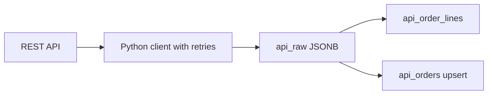

## Business problem

A partner exposes Northwind orders only through a paginated REST API. The API sometimes returns HTTP 503, and each order nests its customer and line items. Analysts need typed tables in PostgreSQL, refreshed daily, and the team wants to keep the raw responses for replay.

## Learning objectives

- Follow pagination until the API says there is no next page
- Retry transient failures with exponential backoff
- Flatten nested JSON with `pandas.json_normalize`
- Land raw payloads in a JSONB table
- Parse JSONB arrays with `jsonb_array_elements` and upsert typed rows

## Architecture

Raw responses are stored before parsing, so parsing can be fixed and replayed without calling the API again.



## Technologies

- **Python**: functions, exceptions, `time.sleep` (injected for tests)
- **pandas** `json_normalize`
- **PostgreSQL** `JSONB`, `->`, `->>`, `jsonb_array_elements`, `ON CONFLICT`

## Dataset

Python tasks use a fake in-memory API. SQL tasks run on **Northwind**: the SQL builds the JSON the API would return from `orders` (100 rows) and `order_details` (250 rows).

## Tasks

First the client, then the database side. Each task runs in its own rolled-back transaction, so create every table the check needs in this task.

```task
{
 "id": "paginate",
 "title": "Follow pagination",
 "type": "python",
 "instructions": "`fake_api(page)` returns `{'data': [...], 'next_page': n or None}`. Write `fetch_all(fetch, start=1, max_pages=100)` that calls `fetch(page)` repeatedly, collects all `data` items in order, and stops when `next_page` is `None`. Raise `RuntimeError` if more than `max_pages` pages are requested.",
 "starter": "PAGES = {1: {'data': [1, 2, 3], 'next_page': 2}, 2: {'data': [4, 5], 'next_page': 3}, 3: {'data': [6, 7], 'next_page': None}}\ncalls = []\n\ndef fake_api(page):\n    calls.append(page)\n    return PAGES[page]\n\ndef fetch_all(fetch, start=1, max_pages=100):\n    return fetch(start)['data']  # TODO\n",
 "solution": "PAGES = {1: {'data': [1, 2, 3], 'next_page': 2}, 2: {'data': [4, 5], 'next_page': 3}, 3: {'data': [6, 7], 'next_page': None}}\ncalls = []\n\ndef fake_api(page):\n    calls.append(page)\n    return PAGES[page]\n\ndef fetch_all(fetch, start=1, max_pages=100):\n    items, page, n = [], start, 0\n    while page is not None:\n        n += 1\n        if n > max_pages:\n            raise RuntimeError('too many pages')\n        resp = fetch(page)\n        items.extend(resp['data'])\n        page = resp['next_page']\n    return items\n",
 "tests": "assert fetch_all(fake_api) == [1, 2, 3, 4, 5, 6, 7]\nassert calls == [1, 2, 3]\nloop = lambda p: {'data': [p], 'next_page': p}\ntry:\n    fetch_all(loop, max_pages=5)\n    assert False, 'should raise'\nexcept RuntimeError:\n    pass"
}
```

```task
{
 "id": "retry-backoff",
 "title": "Retry with exponential backoff",
 "type": "python",
 "instructions": "Write `call_with_retry(fn, retries=3, base_delay=1.0, sleep=time.sleep)`.\n\n- Call `fn()`; return its result on success.\n- On `TransientError`, sleep `base_delay * 2**attempt` (1, 2, 4 …) and try again, up to `retries` retries.\n- Re-raise the last `TransientError` when retries run out.\n- Any other exception propagates immediately without retrying.",
 "starter": "import time\n\nclass TransientError(Exception):\n    pass\n\ndef call_with_retry(fn, retries=3, base_delay=1.0, sleep=time.sleep):\n    return fn()\n",
 "solution": "import time\n\nclass TransientError(Exception):\n    pass\n\ndef call_with_retry(fn, retries=3, base_delay=1.0, sleep=time.sleep):\n    for attempt in range(retries + 1):\n        try:\n            return fn()\n        except TransientError:\n            if attempt == retries:\n                raise\n            sleep(base_delay * 2 ** attempt)\n",
 "tests": "def flaky(fails):\n    state = {'n': 0}\n    def fn():\n        state['n'] += 1\n        if state['n'] <= fails:\n            raise TransientError('503')\n        return 'ok'\n    return fn, state\nslept = []\nfn, st = flaky(2)\nassert call_with_retry(fn, sleep=slept.append) == 'ok'\nassert slept == [1.0, 2.0] and st['n'] == 3\nslept.clear()\nfn, st = flaky(10)\ntry:\n    call_with_retry(fn, retries=3, base_delay=0.5, sleep=slept.append)\n    assert False\nexcept TransientError:\n    pass\nassert slept == [0.5, 1.0, 2.0] and st['n'] == 4\ndef bad():\n    raise ValueError('400')\ntry:\n    call_with_retry(bad, sleep=slept.append)\n    assert False\nexcept ValueError:\n    pass"
}
```

```task
{
 "id": "flatten-json",
 "title": "Flatten nested orders with json_normalize",
 "type": "python",
 "instructions": "Write `flatten(records)` that returns a DataFrame with one row per line item and columns `order_id`, `customer_id`, `country`, `product_id`, `quantity`, `unit_price`, in that order. Use `pd.json_normalize(..., record_path='lines', meta=...)` and rename the nested customer fields.",
 "starter": "import pandas as pd\n\nRECORDS = [\n    {'order_id': 1, 'customer': {'id': 'ALFKI', 'country': 'Germany'}, 'lines': [{'product_id': 11, 'quantity': 2, 'unit_price': 14.0}, {'product_id': 42, 'quantity': 1, 'unit_price': 9.8}]},\n    {'order_id': 2, 'customer': {'id': 'BONAP', 'country': 'France'}, 'lines': [{'product_id': 11, 'quantity': 5, 'unit_price': 14.0}]},\n]\n\ndef flatten(records):\n    return pd.DataFrame(records)\n",
 "solution": "import pandas as pd\n\nRECORDS = [\n    {'order_id': 1, 'customer': {'id': 'ALFKI', 'country': 'Germany'}, 'lines': [{'product_id': 11, 'quantity': 2, 'unit_price': 14.0}, {'product_id': 42, 'quantity': 1, 'unit_price': 9.8}]},\n    {'order_id': 2, 'customer': {'id': 'BONAP', 'country': 'France'}, 'lines': [{'product_id': 11, 'quantity': 5, 'unit_price': 14.0}]},\n]\n\ndef flatten(records):\n    df = pd.json_normalize(records, record_path='lines', meta=['order_id', ['customer', 'id'], ['customer', 'country']])\n    df = df.rename(columns={'customer.id': 'customer_id', 'customer.country': 'country'})\n    return df[['order_id', 'customer_id', 'country', 'product_id', 'quantity', 'unit_price']]\n",
 "tests": "f = flatten(RECORDS)\nassert list(f.columns) == ['order_id', 'customer_id', 'country', 'product_id', 'quantity', 'unit_price']\nassert len(f) == 3\nassert f['quantity'].sum() == 8\nassert list(f['customer_id']) == ['ALFKI', 'ALFKI', 'BONAP']"
}
```

```task
{
 "id": "land-raw-json",
 "title": "Land raw payloads as JSONB",
 "type": "sql",
 "instructions": "Create `api_raw(id SERIAL PRIMARY KEY, payload JSONB NOT NULL, fetched_at TIMESTAMP DEFAULT now())`. Simulate the API by inserting one payload per Northwind order, built with `jsonb_build_object`:\n\n```json\n{\"order_id\": 10248, \"order_date\": \"…\", \"freight\": 32.38,\n \"customer\": {\"id\": \"VINET\", \"country\": \"France\"},\n \"lines\": [{\"product_id\": 11, \"unit_price\": 14, \"quantity\": 12, \"discount\": 0}, …]}\n```\n\n`country` is `ship_country`. `lines` comes from `order_details` via `jsonb_agg`.",
 "starter": "CREATE TABLE api_raw (id SERIAL PRIMARY KEY, payload JSONB NOT NULL, fetched_at TIMESTAMP DEFAULT now());\nINSERT INTO api_raw (payload)\nSELECT jsonb_build_object('order_id', order_id) FROM orders;  -- TODO: customer and lines",
 "solution": "CREATE TABLE api_raw (\n  id SERIAL PRIMARY KEY,\n  payload JSONB NOT NULL,\n  fetched_at TIMESTAMP NOT NULL DEFAULT now()\n);\nINSERT INTO api_raw (payload)\nSELECT jsonb_build_object(\n         'order_id', o.order_id,\n         'order_date', o.order_date,\n         'freight', o.freight,\n         'customer', jsonb_build_object('id', o.customer_id, 'country', o.ship_country),\n         'lines', (SELECT jsonb_agg(jsonb_build_object('product_id', d.product_id, 'unit_price', d.unit_price, 'quantity', d.quantity, 'discount', d.discount) ORDER BY d.product_id)\n                   FROM order_details d WHERE d.order_id = o.order_id))\nFROM orders o ORDER BY o.order_id;",
 "check": "SELECT (COALESCE(((SELECT COUNT(*) FROM api_raw) = (SELECT COUNT(*) FROM orders)), FALSE) AND COALESCE(((SELECT data_type FROM information_schema.columns WHERE table_name = 'api_raw' AND column_name = 'payload') = 'jsonb'), FALSE) AND COALESCE(((SELECT SUM(jsonb_array_length(payload->'lines')) FROM api_raw) = (SELECT COUNT(*) FROM order_details)), FALSE) AND COALESCE((NOT EXISTS (SELECT 1 FROM api_raw WHERE payload->'customer'->>'id' IS NULL OR payload->'customer'->>'country' IS NULL)), FALSE)) AS ok, CASE WHEN NOT COALESCE(((SELECT COUNT(*) FROM api_raw) = (SELECT COUNT(*) FROM orders)), FALSE) THEN 'one payload per order' WHEN NOT COALESCE(((SELECT data_type FROM information_schema.columns WHERE table_name = 'api_raw' AND column_name = 'payload') = 'jsonb'), FALSE) THEN 'payload must be JSONB' WHEN NOT COALESCE(((SELECT SUM(jsonb_array_length(payload->'lines')) FROM api_raw) = (SELECT COUNT(*) FROM order_details)), FALSE) THEN 'lines must contain every order_details row' WHEN NOT COALESCE((NOT EXISTS (SELECT 1 FROM api_raw WHERE payload->'customer'->>'id' IS NULL OR payload->'customer'->>'country' IS NULL)), FALSE) THEN 'each payload needs customer.id and customer.country' ELSE 'Raw payloads landed' END AS message"
}
```

```task
{
 "id": "parse-jsonb",
 "title": "Parse JSONB into a typed table",
 "type": "sql",
 "instructions": "Paste the landing SQL, then create `api_order_lines(order_id INT, customer_id TEXT, product_id INT, unit_price NUMERIC(10,2), quantity INT, discount NUMERIC(4,2))` from `api_raw` using `CROSS JOIN LATERAL jsonb_array_elements(payload->'lines')`.",
 "starter": "CREATE TABLE api_raw (\n  id SERIAL PRIMARY KEY,\n  payload JSONB NOT NULL,\n  fetched_at TIMESTAMP NOT NULL DEFAULT now()\n);\nINSERT INTO api_raw (payload)\nSELECT jsonb_build_object(\n         'order_id', o.order_id,\n         'order_date', o.order_date,\n         'freight', o.freight,\n         'customer', jsonb_build_object('id', o.customer_id, 'country', o.ship_country),\n         'lines', (SELECT jsonb_agg(jsonb_build_object('product_id', d.product_id, 'unit_price', d.unit_price, 'quantity', d.quantity, 'discount', d.discount) ORDER BY d.product_id)\n                   FROM order_details d WHERE d.order_id = o.order_id))\nFROM orders o ORDER BY o.order_id;\n\nCREATE TABLE api_order_lines AS\nSELECT (payload->>'order_id')::int AS order_id, payload->'lines' AS lines FROM api_raw;  -- TODO",
 "solution": "CREATE TABLE api_raw (\n  id SERIAL PRIMARY KEY,\n  payload JSONB NOT NULL,\n  fetched_at TIMESTAMP NOT NULL DEFAULT now()\n);\nINSERT INTO api_raw (payload)\nSELECT jsonb_build_object(\n         'order_id', o.order_id,\n         'order_date', o.order_date,\n         'freight', o.freight,\n         'customer', jsonb_build_object('id', o.customer_id, 'country', o.ship_country),\n         'lines', (SELECT jsonb_agg(jsonb_build_object('product_id', d.product_id, 'unit_price', d.unit_price, 'quantity', d.quantity, 'discount', d.discount) ORDER BY d.product_id)\n                   FROM order_details d WHERE d.order_id = o.order_id))\nFROM orders o ORDER BY o.order_id;\n\nCREATE TABLE api_order_lines AS\nSELECT (r.payload->>'order_id')::int AS order_id,\n       r.payload->'customer'->>'id' AS customer_id,\n       (l->>'product_id')::int AS product_id,\n       (l->>'unit_price')::numeric(10,2) AS unit_price,\n       (l->>'quantity')::int AS quantity,\n       (l->>'discount')::numeric(4,2) AS discount\nFROM api_raw r\nCROSS JOIN LATERAL jsonb_array_elements(r.payload->'lines') AS l;",
 "check": "SELECT (COALESCE(((SELECT COUNT(*) FROM information_schema.columns WHERE table_schema = current_schema() AND table_name = 'api_order_lines' AND column_name IN ('order_id','customer_id','product_id','unit_price','quantity','discount')) = 6), FALSE) AND COALESCE(((SELECT data_type FROM information_schema.columns WHERE table_name = 'api_order_lines' AND column_name = 'quantity') = 'integer'), FALSE) AND COALESCE(((SELECT COUNT(*) FROM api_order_lines) = (SELECT COUNT(*) FROM order_details)), FALSE) AND COALESCE(((SELECT SUM(quantity) FROM api_order_lines) = (SELECT SUM(quantity) FROM order_details) AND (SELECT SUM(unit_price * quantity) FROM api_order_lines) = (SELECT SUM(unit_price * quantity) FROM order_details)), FALSE)) AS ok, CASE WHEN NOT COALESCE(((SELECT COUNT(*) FROM information_schema.columns WHERE table_schema = current_schema() AND table_name = 'api_order_lines' AND column_name IN ('order_id','customer_id','product_id','unit_price','quantity','discount')) = 6), FALSE) THEN 'api_order_lines is missing a column' WHEN NOT COALESCE(((SELECT data_type FROM information_schema.columns WHERE table_name = 'api_order_lines' AND column_name = 'quantity') = 'integer'), FALSE) THEN 'quantity must be an integer, not JSON' WHEN NOT COALESCE(((SELECT COUNT(*) FROM api_order_lines) = (SELECT COUNT(*) FROM order_details)), FALSE) THEN 'one row per line item' WHEN NOT COALESCE(((SELECT SUM(quantity) FROM api_order_lines) = (SELECT SUM(quantity) FROM order_details) AND (SELECT SUM(unit_price * quantity) FROM api_order_lines) = (SELECT SUM(unit_price * quantity) FROM order_details)), FALSE) THEN 'quantities or prices do not match the source' ELSE 'JSONB parsed into typed rows' END AS message"
}
```

```task
{
 "id": "upsert-orders",
 "title": "Upsert orders from a second API pull",
 "type": "sql",
 "instructions": "Paste the landing SQL. Create `api_orders(order_id INT PRIMARY KEY, customer_id TEXT, freight NUMERIC(10,2), updated_at TIMESTAMP)` and load it from `api_raw`.\n\nThe next day's pull changes the freight of the first 10 orders:\n\n```sql\nINSERT INTO api_raw (payload)\nSELECT jsonb_set(payload, '{freight}', to_jsonb((payload->>'freight')::numeric + 1))\nFROM api_raw WHERE (payload->>'order_id')::int IN (SELECT order_id FROM orders ORDER BY order_id LIMIT 10);\n```\n\nRun that, then upsert **only the newest payload per order** into `api_orders` with `ON CONFLICT (order_id) DO UPDATE`.",
 "starter": "CREATE TABLE api_raw (\n  id SERIAL PRIMARY KEY,\n  payload JSONB NOT NULL,\n  fetched_at TIMESTAMP NOT NULL DEFAULT now()\n);\nINSERT INTO api_raw (payload)\nSELECT jsonb_build_object(\n         'order_id', o.order_id,\n         'order_date', o.order_date,\n         'freight', o.freight,\n         'customer', jsonb_build_object('id', o.customer_id, 'country', o.ship_country),\n         'lines', (SELECT jsonb_agg(jsonb_build_object('product_id', d.product_id, 'unit_price', d.unit_price, 'quantity', d.quantity, 'discount', d.discount) ORDER BY d.product_id)\n                   FROM order_details d WHERE d.order_id = o.order_id))\nFROM orders o ORDER BY o.order_id;\n\nCREATE TABLE api_orders (order_id INT PRIMARY KEY, customer_id TEXT, freight NUMERIC(10,2), updated_at TIMESTAMP);\nINSERT INTO api_orders SELECT (payload->>'order_id')::int, payload->'customer'->>'id', (payload->>'freight')::numeric, now() FROM api_raw;\nINSERT INTO api_raw (payload)\nSELECT jsonb_set(payload, '{freight}', to_jsonb((payload->>'freight')::numeric + 1))\nFROM api_raw WHERE (payload->>'order_id')::int IN (SELECT order_id FROM orders ORDER BY order_id LIMIT 10);\n-- TODO: upsert the newest payloads\nINSERT INTO api_orders SELECT (payload->>'order_id')::int, payload->'customer'->>'id', (payload->>'freight')::numeric, now() FROM api_raw\nON CONFLICT DO NOTHING;",
 "solution": "CREATE TABLE api_raw (\n  id SERIAL PRIMARY KEY,\n  payload JSONB NOT NULL,\n  fetched_at TIMESTAMP NOT NULL DEFAULT now()\n);\nINSERT INTO api_raw (payload)\nSELECT jsonb_build_object(\n         'order_id', o.order_id,\n         'order_date', o.order_date,\n         'freight', o.freight,\n         'customer', jsonb_build_object('id', o.customer_id, 'country', o.ship_country),\n         'lines', (SELECT jsonb_agg(jsonb_build_object('product_id', d.product_id, 'unit_price', d.unit_price, 'quantity', d.quantity, 'discount', d.discount) ORDER BY d.product_id)\n                   FROM order_details d WHERE d.order_id = o.order_id))\nFROM orders o ORDER BY o.order_id;\n\nCREATE TABLE api_orders (order_id INT PRIMARY KEY, customer_id TEXT, freight NUMERIC(10,2), updated_at TIMESTAMP);\nINSERT INTO api_orders SELECT (payload->>'order_id')::int, payload->'customer'->>'id', (payload->>'freight')::numeric, now() FROM api_raw;\nINSERT INTO api_raw (payload)\nSELECT jsonb_set(payload, '{freight}', to_jsonb((payload->>'freight')::numeric + 1))\nFROM api_raw WHERE (payload->>'order_id')::int IN (SELECT order_id FROM orders ORDER BY order_id LIMIT 10);\nINSERT INTO api_orders (order_id, customer_id, freight, updated_at)\nSELECT DISTINCT ON ((payload->>'order_id')::int)\n       (payload->>'order_id')::int, payload->'customer'->>'id', (payload->>'freight')::numeric, now()\nFROM api_raw\nORDER BY (payload->>'order_id')::int, id DESC\nON CONFLICT (order_id) DO UPDATE\nSET freight = EXCLUDED.freight, customer_id = EXCLUDED.customer_id, updated_at = EXCLUDED.updated_at\nWHERE api_orders.freight IS DISTINCT FROM EXCLUDED.freight;",
 "check": "SELECT (COALESCE(((SELECT COUNT(*) FROM api_orders) = (SELECT COUNT(*) FROM orders)), FALSE) AND COALESCE(((SELECT COUNT(*) FROM api_orders a JOIN orders o USING (order_id) WHERE a.freight = o.freight + 1) = 10), FALSE) AND COALESCE(((SELECT COUNT(*) FROM api_orders a JOIN orders o USING (order_id) WHERE a.freight = o.freight) = (SELECT COUNT(*) - 10 FROM orders)), FALSE)) AS ok, CASE WHEN NOT COALESCE(((SELECT COUNT(*) FROM api_orders) = (SELECT COUNT(*) FROM orders)), FALSE) THEN 'one row per order' WHEN NOT COALESCE(((SELECT COUNT(*) FROM api_orders a JOIN orders o USING (order_id) WHERE a.freight = o.freight + 1) = 10), FALSE) THEN 'the 10 changed orders must have the new freight' WHEN NOT COALESCE(((SELECT COUNT(*) FROM api_orders a JOIN orders o USING (order_id) WHERE a.freight = o.freight) = (SELECT COUNT(*) - 10 FROM orders)), FALSE) THEN 'unchanged orders must keep their freight' ELSE 'Upsert keeps the newest payload' END AS message"
}
```

```task
{
 "id": "real-api",
 "title": "Point the client at a real API",
 "type": "checklist",
 "instructions": "Run the pipeline end to end outside the browser.",
 "items": [
  "`pip install requests psycopg[binary]` in a virtual environment",
  "Replace `fake_api` with `requests.get(url, params={'page': n}, timeout=10)` and raise `TransientError` on timeouts, 429 and 5xx",
  "Read the API token from an environment variable, never from code",
  "Insert each raw page into `api_raw` before parsing",
  "Run the parse and upsert SQL in the same transaction",
  "Schedule it daily and alert when retries are exhausted"
 ]
}
```

## Design decisions

Real pipelines are mostly decisions. Pick the option that fits each scenario; every option explains itself once you answer.

```task
{
  "id": "d-pagination",
  "title": "Paginating a changing API",
  "type": "decision",
  "instructions": "The API returns customers 100 per page. New customers are inserted while you page through.",
  "options": [
    "Use page numbers (?page=1,2,3)",
    "Use the API's cursor (next token) or keyset (updated_after + id)",
    "Request one huge page",
    "Page until an error"
  ],
  "answer": 1,
  "why": [
    "Inserts shift offsets, so rows are skipped or repeated between pages.",
    "A cursor or keyset position is stable under concurrent inserts, so every row is read exactly once.",
    "Usually capped by the API and times out.",
    "Errors are not a reliable end-of-data signal and hide real failures."
  ]
}
```

```task
{
  "id": "d-rate-limit",
  "title": "HTTP 429 Too Many Requests",
  "type": "decision",
  "instructions": "During the nightly sync the API starts returning 429 after ~300 calls.",
  "options": [
    "Retry immediately in a loop",
    "Respect Retry-After, back off exponentially with jitter, and cap the attempts",
    "Abort the whole sync",
    "Run more parallel workers to finish faster"
  ],
  "answer": 1,
  "why": [
    "Hammers the API and extends the throttling.",
    "Backing off is what the API asks for; jitter avoids synchronised retries and a cap stops endless loops.",
    "One throttled call loses the whole night's data.",
    "More requests make the throttling worse."
  ]
}
```

## Expected output

- `fetch_all` returns 7 records from 3 pages
- `api_raw` holds 100 payloads
- `api_order_lines` holds 250 lines with total quantity 5080
- After the second API pull, `api_orders` still has 100 rows and 10 updated freights

## Common mistakes

- Retrying on every exception, including 4xx client errors that will never succeed.
- Sleeping a fixed time between retries; many clients then retry in lockstep.
- Parsing JSON in the extract step and throwing away the raw response.
- Casting `->` (JSONB) instead of `->>` (text) to a number.

## Interview discussion questions

### Why store raw API responses?
They let you replay parsing after a bug fix or schema change without hitting rate limits, and they are an audit trail of what the source actually sent.

### How do you paginate safely?
Prefer cursor or `next` links over page numbers, cap the number of pages, and checkpoint the cursor so a crash can resume.

### Which errors should be retried?
Timeouts, connection errors, 429 and 5xx. Use exponential backoff with jitter and honour `Retry-After`. Do not retry 400, 401 or 404.

## Summary

You wrote a resilient API client, kept raw JSON, and turned it into typed, idempotently upserted tables.
