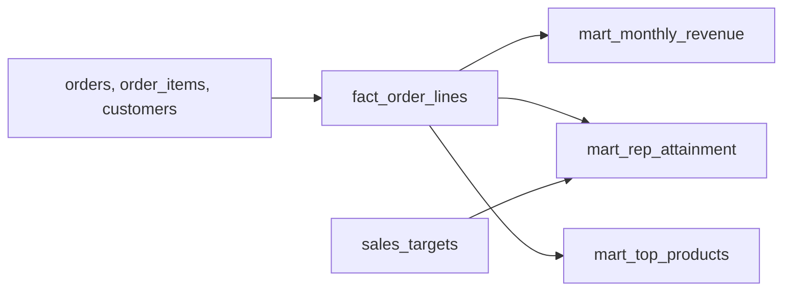

## Business problem

Sales leadership reviews revenue every Monday. They need monthly revenue, each rep's attainment against quota, and the best-selling products in every region. Cancelled orders must not count, and finance only recognises shipped or delivered revenue.

## Learning objectives

- Build a line-level fact with gross, discount and net amounts
- Aggregate to a monthly time series with `date_trunc`
- Join actuals to targets without losing reps who sold nothing
- Rank products per region with `ROW_NUMBER`
- Compute month-over-month growth in pandas

## Architecture

One fact table feeds several small marts.



## Technologies

- **PostgreSQL 16**: `date_trunc`, `FILTER`, window functions
- **pandas**: `groupby`, `pivot_table`, `pct_change`

## Dataset

The **sales** dataset: 623 orders from 2024-01-03 to 2025-12-31, 1579 order lines, 25 reps in 5 regions and 184 quarterly targets. Statuses are pending, shipped, delivered, cancelled and returned.

## Tasks

Build the fact first, then the marts. Each task runs in its own rolled-back transaction, so create every table the check needs in this task.

```task
{
 "id": "fact-order-lines",
 "title": "Build fact_order_lines",
 "type": "sql",
 "instructions": "Create `fact_order_lines` with one row per order line of every **non-cancelled** order and columns `order_id, product_id, order_date, customer_id, rep_id, region_id, status, quantity, gross_amount, discount_amount, net_amount`.\n\n- `region_id` is the customer's region.\n- `gross_amount` = quantity × unit_price.\n- `discount_amount` and `net_amount` are rounded to 2 decimals.",
 "starter": "CREATE TABLE fact_order_lines AS\nSELECT oi.order_id, oi.product_id, oi.quantity, oi.quantity * oi.unit_price AS net_amount\nFROM order_items oi;  -- TODO",
 "solution": "CREATE TABLE fact_order_lines AS\nSELECT oi.order_id, oi.product_id, o.order_date, o.customer_id, o.rep_id, c.region_id, o.status,\n       oi.quantity,\n       oi.quantity * oi.unit_price AS gross_amount,\n       ROUND(oi.quantity * oi.unit_price * oi.discount, 2) AS discount_amount,\n       ROUND(oi.quantity * oi.unit_price * (1 - oi.discount), 2) AS net_amount\nFROM order_items oi\nJOIN orders o ON o.order_id = oi.order_id\nJOIN customers c ON c.customer_id = o.customer_id\nWHERE o.status <> 'cancelled';",
 "check": "SELECT (COALESCE(((SELECT COUNT(*) FROM information_schema.columns WHERE table_schema = current_schema() AND table_name = 'fact_order_lines' AND column_name IN ('order_id','product_id','order_date','customer_id','rep_id','region_id','status','quantity','gross_amount','discount_amount','net_amount')) = 11), FALSE) AND COALESCE(((SELECT COUNT(*) FROM fact_order_lines) = (SELECT COUNT(*) FROM order_items oi JOIN orders o USING (order_id) WHERE o.status <> 'cancelled')), FALSE) AND COALESCE(((SELECT SUM(net_amount) FROM fact_order_lines) = (SELECT SUM(ROUND(oi.quantity*oi.unit_price*(1-oi.discount),2)) FROM order_items oi JOIN orders o USING (order_id) WHERE o.status <> 'cancelled')), FALSE) AND COALESCE((NOT EXISTS (SELECT 1 FROM fact_order_lines WHERE region_id IS NULL OR gross_amount - discount_amount - net_amount NOT BETWEEN -0.01 AND 0.01)), FALSE)) AS ok, CASE WHEN NOT COALESCE(((SELECT COUNT(*) FROM information_schema.columns WHERE table_schema = current_schema() AND table_name = 'fact_order_lines' AND column_name IN ('order_id','product_id','order_date','customer_id','rep_id','region_id','status','quantity','gross_amount','discount_amount','net_amount')) = 11), FALSE) THEN 'fact_order_lines is missing a column' WHEN NOT COALESCE(((SELECT COUNT(*) FROM fact_order_lines) = (SELECT COUNT(*) FROM order_items oi JOIN orders o USING (order_id) WHERE o.status <> 'cancelled')), FALSE) THEN 'include every line of non-cancelled orders only' WHEN NOT COALESCE(((SELECT SUM(net_amount) FROM fact_order_lines) = (SELECT SUM(ROUND(oi.quantity*oi.unit_price*(1-oi.discount),2)) FROM order_items oi JOIN orders o USING (order_id) WHERE o.status <> 'cancelled')), FALSE) THEN 'net_amount totals do not match' WHEN NOT COALESCE((NOT EXISTS (SELECT 1 FROM fact_order_lines WHERE region_id IS NULL OR gross_amount - discount_amount - net_amount NOT BETWEEN -0.01 AND 0.01)), FALSE) THEN 'region_id must be set and gross - discount must equal net' ELSE 'fact_order_lines is correct' END AS message"
}
```

```task
{
 "id": "monthly-revenue",
 "title": "Monthly recognised revenue",
 "type": "sql",
 "instructions": "Include the fact build, then create `mart_monthly_revenue(month DATE, orders INTEGER, net_revenue NUMERIC)`. Count only `shipped` and `delivered` orders. `month` is the first day of the month.",
 "starter": "CREATE TABLE fact_order_lines AS\nSELECT oi.order_id, oi.product_id, o.order_date, o.customer_id, o.rep_id, c.region_id, o.status,\n       oi.quantity,\n       oi.quantity * oi.unit_price AS gross_amount,\n       ROUND(oi.quantity * oi.unit_price * oi.discount, 2) AS discount_amount,\n       ROUND(oi.quantity * oi.unit_price * (1 - oi.discount), 2) AS net_amount\nFROM order_items oi\nJOIN orders o ON o.order_id = oi.order_id\nJOIN customers c ON c.customer_id = o.customer_id\nWHERE o.status <> 'cancelled';\n\nCREATE TABLE mart_monthly_revenue AS\nSELECT order_date AS month, COUNT(*) AS orders, SUM(net_amount) AS net_revenue\nFROM fact_order_lines GROUP BY order_date;  -- TODO",
 "solution": "CREATE TABLE fact_order_lines AS\nSELECT oi.order_id, oi.product_id, o.order_date, o.customer_id, o.rep_id, c.region_id, o.status,\n       oi.quantity,\n       oi.quantity * oi.unit_price AS gross_amount,\n       ROUND(oi.quantity * oi.unit_price * oi.discount, 2) AS discount_amount,\n       ROUND(oi.quantity * oi.unit_price * (1 - oi.discount), 2) AS net_amount\nFROM order_items oi\nJOIN orders o ON o.order_id = oi.order_id\nJOIN customers c ON c.customer_id = o.customer_id\nWHERE o.status <> 'cancelled';\n\nCREATE TABLE mart_monthly_revenue AS\nSELECT date_trunc('month', order_date)::date AS month,\n       COUNT(DISTINCT order_id)::int AS orders,\n       SUM(net_amount) AS net_revenue\nFROM fact_order_lines\nWHERE status IN ('shipped', 'delivered')\nGROUP BY 1;",
 "check": "SELECT (COALESCE(((SELECT COUNT(*) FROM mart_monthly_revenue) = (SELECT COUNT(DISTINCT date_trunc('month', order_date)) FROM orders WHERE status IN ('shipped','delivered'))), FALSE) AND COALESCE((NOT EXISTS (SELECT 1 FROM mart_monthly_revenue WHERE EXTRACT(day FROM month) <> 1)), FALSE) AND COALESCE(((SELECT SUM(net_revenue) FROM mart_monthly_revenue) = (SELECT SUM(ROUND(oi.quantity*oi.unit_price*(1-oi.discount),2)) FROM order_items oi JOIN orders o USING (order_id) WHERE o.status IN ('shipped','delivered'))), FALSE) AND COALESCE(((SELECT SUM(orders) FROM mart_monthly_revenue) = (SELECT COUNT(*) FROM orders o WHERE status IN ('shipped','delivered') AND EXISTS (SELECT 1 FROM order_items i WHERE i.order_id = o.order_id))), FALSE)) AS ok, CASE WHEN NOT COALESCE(((SELECT COUNT(*) FROM mart_monthly_revenue) = (SELECT COUNT(DISTINCT date_trunc('month', order_date)) FROM orders WHERE status IN ('shipped','delivered'))), FALSE) THEN 'one row per month' WHEN NOT COALESCE((NOT EXISTS (SELECT 1 FROM mart_monthly_revenue WHERE EXTRACT(day FROM month) <> 1)), FALSE) THEN 'month must be the first day of the month' WHEN NOT COALESCE(((SELECT SUM(net_revenue) FROM mart_monthly_revenue) = (SELECT SUM(ROUND(oi.quantity*oi.unit_price*(1-oi.discount),2)) FROM order_items oi JOIN orders o USING (order_id) WHERE o.status IN ('shipped','delivered'))), FALSE) THEN 'net_revenue should count shipped and delivered orders only' WHEN NOT COALESCE(((SELECT SUM(orders) FROM mart_monthly_revenue) = (SELECT COUNT(*) FROM orders o WHERE status IN ('shipped','delivered') AND EXISTS (SELECT 1 FROM order_items i WHERE i.order_id = o.order_id))), FALSE) THEN 'orders must count distinct orders' ELSE 'mart_monthly_revenue is correct' END AS message"
}
```

```task
{
 "id": "rep-attainment",
 "title": "Quota attainment per rep and quarter",
 "type": "sql",
 "instructions": "Include the fact build, then create `mart_rep_attainment(rep_id, year, quarter, target_amount, actual_amount, attainment_pct)` with **one row per `sales_targets` row**.\n\n- `actual_amount` = net revenue of the rep's shipped/delivered orders in that quarter, 0 when none.\n- `attainment_pct` = actual / target × 100, rounded to 1 decimal.",
 "starter": "CREATE TABLE fact_order_lines AS\nSELECT oi.order_id, oi.product_id, o.order_date, o.customer_id, o.rep_id, c.region_id, o.status,\n       oi.quantity,\n       oi.quantity * oi.unit_price AS gross_amount,\n       ROUND(oi.quantity * oi.unit_price * oi.discount, 2) AS discount_amount,\n       ROUND(oi.quantity * oi.unit_price * (1 - oi.discount), 2) AS net_amount\nFROM order_items oi\nJOIN orders o ON o.order_id = oi.order_id\nJOIN customers c ON c.customer_id = o.customer_id\nWHERE o.status <> 'cancelled';\n\nCREATE TABLE mart_rep_attainment AS\nSELECT t.rep_id, t.year, t.quarter, t.target_amount, SUM(f.net_amount) AS actual_amount\nFROM sales_targets t\nJOIN fact_order_lines f ON f.rep_id = t.rep_id\nGROUP BY 1, 2, 3, 4;  -- TODO",
 "solution": "CREATE TABLE fact_order_lines AS\nSELECT oi.order_id, oi.product_id, o.order_date, o.customer_id, o.rep_id, c.region_id, o.status,\n       oi.quantity,\n       oi.quantity * oi.unit_price AS gross_amount,\n       ROUND(oi.quantity * oi.unit_price * oi.discount, 2) AS discount_amount,\n       ROUND(oi.quantity * oi.unit_price * (1 - oi.discount), 2) AS net_amount\nFROM order_items oi\nJOIN orders o ON o.order_id = oi.order_id\nJOIN customers c ON c.customer_id = o.customer_id\nWHERE o.status <> 'cancelled';\n\nCREATE TABLE mart_rep_attainment AS\nWITH actuals AS (\n  SELECT rep_id, EXTRACT(year FROM order_date)::int AS year, EXTRACT(quarter FROM order_date)::int AS quarter,\n         SUM(net_amount) AS actual_amount\n  FROM fact_order_lines\n  WHERE status IN ('shipped', 'delivered') AND rep_id IS NOT NULL\n  GROUP BY 1, 2, 3\n)\nSELECT t.rep_id, t.year, t.quarter, t.target_amount,\n       COALESCE(a.actual_amount, 0) AS actual_amount,\n       ROUND(100 * COALESCE(a.actual_amount, 0) / t.target_amount, 1) AS attainment_pct\nFROM sales_targets t\nLEFT JOIN actuals a ON a.rep_id = t.rep_id AND a.year = t.year AND a.quarter = t.quarter;",
 "check": "SELECT (COALESCE(((SELECT COUNT(*) FROM mart_rep_attainment) = (SELECT COUNT(*) FROM sales_targets)), FALSE) AND COALESCE((NOT EXISTS (SELECT 1 FROM mart_rep_attainment WHERE actual_amount IS NULL OR attainment_pct IS NULL)), FALSE) AND COALESCE(((SELECT SUM(actual_amount) FROM mart_rep_attainment) = (SELECT SUM(ROUND(oi.quantity*oi.unit_price*(1-oi.discount),2)) FROM order_items oi JOIN orders o USING (order_id) JOIN sales_targets t ON t.rep_id = o.rep_id AND t.year = EXTRACT(year FROM o.order_date) AND t.quarter = EXTRACT(quarter FROM o.order_date) WHERE o.status IN ('shipped','delivered'))), FALSE)) AS ok, CASE WHEN NOT COALESCE(((SELECT COUNT(*) FROM mart_rep_attainment) = (SELECT COUNT(*) FROM sales_targets)), FALSE) THEN 'one row per sales_targets row (use a LEFT JOIN)' WHEN NOT COALESCE((NOT EXISTS (SELECT 1 FROM mart_rep_attainment WHERE actual_amount IS NULL OR attainment_pct IS NULL)), FALSE) THEN 'use 0 when a rep sold nothing' WHEN NOT COALESCE(((SELECT SUM(actual_amount) FROM mart_rep_attainment) = (SELECT SUM(ROUND(oi.quantity*oi.unit_price*(1-oi.discount),2)) FROM order_items oi JOIN orders o USING (order_id) JOIN sales_targets t ON t.rep_id = o.rep_id AND t.year = EXTRACT(year FROM o.order_date) AND t.quarter = EXTRACT(quarter FROM o.order_date) WHERE o.status IN ('shipped','delivered'))), FALSE) THEN 'actual_amount must be per rep and calendar quarter' ELSE 'mart_rep_attainment is correct' END AS message"
}
```

```task
{
 "id": "top-products-region",
 "title": "Top 3 products per region",
 "type": "sql",
 "instructions": "Include the fact build, then create `mart_top_products(region_name, product_name, rnk, revenue)`: the 3 products with the highest net revenue (shipped/delivered) in each region. Break ties by `product_id`. `rnk` is 1, 2, 3.",
 "starter": "CREATE TABLE fact_order_lines AS\nSELECT oi.order_id, oi.product_id, o.order_date, o.customer_id, o.rep_id, c.region_id, o.status,\n       oi.quantity,\n       oi.quantity * oi.unit_price AS gross_amount,\n       ROUND(oi.quantity * oi.unit_price * oi.discount, 2) AS discount_amount,\n       ROUND(oi.quantity * oi.unit_price * (1 - oi.discount), 2) AS net_amount\nFROM order_items oi\nJOIN orders o ON o.order_id = oi.order_id\nJOIN customers c ON c.customer_id = o.customer_id\nWHERE o.status <> 'cancelled';\n\nCREATE TABLE mart_top_products AS\nSELECT r.region_name, p.product_name, 1 AS rnk, SUM(f.net_amount) AS revenue\nFROM fact_order_lines f JOIN regions r USING (region_id) JOIN products p USING (product_id)\nGROUP BY 1, 2;  -- TODO",
 "solution": "CREATE TABLE fact_order_lines AS\nSELECT oi.order_id, oi.product_id, o.order_date, o.customer_id, o.rep_id, c.region_id, o.status,\n       oi.quantity,\n       oi.quantity * oi.unit_price AS gross_amount,\n       ROUND(oi.quantity * oi.unit_price * oi.discount, 2) AS discount_amount,\n       ROUND(oi.quantity * oi.unit_price * (1 - oi.discount), 2) AS net_amount\nFROM order_items oi\nJOIN orders o ON o.order_id = oi.order_id\nJOIN customers c ON c.customer_id = o.customer_id\nWHERE o.status <> 'cancelled';\n\nCREATE TABLE mart_top_products AS\nSELECT region_name, product_name, rnk, revenue\nFROM (\n  SELECT r.region_name, p.product_name, SUM(f.net_amount) AS revenue,\n         ROW_NUMBER() OVER (PARTITION BY r.region_id ORDER BY SUM(f.net_amount) DESC, p.product_id) AS rnk\n  FROM fact_order_lines f\n  JOIN regions r ON r.region_id = f.region_id\n  JOIN products p ON p.product_id = f.product_id\n  WHERE f.status IN ('shipped', 'delivered')\n  GROUP BY r.region_id, r.region_name, p.product_id, p.product_name\n) x\nWHERE rnk <= 3;",
 "check": "SELECT (COALESCE(((SELECT COUNT(*) FROM mart_top_products) = 3 * (SELECT COUNT(*) FROM regions)), FALSE) AND COALESCE(((SELECT COUNT(DISTINCT (region_name, rnk)) FROM mart_top_products) = (SELECT COUNT(*) FROM mart_top_products)), FALSE) AND COALESCE(((SELECT SUM(revenue) FROM mart_top_products WHERE rnk = 1) = (SELECT SUM(m) FROM (SELECT MAX(rev) m FROM (SELECT c.region_id, oi.product_id, SUM(ROUND(oi.quantity*oi.unit_price*(1-oi.discount),2)) rev FROM order_items oi JOIN orders o USING (order_id) JOIN customers c USING (customer_id) WHERE o.status IN ('shipped','delivered') GROUP BY 1, 2) a GROUP BY region_id) b)), FALSE)) AS ok, CASE WHEN NOT COALESCE(((SELECT COUNT(*) FROM mart_top_products) = 3 * (SELECT COUNT(*) FROM regions)), FALSE) THEN 'exactly 3 rows per region' WHEN NOT COALESCE(((SELECT COUNT(DISTINCT (region_name, rnk)) FROM mart_top_products) = (SELECT COUNT(*) FROM mart_top_products)), FALSE) THEN 'rnk must be 1, 2, 3 within each region' WHEN NOT COALESCE(((SELECT SUM(revenue) FROM mart_top_products WHERE rnk = 1) = (SELECT SUM(m) FROM (SELECT MAX(rev) m FROM (SELECT c.region_id, oi.product_id, SUM(ROUND(oi.quantity*oi.unit_price*(1-oi.discount),2)) rev FROM order_items oi JOIN orders o USING (order_id) JOIN customers c USING (customer_id) WHERE o.status IN ('shipped','delivered') GROUP BY 1, 2) a GROUP BY region_id) b)), FALSE) THEN 'rank 1 must be the highest-revenue product in each region' ELSE 'mart_top_products is correct' END AS message"
}
```

```task
{
 "id": "mom-growth",
 "title": "Month-over-month growth by region in pandas",
 "type": "python",
 "instructions": "Write `mom_growth(df)` for a DataFrame with `order_date`, `region` and `net_amount`. Return a DataFrame indexed by month (`Period[M]`), one column per region, holding the percentage change from the previous month rounded to 1 decimal. The first month is NaN.",
 "starter": "import io\nimport pandas as pd\n\nCSV = \"\"\"order_date,region,net_amount\n2025-01-05,East,100\n2025-01-20,West,200\n2025-02-03,East,150\n2025-02-10,West,100\n2025-03-01,East,75\n2025-03-15,West,300\n\"\"\"\ndf = pd.read_csv(io.StringIO(CSV), parse_dates=['order_date'])\n\ndef mom_growth(df):\n    return df  # TODO\n",
 "solution": "import io\nimport pandas as pd\n\nCSV = \"\"\"order_date,region,net_amount\n2025-01-05,East,100\n2025-01-20,West,200\n2025-02-03,East,150\n2025-02-10,West,100\n2025-03-01,East,75\n2025-03-15,West,300\n\"\"\"\ndf = pd.read_csv(io.StringIO(CSV), parse_dates=['order_date'])\n\ndef mom_growth(df):\n    monthly = df.assign(month=df['order_date'].dt.to_period('M')).pivot_table(index='month', columns='region', values='net_amount', aggfunc='sum')\n    return (monthly.pct_change() * 100).round(1)\n",
 "tests": "g = mom_growth(df)\nassert list(g.columns) == ['East', 'West']\nassert str(g.index[1]) == '2025-02'\nassert pd.isna(g.iloc[0, 0])\nassert g.loc[pd.Period('2025-02', 'M'), 'East'] == 50.0\nassert g.loc[pd.Period('2025-02', 'M'), 'West'] == -50.0\nassert g.loc[pd.Period('2025-03', 'M'), 'West'] == 200.0"
}
```

```task
{
 "id": "schedule-report",
 "title": "Schedule the pipeline",
 "type": "checklist",
 "instructions": "Run the marts on a schedule outside the browser.",
 "items": [
  "Save the four SQL tasks as files under `sql/` in dependency order",
  "Write a shell or Python runner that executes them in one transaction with `psql -v ON_ERROR_STOP=1`",
  "Schedule it with cron every Monday at 06:00",
  "Point a BI tool (Metabase, Superset) at the marts and build a monthly revenue chart"
 ]
}
```

## Design decisions

Real pipelines are mostly decisions. Pick the option that fits each scenario; every option explains itself once you answer.

```task
{
  "id": "d-grain",
  "title": "Choosing the fact grain",
  "type": "decision",
  "instructions": "Analysts want revenue by product, by store and by day, and sometimes per order line.",
  "options": [
    "One row per order",
    "One row per order line (product × order)",
    "One row per day per store",
    "One row per month"
  ],
  "answer": 1,
  "why": [
    "Products can't be analysed: an order has many products.",
    "The lowest grain answers every question; daily and monthly views are aggregations of it.",
    "Loses product and order detail forever.",
    "Far too coarse for the daily questions."
  ]
}
```

```task
{
  "id": "d-currency",
  "title": "Multi-currency revenue",
  "type": "decision",
  "instructions": "Stores sell in EUR, GBP and USD. Finance reports in EUR using the rate of the order date.",
  "options": [
    "Convert with today's rate in the report",
    "Store the original amount and currency, plus the EUR amount converted at the order-date rate",
    "Store only EUR",
    "Ignore currencies and sum the numbers"
  ],
  "answer": 1,
  "why": [
    "Historical revenue changes every day as rates move.",
    "Keeps the source truth and a stable reporting value; reconversion stays possible if rates are corrected.",
    "Loses the original amounts needed for audits and local reports.",
    "Adds euros to pounds: the totals are meaningless."
  ]
}
```

## Expected output

- `fact_order_lines`: 1471 lines
- `mart_monthly_revenue`: 24 months, total 11494315.41
- `mart_rep_attainment`: 184 rows, one per target
- `mart_top_products`: 3 products for each of the 5 regions

## Common mistakes

- Summing `unit_price * quantity` and forgetting the discount.
- Inner-joining targets to actuals, which hides reps with zero sales.
- Using `RANK` when ties should not create a 4th row in a top-3 list.
- Grouping by `order_date` instead of the truncated month.

## Interview discussion questions

### Why build a line-level fact first?
The lowest grain can answer every later question. Product, customer and time rollups all come from the same rows, so the numbers agree.

### How do you handle returned orders?
Agree on a revenue-recognition rule with finance. Here returned and cancelled orders are excluded from recognised revenue but kept in the fact with their status.

### ROW_NUMBER, RANK or DENSE_RANK for a top-N?
`ROW_NUMBER` gives exactly N rows. `RANK` and `DENSE_RANK` keep ties, which can return more than N.

## Summary

You turned raw orders into a reusable fact table and three marts that answer the weekly sales questions consistently.
