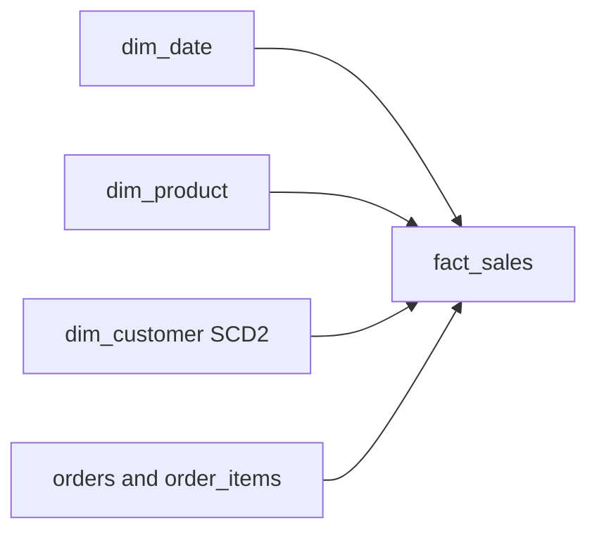

## Business problem

The e-commerce team wants self-service analytics: revenue by day, product category and customer country. Customers move countries, and finance wants old orders reported under the country the customer had at the time. The OLTP schema is normalised and hard to query, so you will build a star schema.

## Learning objectives

- Generate a date dimension with `generate_series`
- Flatten a category hierarchy into a product dimension
- Implement SCD type 2: expire the current row, insert a new version
- Build a fact table at order-line grain with surrogate keys
- Validate grain and foreign keys in pandas

## Architecture

One fact table sits in the middle. Three dimensions surround it.



## Technologies

- **PostgreSQL 16**: `generate_series`, `UPDATE … FROM`, `SERIAL` keys
- **pandas** for grain and orphan checks

## Dataset

The **ecommerce** dataset: 250 users, 58 products in 20 categories (with parents), 700 orders and 1218 order items from 2024-01-21 to 2025-12-31. Some users have a NULL country.

## Tasks

Build each dimension, then the fact. Each task runs in its own rolled-back transaction, so create every table the check needs in this task.

```task
{
 "id": "dim-date",
 "title": "Generate dim_date",
 "type": "sql",
 "instructions": "Create `dim_date` with one row for **every** day from the first to the last order date (inclusive), and columns `date_key` (INTEGER `YYYYMMDD`, primary key), `full_date`, `year`, `quarter`, `month`, `month_name` (e.g. `January`), `day_of_week` (ISO, Monday = 1) and `is_weekend`.",
 "starter": "CREATE TABLE dim_date AS\nSELECT DISTINCT order_date::date AS full_date FROM orders;  -- TODO",
 "solution": "CREATE TABLE dim_date AS\nSELECT to_char(d, 'YYYYMMDD')::int AS date_key,\n       d::date AS full_date,\n       EXTRACT(year FROM d)::int AS year,\n       EXTRACT(quarter FROM d)::int AS quarter,\n       EXTRACT(month FROM d)::int AS month,\n       to_char(d, 'FMMonth') AS month_name,\n       EXTRACT(isodow FROM d)::int AS day_of_week,\n       EXTRACT(isodow FROM d) IN (6, 7) AS is_weekend\nFROM generate_series((SELECT MIN(order_date)::date FROM orders), (SELECT MAX(order_date)::date FROM orders), interval '1 day') AS g(d);\nALTER TABLE dim_date ADD PRIMARY KEY (date_key);",
 "check": "SELECT (COALESCE(((SELECT COUNT(*) FROM information_schema.columns WHERE table_schema = current_schema() AND table_name = 'dim_date' AND column_name IN ('date_key','full_date','year','quarter','month','month_name','day_of_week','is_weekend')) = 8), FALSE) AND COALESCE(((SELECT COUNT(*) FROM dim_date) = (SELECT MAX(order_date)::date - MIN(order_date)::date + 1 FROM orders)), FALSE) AND COALESCE(((SELECT COUNT(DISTINCT date_key) FROM dim_date) = (SELECT COUNT(*) FROM dim_date)), FALSE) AND COALESCE((NOT EXISTS (SELECT 1 FROM dim_date WHERE date_key <> to_char(full_date, 'YYYYMMDD')::int OR is_weekend <> (day_of_week IN (6, 7)))), FALSE) AND COALESCE(((SELECT day_of_week FROM dim_date WHERE full_date = DATE '2025-01-06') = 1 AND (SELECT month_name FROM dim_date WHERE full_date = DATE '2025-01-06') = 'January'), FALSE)) AS ok, CASE WHEN NOT COALESCE(((SELECT COUNT(*) FROM information_schema.columns WHERE table_schema = current_schema() AND table_name = 'dim_date' AND column_name IN ('date_key','full_date','year','quarter','month','month_name','day_of_week','is_weekend')) = 8), FALSE) THEN 'dim_date is missing a column' WHEN NOT COALESCE(((SELECT COUNT(*) FROM dim_date) = (SELECT MAX(order_date)::date - MIN(order_date)::date + 1 FROM orders)), FALSE) THEN 'one row for every day in the range, with no gaps' WHEN NOT COALESCE(((SELECT COUNT(DISTINCT date_key) FROM dim_date) = (SELECT COUNT(*) FROM dim_date)), FALSE) THEN 'date_key must be unique' WHEN NOT COALESCE((NOT EXISTS (SELECT 1 FROM dim_date WHERE date_key <> to_char(full_date, 'YYYYMMDD')::int OR is_weekend <> (day_of_week IN (6, 7)))), FALSE) THEN 'date_key or is_weekend is wrong' WHEN NOT COALESCE(((SELECT day_of_week FROM dim_date WHERE full_date = DATE '2025-01-06') = 1 AND (SELECT month_name FROM dim_date WHERE full_date = DATE '2025-01-06') = 'January'), FALSE) THEN 'day_of_week must be ISO (Monday = 1) and month_name a full name' ELSE 'dim_date is complete' END AS message"
}
```

```task
{
 "id": "dim-product",
 "title": "Flatten categories into dim_product",
 "type": "sql",
 "instructions": "Create `dim_product(product_key, product_id, product_name, category_name, parent_category_name, price, is_active)`. `product_key` is `ROW_NUMBER()` over `product_id`. `parent_category_name` is the parent category's name, or the category's own name when it has no parent.",
 "starter": "CREATE TABLE dim_product AS\nSELECT product_id AS product_key, product_id, name AS product_name FROM products;  -- TODO",
 "solution": "CREATE TABLE dim_product AS\nSELECT ROW_NUMBER() OVER (ORDER BY p.product_id)::int AS product_key,\n       p.product_id, p.name AS product_name, c.name AS category_name,\n       COALESCE(pc.name, c.name) AS parent_category_name, p.price, p.is_active\nFROM products p\nJOIN categories c ON c.category_id = p.category_id\nLEFT JOIN categories pc ON pc.category_id = c.parent_id;",
 "check": "SELECT (COALESCE(((SELECT COUNT(*) FROM information_schema.columns WHERE table_schema = current_schema() AND table_name = 'dim_product' AND column_name IN ('product_key','product_id','product_name','category_name','parent_category_name','price','is_active')) = 7), FALSE) AND COALESCE(((SELECT COUNT(*) FROM dim_product) = (SELECT COUNT(*) FROM products)), FALSE) AND COALESCE((NOT EXISTS (SELECT 1 FROM dim_product WHERE category_name IS NULL OR parent_category_name IS NULL)), FALSE) AND COALESCE(((SELECT COUNT(*) FROM dim_product dp JOIN products p USING (product_id) JOIN categories c ON c.category_id = p.category_id WHERE c.parent_id IS NOT NULL AND dp.parent_category_name = (SELECT name FROM categories WHERE category_id = c.parent_id)) = (SELECT COUNT(*) FROM products p JOIN categories c USING (category_id) WHERE c.parent_id IS NOT NULL)), FALSE)) AS ok, CASE WHEN NOT COALESCE(((SELECT COUNT(*) FROM information_schema.columns WHERE table_schema = current_schema() AND table_name = 'dim_product' AND column_name IN ('product_key','product_id','product_name','category_name','parent_category_name','price','is_active')) = 7), FALSE) THEN 'dim_product is missing a column' WHEN NOT COALESCE(((SELECT COUNT(*) FROM dim_product) = (SELECT COUNT(*) FROM products)), FALSE) THEN 'one row per product' WHEN NOT COALESCE((NOT EXISTS (SELECT 1 FROM dim_product WHERE category_name IS NULL OR parent_category_name IS NULL)), FALSE) THEN 'category_name and parent_category_name must be filled' WHEN NOT COALESCE(((SELECT COUNT(*) FROM dim_product dp JOIN products p USING (product_id) JOIN categories c ON c.category_id = p.category_id WHERE c.parent_id IS NOT NULL AND dp.parent_category_name = (SELECT name FROM categories WHERE category_id = c.parent_id)) = (SELECT COUNT(*) FROM products p JOIN categories c USING (category_id) WHERE c.parent_id IS NOT NULL)), FALSE) THEN 'parent_category_name must be the parent''s name' ELSE 'dim_product is ready' END AS message"
}
```

```task
{
 "id": "dim-customer-initial",
 "title": "Initial load of dim_customer (SCD2)",
 "type": "sql",
 "instructions": "Create `dim_customer(customer_key SERIAL PRIMARY KEY, user_id, username, country, valid_from DATE, valid_to DATE, is_current BOOLEAN)` and load one current version per user: `valid_from = signup_date`, `valid_to = '9999-12-31'`, `is_current = TRUE`.",
 "starter": "CREATE TABLE dim_customer AS SELECT user_id, username, country FROM users;  -- TODO",
 "solution": "CREATE TABLE dim_customer (\n  customer_key SERIAL PRIMARY KEY,\n  user_id INTEGER NOT NULL,\n  username VARCHAR(40) NOT NULL,\n  country VARCHAR(40),\n  valid_from DATE NOT NULL,\n  valid_to DATE NOT NULL,\n  is_current BOOLEAN NOT NULL\n);\nINSERT INTO dim_customer (user_id, username, country, valid_from, valid_to, is_current)\nSELECT user_id, username, country, signup_date, DATE '9999-12-31', TRUE\nFROM users ORDER BY user_id;",
 "check": "SELECT (COALESCE(((SELECT COUNT(*) FROM information_schema.columns WHERE table_schema = current_schema() AND table_name = 'dim_customer' AND column_name IN ('customer_key','user_id','username','country','valid_from','valid_to','is_current')) = 7), FALSE) AND COALESCE(((SELECT COUNT(*) FROM dim_customer WHERE is_current AND valid_to = DATE '9999-12-31') = (SELECT COUNT(*) FROM users)), FALSE) AND COALESCE(((SELECT COUNT(DISTINCT customer_key) FROM dim_customer) = (SELECT COUNT(*) FROM dim_customer)), FALSE) AND COALESCE((NOT EXISTS (SELECT 1 FROM dim_customer d JOIN users u USING (user_id) WHERE d.valid_from <> u.signup_date)), FALSE)) AS ok, CASE WHEN NOT COALESCE(((SELECT COUNT(*) FROM information_schema.columns WHERE table_schema = current_schema() AND table_name = 'dim_customer' AND column_name IN ('customer_key','user_id','username','country','valid_from','valid_to','is_current')) = 7), FALSE) THEN 'dim_customer is missing a column' WHEN NOT COALESCE(((SELECT COUNT(*) FROM dim_customer WHERE is_current AND valid_to = DATE '9999-12-31') = (SELECT COUNT(*) FROM users)), FALSE) THEN 'one current, open-ended row per user' WHEN NOT COALESCE(((SELECT COUNT(DISTINCT customer_key) FROM dim_customer) = (SELECT COUNT(*) FROM dim_customer)), FALSE) THEN 'customer_key must be unique' WHEN NOT COALESCE((NOT EXISTS (SELECT 1 FROM dim_customer d JOIN users u USING (user_id) WHERE d.valid_from <> u.signup_date)), FALSE) THEN 'valid_from must be the signup_date' ELSE 'dim_customer loaded' END AS message"
}
```

```task
{
 "id": "scd2-change",
 "title": "Apply an SCD type 2 change",
 "type": "sql",
 "instructions": "Paste the initial load, then apply this change set:\n\n```sql\nCREATE TEMP TABLE customer_changes (user_id INTEGER, country VARCHAR(40), changed_on DATE);\nINSERT INTO customer_changes VALUES (1, 'Germany', '2026-01-01'), (2, 'Canada', '2026-01-01'), (3, 'India', '2026-01-01');\n```\n\nFor each changed user, close the current row (`valid_to = changed_on - 1`, `is_current = FALSE`) and insert a new current version starting on `changed_on`.",
 "starter": "CREATE TABLE dim_customer (\n  customer_key SERIAL PRIMARY KEY,\n  user_id INTEGER NOT NULL,\n  username VARCHAR(40) NOT NULL,\n  country VARCHAR(40),\n  valid_from DATE NOT NULL,\n  valid_to DATE NOT NULL,\n  is_current BOOLEAN NOT NULL\n);\nINSERT INTO dim_customer (user_id, username, country, valid_from, valid_to, is_current)\nSELECT user_id, username, country, signup_date, DATE '9999-12-31', TRUE\nFROM users ORDER BY user_id;\n\nCREATE TEMP TABLE customer_changes (user_id INTEGER, country VARCHAR(40), changed_on DATE);\nINSERT INTO customer_changes VALUES (1, 'Germany', '2026-01-01'), (2, 'Canada', '2026-01-01'), (3, 'India', '2026-01-01');\n\n-- TODO (this is SCD1, not SCD2)\nUPDATE dim_customer d SET country = c.country FROM customer_changes c WHERE d.user_id = c.user_id;",
 "solution": "CREATE TABLE dim_customer (\n  customer_key SERIAL PRIMARY KEY,\n  user_id INTEGER NOT NULL,\n  username VARCHAR(40) NOT NULL,\n  country VARCHAR(40),\n  valid_from DATE NOT NULL,\n  valid_to DATE NOT NULL,\n  is_current BOOLEAN NOT NULL\n);\nINSERT INTO dim_customer (user_id, username, country, valid_from, valid_to, is_current)\nSELECT user_id, username, country, signup_date, DATE '9999-12-31', TRUE\nFROM users ORDER BY user_id;\n\nCREATE TEMP TABLE customer_changes (user_id INTEGER, country VARCHAR(40), changed_on DATE);\nINSERT INTO customer_changes VALUES (1, 'Germany', '2026-01-01'), (2, 'Canada', '2026-01-01'), (3, 'India', '2026-01-01');\n\nUPDATE dim_customer d\nSET valid_to = c.changed_on - 1, is_current = FALSE\nFROM customer_changes c\nWHERE d.user_id = c.user_id AND d.is_current AND d.country IS DISTINCT FROM c.country;\nINSERT INTO dim_customer (user_id, username, country, valid_from, valid_to, is_current)\nSELECT u.user_id, u.username, c.country, c.changed_on, DATE '9999-12-31', TRUE\nFROM customer_changes c JOIN users u ON u.user_id = c.user_id\nWHERE NOT EXISTS (SELECT 1 FROM dim_customer d WHERE d.user_id = c.user_id AND d.is_current);",
 "check": "SELECT (COALESCE(((SELECT COUNT(*) FROM dim_customer) = (SELECT COUNT(*) + 3 FROM users)), FALSE) AND COALESCE((NOT EXISTS (SELECT user_id FROM dim_customer WHERE is_current GROUP BY user_id HAVING COUNT(*) <> 1) AND (SELECT COUNT(DISTINCT user_id) FROM dim_customer WHERE is_current) = (SELECT COUNT(*) FROM users)), FALSE) AND COALESCE(((SELECT country FROM dim_customer WHERE user_id = 1 AND is_current) = 'Germany'), FALSE) AND COALESCE(((SELECT valid_to FROM dim_customer WHERE user_id = 1 AND NOT is_current) = DATE '2025-12-31'), FALSE) AND COALESCE(((SELECT country FROM dim_customer WHERE user_id = 1 AND NOT is_current) IS NOT DISTINCT FROM (SELECT country FROM users WHERE user_id = 1)), FALSE)) AS ok, CASE WHEN NOT COALESCE(((SELECT COUNT(*) FROM dim_customer) = (SELECT COUNT(*) + 3 FROM users)), FALSE) THEN 'three new versions should be added' WHEN NOT COALESCE((NOT EXISTS (SELECT user_id FROM dim_customer WHERE is_current GROUP BY user_id HAVING COUNT(*) <> 1) AND (SELECT COUNT(DISTINCT user_id) FROM dim_customer WHERE is_current) = (SELECT COUNT(*) FROM users)), FALSE) THEN 'each user needs exactly one current row' WHEN NOT COALESCE(((SELECT country FROM dim_customer WHERE user_id = 1 AND is_current) = 'Germany'), FALSE) THEN 'user 1''s current country should be Germany' WHEN NOT COALESCE(((SELECT valid_to FROM dim_customer WHERE user_id = 1 AND NOT is_current) = DATE '2025-12-31'), FALSE) THEN 'the old row must end the day before the change' WHEN NOT COALESCE(((SELECT country FROM dim_customer WHERE user_id = 1 AND NOT is_current) IS NOT DISTINCT FROM (SELECT country FROM users WHERE user_id = 1)), FALSE) THEN 'the old row must keep the old country' ELSE 'SCD2 change applied' END AS message"
}
```

```task
{
 "id": "fact-sales",
 "title": "Build fact_sales",
 "type": "sql",
 "instructions": "Build the dimensions (date, product, customer initial load), then create `fact_sales(order_item_id, order_id, date_key, customer_key, product_key, quantity, unit_price, line_amount)`. Grain: one order item. Exclude `cancelled` and `refunded` orders. Use the **current** customer version.",
 "starter": "CREATE TABLE dim_date AS\nSELECT to_char(d, 'YYYYMMDD')::int AS date_key,\n       d::date AS full_date,\n       EXTRACT(year FROM d)::int AS year,\n       EXTRACT(quarter FROM d)::int AS quarter,\n       EXTRACT(month FROM d)::int AS month,\n       to_char(d, 'FMMonth') AS month_name,\n       EXTRACT(isodow FROM d)::int AS day_of_week,\n       EXTRACT(isodow FROM d) IN (6, 7) AS is_weekend\nFROM generate_series((SELECT MIN(order_date)::date FROM orders), (SELECT MAX(order_date)::date FROM orders), interval '1 day') AS g(d);\nALTER TABLE dim_date ADD PRIMARY KEY (date_key);\n\nCREATE TABLE dim_product AS\nSELECT ROW_NUMBER() OVER (ORDER BY p.product_id)::int AS product_key,\n       p.product_id, p.name AS product_name, c.name AS category_name,\n       COALESCE(pc.name, c.name) AS parent_category_name, p.price, p.is_active\nFROM products p\nJOIN categories c ON c.category_id = p.category_id\nLEFT JOIN categories pc ON pc.category_id = c.parent_id;\n\nCREATE TABLE dim_customer (\n  customer_key SERIAL PRIMARY KEY,\n  user_id INTEGER NOT NULL,\n  username VARCHAR(40) NOT NULL,\n  country VARCHAR(40),\n  valid_from DATE NOT NULL,\n  valid_to DATE NOT NULL,\n  is_current BOOLEAN NOT NULL\n);\nINSERT INTO dim_customer (user_id, username, country, valid_from, valid_to, is_current)\nSELECT user_id, username, country, signup_date, DATE '9999-12-31', TRUE\nFROM users ORDER BY user_id;\n\nCREATE TABLE fact_sales AS\nSELECT oi.order_item_id, oi.order_id, o.user_id AS customer_key, oi.product_id AS product_key, oi.quantity\nFROM order_items oi JOIN orders o USING (order_id);  -- TODO",
 "solution": "CREATE TABLE dim_date AS\nSELECT to_char(d, 'YYYYMMDD')::int AS date_key,\n       d::date AS full_date,\n       EXTRACT(year FROM d)::int AS year,\n       EXTRACT(quarter FROM d)::int AS quarter,\n       EXTRACT(month FROM d)::int AS month,\n       to_char(d, 'FMMonth') AS month_name,\n       EXTRACT(isodow FROM d)::int AS day_of_week,\n       EXTRACT(isodow FROM d) IN (6, 7) AS is_weekend\nFROM generate_series((SELECT MIN(order_date)::date FROM orders), (SELECT MAX(order_date)::date FROM orders), interval '1 day') AS g(d);\nALTER TABLE dim_date ADD PRIMARY KEY (date_key);\n\nCREATE TABLE dim_product AS\nSELECT ROW_NUMBER() OVER (ORDER BY p.product_id)::int AS product_key,\n       p.product_id, p.name AS product_name, c.name AS category_name,\n       COALESCE(pc.name, c.name) AS parent_category_name, p.price, p.is_active\nFROM products p\nJOIN categories c ON c.category_id = p.category_id\nLEFT JOIN categories pc ON pc.category_id = c.parent_id;\n\nCREATE TABLE dim_customer (\n  customer_key SERIAL PRIMARY KEY,\n  user_id INTEGER NOT NULL,\n  username VARCHAR(40) NOT NULL,\n  country VARCHAR(40),\n  valid_from DATE NOT NULL,\n  valid_to DATE NOT NULL,\n  is_current BOOLEAN NOT NULL\n);\nINSERT INTO dim_customer (user_id, username, country, valid_from, valid_to, is_current)\nSELECT user_id, username, country, signup_date, DATE '9999-12-31', TRUE\nFROM users ORDER BY user_id;\n\nCREATE TABLE fact_sales AS\nSELECT oi.order_item_id, oi.order_id,\n       to_char(o.order_date, 'YYYYMMDD')::int AS date_key,\n       dc.customer_key, dp.product_key,\n       oi.quantity, oi.unit_price,\n       oi.quantity * oi.unit_price AS line_amount\nFROM order_items oi\nJOIN orders o ON o.order_id = oi.order_id\nJOIN dim_customer dc ON dc.user_id = o.user_id AND dc.is_current\nJOIN dim_product dp ON dp.product_id = oi.product_id\nWHERE o.status NOT IN ('cancelled', 'refunded');",
 "check": "SELECT (COALESCE(((SELECT COUNT(*) FROM information_schema.columns WHERE table_schema = current_schema() AND table_name = 'fact_sales' AND column_name IN ('order_item_id','order_id','date_key','customer_key','product_key','quantity','unit_price','line_amount')) = 8), FALSE) AND COALESCE(((SELECT COUNT(*) FROM fact_sales) = (SELECT COUNT(*) FROM order_items oi JOIN orders o USING (order_id) WHERE o.status NOT IN ('cancelled','refunded'))), FALSE) AND COALESCE(((SELECT COUNT(DISTINCT order_item_id) FROM fact_sales) = (SELECT COUNT(*) FROM fact_sales)), FALSE) AND COALESCE(((SELECT SUM(line_amount) FROM fact_sales) = (SELECT SUM(oi.quantity*oi.unit_price) FROM order_items oi JOIN orders o USING (order_id) WHERE o.status NOT IN ('cancelled','refunded'))), FALSE) AND COALESCE((NOT EXISTS (SELECT 1 FROM fact_sales f LEFT JOIN dim_date d USING (date_key) LEFT JOIN dim_product p USING (product_key) LEFT JOIN dim_customer c USING (customer_key) WHERE d.date_key IS NULL OR p.product_key IS NULL OR c.customer_key IS NULL)), FALSE)) AS ok, CASE WHEN NOT COALESCE(((SELECT COUNT(*) FROM information_schema.columns WHERE table_schema = current_schema() AND table_name = 'fact_sales' AND column_name IN ('order_item_id','order_id','date_key','customer_key','product_key','quantity','unit_price','line_amount')) = 8), FALSE) THEN 'fact_sales is missing a column' WHEN NOT COALESCE(((SELECT COUNT(*) FROM fact_sales) = (SELECT COUNT(*) FROM order_items oi JOIN orders o USING (order_id) WHERE o.status NOT IN ('cancelled','refunded'))), FALSE) THEN 'one row per order item of non-cancelled, non-refunded orders' WHEN NOT COALESCE(((SELECT COUNT(DISTINCT order_item_id) FROM fact_sales) = (SELECT COUNT(*) FROM fact_sales)), FALSE) THEN 'the grain is one order item' WHEN NOT COALESCE(((SELECT SUM(line_amount) FROM fact_sales) = (SELECT SUM(oi.quantity*oi.unit_price) FROM order_items oi JOIN orders o USING (order_id) WHERE o.status NOT IN ('cancelled','refunded'))), FALSE) THEN 'line_amount totals do not match' WHEN NOT COALESCE((NOT EXISTS (SELECT 1 FROM fact_sales f LEFT JOIN dim_date d USING (date_key) LEFT JOIN dim_product p USING (product_key) LEFT JOIN dim_customer c USING (customer_key) WHERE d.date_key IS NULL OR p.product_key IS NULL OR c.customer_key IS NULL)), FALSE) THEN 'every foreign key must exist in its dimension' ELSE 'fact_sales is correct' END AS message"
}
```

```task
{
 "id": "grain-validator",
 "title": "Validate grain and orphans in pandas",
 "type": "python",
 "instructions": "Write `validate_fact(fact, dims, grain)` where `fact` is a DataFrame, `dims` maps a key column to the set of valid keys, and `grain` is a list of columns. Return a dict:\n\n- `duplicate_grain`: number of rows whose grain values occur more than once\n- `orphans`: `{key_column: number of fact rows whose key is not in the dimension}`",
 "starter": "import io\nimport pandas as pd\n\nfact = pd.read_csv(io.StringIO(\"\"\"order_item_id,date_key,product_key,customer_key\n1,20250101,1,10\n2,20250101,2,10\n2,20250101,2,10\n3,20250102,9,11\n4,20250199,1,99\n\"\"\"))\ndims = {'date_key': {20250101, 20250102}, 'product_key': {1, 2}, 'customer_key': {10, 11}}\n\ndef validate_fact(fact, dims, grain):\n    return {'duplicate_grain': 0, 'orphans': {}}\n",
 "solution": "import io\nimport pandas as pd\n\nfact = pd.read_csv(io.StringIO(\"\"\"order_item_id,date_key,product_key,customer_key\n1,20250101,1,10\n2,20250101,2,10\n2,20250101,2,10\n3,20250102,9,11\n4,20250199,1,99\n\"\"\"))\ndims = {'date_key': {20250101, 20250102}, 'product_key': {1, 2}, 'customer_key': {10, 11}}\n\ndef validate_fact(fact, dims, grain):\n    dup = int(fact.duplicated(grain, keep=False).sum())\n    orphans = {col: int((~fact[col].isin(keys)).sum()) for col, keys in dims.items()}\n    return {'duplicate_grain': dup, 'orphans': orphans}\n",
 "tests": "r = validate_fact(fact, dims, ['order_item_id'])\nassert r['duplicate_grain'] == 2, r\nassert r['orphans'] == {'date_key': 1, 'product_key': 1, 'customer_key': 1}, r\nclean = fact.drop_duplicates().iloc[:2]\nassert validate_fact(clean, dims, ['order_item_id']) == {'duplicate_grain': 0, 'orphans': {'date_key': 0, 'product_key': 0, 'customer_key': 0}}"
}
```

## Expected output

- `dim_date`: 711 days
- `dim_product`: 58 rows
- `dim_customer` after the SCD2 change: 253 rows, 250 of them current
- `fact_sales`: 1047 lines worth 527353.19

## Common mistakes

- Building `dim_date` only from dates that have orders, which leaves gaps in time-series charts.
- Overwriting the customer's country in place (SCD1) when history was required.
- Joining facts to every version of a type 2 dimension, which multiplies rows.
- Setting `valid_to` of the old row to the change date itself, so both versions match that day.

## Interview discussion questions

### Star or snowflake?
A star schema denormalises dimensions (category and parent in `dim_product`). Queries need fewer joins and BI tools handle it well. A snowflake saves a little storage but costs join complexity.

### How do facts pick the right SCD2 version?
At load time, join on the natural key and the event date between `valid_from` and `valid_to`, then store that surrogate key. Here we use the current version for simplicity.

### Why a smart integer date key?
`20250115` is readable, sorts correctly and makes partition pruning easy, while still being a compact integer.

## Summary

You built a complete star schema with a type 2 dimension and validated the fact grain, the foundation of every dimensional warehouse.
